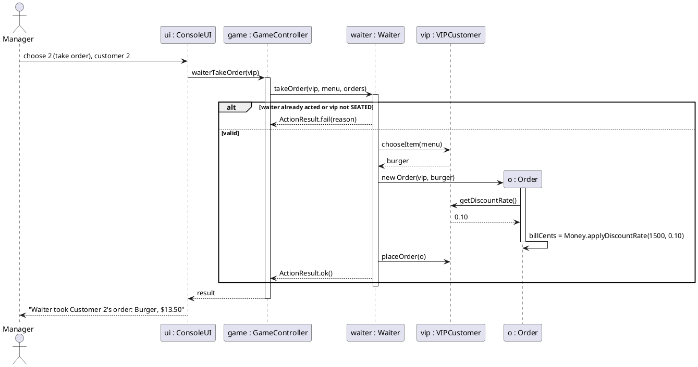

# Enoch's part progress

- Conversation ID: `8c447be9-ee44-4663-b311-99d531ae3610`
- Started: 2026-11-10 04:29 UTC
- Last updated: 2026-11-10 06:29 UTC
- Tool: Claude (Anthropic), claude.ai
- Every prompt and reply is in original order. Tool calls are shown in full; long tool outputs are shortened.

---

## 1. Yunxi (prompt)  
_2026-11-10 04:29 UTC_

okay enoch is done with his part let us continue

---

## 2. Claude (reply)  
_2026-11-10 04:29 UTC_

**Tool call: `mcp__memory__memory_read`**

```json
{
  "path": "/projects/01a0b3b2-d5ce-727b-9ef1-9a47d26f74f2/areas/sc2002-restaurant-rush.md"
}
```

<details><summary>Tool output</summary>

```text
[updated: 2026-10-29T06:16:38.824581+00:00] [size: 487 of 49152 bytes — 48665 free] [version: 57510ac9b06f] (pass as if_version on your next write or edit of this path)
---
name: sc2002-restaurant-rush
description: SC2002 group assignment (Restaurant Rush Java CLI game) that Yunxi is doing in a group
sources: [cowork]
aliases: [Restaurant Rush, SC2002 group assignment]
---
- [stated] Working on the SC2002 Restaurant Rush group assignment in a group of 4
- [stated] Going with splitting the work by component ownership across all stages, not by stage
- [stated] Is member D in the group: owns the CLI and release role, and set up the group's GitHub repo
```

</details>

**Tool call: `mcp__claude_ai__conversation_search`**

```json
{
  "max_results": 5,
  "query": "Enoch Restaurant Rush"
}
```

<details><summary>Tool output</summary>

```text
<chat url="https://claude.ai/chat/fadf5340-3801-4ab1-8001-bd0a370a27c6" updated_at="2026-10-15T05:29:19.963988+00:00" kind="summary">Title: Work division for 4 people
Work division for 4 people
&lt;chat_summary&gt;**Conversation overview**

The person is working on a group assignment for module SC2002 (an object-oriented design and programming course), building a turn-based Java CLI restaurant simulation game called "Restaurant Rush" with three other group members. The assignment requires three staged, git-tagged deliverables (stage-1, stage-2, stage-3), each adding features: Stage 1 covers regular customers, a basic menu, staff roles (Waiter, Chef, Cashier), tables, and the core turn loop; Stage 2 adds VIP and Critic customer types requiring polymorphism rather than instanceof checks; Stage 3 adds a Host role, combo meals, and a Happy Hour discount mechanic. Grading weights design evidence heavily (UML class diagram, sequence diagram, design discussion) alongside code and a video walkthrough.

Claude extracted the assignment brief from an uploaded document and proposed splitting work by subsystem (owned across all three stages by one person) rather than by stage, since stages are sequential and Stage 1 is the heaviest. The conversation progressed from a four-person subsystem split (engine, domain/customers, staff+CLI, evidence+QA) to a revised split covering turn engine, customers+pricing, menu+kitchen, and front-of-house+CLI, with corresponding documentation ownership (sequ
... [output truncated, 15947 characters in total]
```

</details>

**Tool call: `ToolSearch`**

```json
{
  "max_results": 2,
  "query": "select:mcp__remote-devices__device_bash,mcp__remote-devices__get_device_info"
}
```

<details><summary>Tool output</summary>

_(no output)_

</details>

I'll pick up from yesterday: pull Enoch's change, recompile, run the victory test, then do the release steps. First I need access to your repo folder again.

**Tool call: `mcp__remote-devices__device_request_folder_access`**

```json
{
  "paths": [
    "/Users/ngyunxi/code/sc2002-restaurant-rush"
  ],
  "reason": "To check Enoch's merged change and run the Stage 2 tests in your Restaurant Rush repo."
}
```

<details><summary>Tool output</summary>

```text
{"granted":["/Users/ngyunxi/code/sc2002-restaurant-rush"]}
```

</details>

**Tool call: `mcp__remote-devices__device_bash`**

```bash
cd $HOME/mnt/sc2002-restaurant-rush && git branch --show-current; git status --short; git fetch origin 2>&1 | tail -2; git log --oneline -5 origin/main; echo ---; git log --oneline main..origin/main; echo ---; git diff main origin/main --stat
```

<details><summary>Tool output</summary>

```text
stage2-release
fatal: could not read Username for 'https://github.com': No such device or address
84bfe18 Merge pull request #16 from nyunxi/stage2-override-docs
6c2b94b Stage 2 class diagram: VIP and Critic subclasses, creation point
1ce966a Merge pull request #15 from nyunxi/stage2-override-docs
80f1744 Design doc:name the four overridable Customer methods
adace26 Design doc: Stage 2 customer types, critic rule, creation point
---
---
```

</details>

**Tool call: `mcp__remote-devices__device_bash`**

```bash
cd $HOME/mnt/sc2002-restaurant-rush && git log --oneline -4; git log --oneline origin/main..HEAD; ls .git/*.lock 2>/dev/null; grep -n "billCents\|Discount" src/restaurantrush/Order.java
```

<details><summary>Tool output</summary>

```text
84bfe18 Merge pull request #16 from nyunxi/stage2-override-docs
6c2b94b Stage 2 class diagram: VIP and Critic subclasses, creation point
1ce966a Merge pull request #15 from nyunxi/stage2-override-docs
80f1744 Design doc:name the four overridable Customer methods
10:    private final int billCents;   // locked when the order is taken
24:        this.billCents = item.getPriceCents();
81:        return billCents;
85:        return Money.format(billCents);
```

</details>

I can't pull from here because my shell has no GitHub login, so your copy still shows the old `Order` (`billCents = item.getPriceCents()`, no discount). Run this in your own Terminal:

```bash
cd ~/code/sc2002-restaurant-rush
git switch main
git pull
git log --oneline -3
```

What each line does:
- `git switch main`: you're on `stage2-release` right now. Enoch's PR merged into `main`, so switch there first. Your branch has no commits of its own yet, so nothing gets lost.
- `git pull`: downloads the new commits from GitHub and moves your local `main` up to match.
- `git log --oneline -3`: the top line should be a merge of Enoch's PR. If it still says `84bfe18 Merge pull request #16`, his PR hasn't actually been merged on GitHub yet.

Send me "pulled" when it's done. Then I'll check his `Order` change (it should call `customer.getDiscountRate()` and have no `instanceof`), recompile, and run `victory.txt`. We're expecting VICTORY at $73.50.

**Before the run, predict this:** customer 2 is a VIP ordering a $15.00 Burger. What should their bill be in cents, and which object's method works out the 10%?

---

## 3. Yunxi (prompt)  
_2026-11-10 04:31 UTC_

Attached: `Screenshot 2026-11-10 at 12.31.48PM.png`

_[image attached]_

---

## 4. Claude (reply)  
_2026-11-10 04:32 UTC_

**Tool call: `mcp__remote-devices__device_bash`**

```bash
cd $HOME/mnt/sc2002-restaurant-rush && git log --format='%h %an %s' 84bfe18..main; echo; git diff 84bfe18 main -- src
```

<details><summary>Tool output</summary>

```text
0526fea DADE52 Deleted
dcf976e DADE52 Updated menu.java
a1491e3 DADE52 Added closing bracket
fabe21c DADE52 Added percentOff and applyDiscountRate
dfe4409 DADE52 Updated Order.java
eb79f5c DADE52 Created ComboMeal.java
de1bae8 DADE52 Updated the menu

diff --git a/src/restaurantrush/Menu.java b/src/restaurantrush/Menu.java
index 3d13a4d..9930db3 100644
--- a/src/restaurantrush/Menu.java
+++ b/src/restaurantrush/Menu.java
@@ -1,32 +1,27 @@
 package restaurantrush;
-
+ 
 import java.util.ArrayList;
 import java.util.Collections;
 import java.util.List;
-
+ 
 public class Menu {
-
-    /** Names of the base dishes, so other classes need not type the strings. */
+ 
     public static final String SALAD = "Salad";
     public static final String BURGER = "Burger";
     public static final String PASTA = "Pasta";
-
+ 
     private final List<MenuItem> items = new ArrayList<MenuItem>();
-
-    /**
-     * Creates the base-setting menu from brief 2.1, in this order:
-     * Salad $9.00 / 1 unit, Burger $15.00 / 1 unit, Pasta $18.00 / 2 units.
-     */
+ 
     public Menu() {
         items.add(new MenuItem(SALAD, 900, 1));
         items.add(new MenuItem(BURGER, 1500, 1));
         items.add(new MenuItem(PASTA, 1800, 2));
     }
-
+ 
     public List<MenuItem> getItems() {
         return Collections.unmodifiableList(items);
     }
-
+ 
     public MenuItem getItem(int index) {
         if (index < 0 || index >= items.size()) {
             throw new IndexOutOfBoundsException("No men
... [output truncated, 4367 characters in total]
```

</details>

**Tool call: `mcp__remote-devices__device_bash`**

```bash
cd $HOME/mnt/sc2002-restaurant-rush && ls src/restaurantrush tests; grep -n "getDiscountRate" -r src; grep -rn instanceof src; which java javac; rm -rf /tmp/o; javac --release 17 -d /tmp/o src/restaurantrush/*.java 2>&1 | grep -v JAVA_TOOL | tail; echo rc=${PIPESTATUS[0]}
```

<details><summary>Tool output</summary>

```text
src/restaurantrush:
ActionResult.java
Cashier.java
Chef.java
ConsoleUI.java
CriticCustomer.java
Customer.java
CustomerState.java
GameController.java
GameQuitException.java
IllegalOrderStateException.java
InputReader.java
Main.java
Menu.java
MenuItem.java
Money.java
Order.java
OrderStatus.java
Table.java
VIPCustomer.java
Waiter.java

tests:
defeat.txt
failures.txt
happy.txt
rejects.txt
victory.txt
src/restaurantrush/Order.java:24:        this.billCents = Money.applyDiscountRate(item.getPriceCents(), customer.getDiscountRate());
src/restaurantrush/Customer.java:23:	public double getDiscountRate() {
src/restaurantrush/VIPCustomer.java:15:    public double getDiscountRate() {
/usr/bin/java
bash: line 1: javac: command not found
rc=127
```

</details>

**Tool call: `mcp__remote-devices__device_stage_files`**

```json
{
  "paths": [
    "/Users/ngyunxi/code/sc2002-restaurant-rush/src/restaurantrush/ActionResult.java",
    "/Users/ngyunxi/code/sc2002-restaurant-rush/src/restaurantrush/Cashier.java",
    "/Users/ngyunxi/code/sc2002-restaurant-rush/src/restaurantrush/Chef.java",
    "/Users/ngyunxi/code/sc2002-restaurant-rush/src/restaurantrush/ConsoleUI.java",
    "/Users/ngyunxi/code/sc2002-restaurant-rush/src/restaurantrush/CriticCustomer.java",
    "/Users/ngyunxi/code/sc2002-restaurant-rush/src/restaurantrush/Customer.java",
    "/Users/ngyunxi/code/sc2002-restaurant-rush/src/restaurantrush/CustomerState.java",
    "/Users/ngyunxi/code/sc2002-restaurant-rush/src/restaurantrush/GameController.java",
    "/Users/ngyunxi/code/sc2002-restaurant-rush/src/restaurantrush/GameQuitException.java",
    "/Users/ngyunxi/code/sc2002-restaurant-rush/src/restaurantrush/IllegalOrderStateException.java",
    "/Users/ngyunxi/code/sc2002-restaurant-rush/src/restaurantrush/InputReader.java",
    "/Users/ngyunxi/code/sc2002-restaurant-rush/src/restaurantrush/Main.java",
    "/Users/ngyunxi/code/sc2002-restaurant-rush/src/restaurantrush/Menu.java",
    "/Users/ngyunxi/code/sc2002-restaurant-rush/src/restaurantrush/MenuItem.java",
    "/Users/ngyunxi/code/sc2002-restaurant-rush/src/restaurantrush/Money.java",
    "/Users/ngyunxi/code/sc2002-restaurant-rush/src/restaurantrush/Order.java",
    "/Users/ngyunxi/code/sc2002-restaurant-rush/src/restaurantrush/OrderStatus.java",
    "/Users/ngyunxi/code/sc2002-restaurant-rush/src/restaurantrush/Table.java",
    "/Users/ngyunxi/code/sc2002-restaurant-rush/src/restaurantrush/VIPCustomer.java",
    "/Users/ngyunxi/code/sc2002-restaurant-rush/src/restaurantrush/Waiter.java",
    "/Users/ngyunxi/code/sc2002-restaurant-rush/tests/defeat.txt",
    "/Users/ngyunxi/code/sc2002-restaurant-rush/tests/failures.txt",
    "/Users/ngyunxi/code/sc2002-restaurant-rush/tests/happy.txt",
    "/Users/ngyunxi/code/sc2002-restaurant-rush/tests/rejects.txt",
    "/Users/ngyunxi/code/sc2002-restaurant-rush/tests/victory.txt"
  ]
}
```

<details><summary>Tool output</summary>

```text
{"staged":[{"devicePath":"/Users/ngyunxi/code/sc2002-restaurant-rush/src/restaurantrush/ActionResult.java","ok":false,"error":"upload failed"},{"devicePath":"/Users/ngyunxi/code/sc2002-restaurant-rush/src/restaurantrush/Cashier.java","ok":false,"error":"upload failed"},{"devicePath":"/Users/ngyunxi/code/sc2002-restaurant-rush/src/restaurantrush/Chef.java","ok":false,"error":"upload failed"},{"devicePath":"/Users/ngyunxi/code/sc2002-restaurant-rush/src/restaurantrush/ConsoleUI.java","ok":false,"error":"upload failed"},{"devicePath":"/Users/ngyunxi/code/sc2002-restaurant-rush/src/restaurantrush/CriticCustomer.java","ok":false,"error":"upload failed"},{"devicePath":"/Users/ngyunxi/code/sc2002-restaurant-rush/src/restaurantrush/Customer.java","ok":false,"error":"upload failed"},{"devicePath":"/Users/ngyunxi/code/sc2002-restaurant-rush/src/restaurantrush/CustomerState.java","ok":false,"error":"upload failed"},{"devicePath":"/Users/ngyunxi/code/sc2002-restaurant-rush/src/restaurantrush/GameController.java","ok":false,"error":"upload failed"},{"devicePath":"/Users/ngyunxi/code/sc2002-restaurant-rush/src/restaurantrush/GameQuitException.java","ok":false,"error":"upload failed"},{"devicePath":"/Users/ngyunxi/code/sc2002-restaurant-rush/src/restaurantrush/IllegalOrderStateException.java","stagedPath":"/mnt/user-data/uploads/sc2002-restaurant-rush/src/restaurantrush/IllegalOrderStateException.java","mtimeMs":1794058847366,"bytes":240,"ok":true,"dispatched":true},{"devicePath":"/Users/ng
... [output truncated, 5070 characters in total]
```

</details>

Some uploads failed. Retrying the missing ones.

**Tool call: `mcp__remote-devices__device_stage_files`**

```json
{
  "paths": [
    "/Users/ngyunxi/code/sc2002-restaurant-rush/src/restaurantrush/ActionResult.java",
    "/Users/ngyunxi/code/sc2002-restaurant-rush/src/restaurantrush/Cashier.java",
    "/Users/ngyunxi/code/sc2002-restaurant-rush/src/restaurantrush/Chef.java",
    "/Users/ngyunxi/code/sc2002-restaurant-rush/src/restaurantrush/ConsoleUI.java",
    "/Users/ngyunxi/code/sc2002-restaurant-rush/src/restaurantrush/CriticCustomer.java",
    "/Users/ngyunxi/code/sc2002-restaurant-rush/src/restaurantrush/Customer.java",
    "/Users/ngyunxi/code/sc2002-restaurant-rush/src/restaurantrush/CustomerState.java",
    "/Users/ngyunxi/code/sc2002-restaurant-rush/src/restaurantrush/GameController.java",
    "/Users/ngyunxi/code/sc2002-restaurant-rush/src/restaurantrush/GameQuitException.java"
  ]
}
```

<details><summary>Tool output</summary>

```text
{"staged":[{"devicePath":"/Users/ngyunxi/code/sc2002-restaurant-rush/src/restaurantrush/ActionResult.java","stagedPath":"/mnt/user-data/uploads/sc2002-restaurant-rush/src/restaurantrush/ActionResult.java","mtimeMs":1794058847364,"bytes":745,"ok":true,"dispatched":true},{"devicePath":"/Users/ngyunxi/code/sc2002-restaurant-rush/src/restaurantrush/Cashier.java","stagedPath":"/mnt/user-data/uploads/sc2002-restaurant-rush/src/restaurantrush/Cashier.java","mtimeMs":1794149938742,"bytes":1384,"ok":true,"dispatched":true},{"devicePath":"/Users/ngyunxi/code/sc2002-restaurant-rush/src/restaurantrush/Chef.java","stagedPath":"/mnt/user-data/uploads/sc2002-restaurant-rush/src/restaurantrush/Chef.java","mtimeMs":1794058847365,"bytes":693,"ok":true,"dispatched":true},{"devicePath":"/Users/ngyunxi/code/sc2002-restaurant-rush/src/restaurantrush/ConsoleUI.java","stagedPath":"/mnt/user-data/uploads/sc2002-restaurant-rush/src/restaurantrush/ConsoleUI.java","mtimeMs":1794210999375,"bytes":10076,"ok":true,"dispatched":true},{"devicePath":"/Users/ngyunxi/code/sc2002-restaurant-rush/src/restaurantrush/CriticCustomer.java","stagedPath":"/mnt/user-data/uploads/sc2002-restaurant-rush/src/restaurantrush/CriticCustomer.java","mtimeMs":1794216483785,"bytes":730,"ok":true,"dispatched":true},{"devicePath":"/Users/ngyunxi/code/sc2002-restaurant-rush/src/restaurantrush/Customer.java","stagedPath":"/mnt/user-data/uploads/sc2002-restaurant-rush/src/restaurantrush/Customer.java","mtimeMs":1794204311496,"bytes":2
... [output truncated, 2328 characters in total]
```

</details>

**Tool call: `Bash`**

```bash
cd /home/claude && rm -rf rr && mkdir rr && cp -r /mnt/user-data/uploads/sc2002-restaurant-rush/src rr/ && cp -r /mnt/user-data/uploads/sc2002-restaurant-rush/tests rr/ && cd rr && which javac >/dev/null || echo NOJAVAC; javac --release 17 -d out src/restaurantrush/*.java 2>&1 | grep -v JAVA_TOOL; for t in victory defeat happy rejects failures; do echo "===== $t"; java -cp out restaurantrush.Main < tests/$t.txt > out_$t.log 2>&1; tail -12 out_$t.log; done
```

<details><summary>Tool output</summary>

```text
===== victory
========== GAME OVER ==========
VICTORY
Paid customers: 5 (need 4)
Revenue: $73.50 (need $45.00)
Average satisfaction (paid): 75.6 (need 60)
Customers:
  Customer 1 (Regular) | satisfaction 84 | PAID | Salad 1/1 units Paid
  Customer 2 (VIP) | satisfaction 90 | PAID | Burger 1/1 units Paid
  Customer 3 (Regular) | satisfaction 76 | PAID | Pasta 2/2 units Paid
  Customer 4 (Critic) | satisfaction 52 | PAID | Pasta 2/2 units Paid
  Customer 5 (Regular) | satisfaction 76 | PAID | Burger 1/1 units Paid
  Customer 6 (Regular) | satisfaction 76 | ORDERED | Pasta 1/2 units In preparation
===== defeat
========== GAME OVER ==========
DEFEAT
Paid customers: 0 (need 4)
Revenue: $0.00 (need $45.00)
Average satisfaction (paid): N/A (need 60)
Customers:
  Customer 1 (Regular) | satisfaction 0 | LEFT
  Customer 2 (VIP) | satisfaction 25 | WAITING
  Customer 3 (Regular) | satisfaction 4 | WAITING
  Customer 4 (Critic) | satisfaction 0 | LEFT
  Customer 5 (Regular) | satisfaction 52 | WAITING
  Customer 6 (Regular) | satisfaction 76 | WAITING
===== happy
========== GAME OVER ==========
DEFEAT
Paid customers: 1 (need 4)
Revenue: $9.00 (need $45.00)
Average satisfaction (paid): 84.0 (need 60)
Customers:
  Customer 1 (Regular) | satisfaction 84 | PAID | Salad 1/1 units Paid
  Customer 2 (VIP) | satisfaction 25 | WAITING
  Customer 3 (Regular) | satisfaction 4 | WAITING
  Customer 4 (Critic) | satisfaction 0 | LEFT
  Customer 5 (Regular) | satisfaction 52 | WAITING
  Customer 6 (Reg
... [output truncated, 2499 characters in total]
```

</details>

**Tool call: `Bash`**

```bash
cd /home/claude/rr && grep -n "menu \$\|13.50\|Exception" out_*.log | head; grep -c "" src/restaurantrush/Menu.java; grep -n " $" src/restaurantrush/Menu.java | head -3
```

<details><summary>Tool output</summary>

```text
out_victory.log:112:Choose (1-2): Waiter took Customer 2's order: Burger, $13.50.
out_victory.log:117:  2. Customer 2: Order #2 (Burger), $13.50 (menu $15.00), In preparation (0/1 units)
out_victory.log:137:  1. Customer 2: Order #2 (Burger), $13.50 (menu $15.00), Ready to serve
out_victory.log:189:  1. Customer 2: Order #2 (Burger), $13.50 (menu $15.00), Served
59
2: 
6: 
8:
```

</details>

**Tool call: `mcp__remote-devices__device_bash`**

```bash
cd $HOME/mnt/sc2002-restaurant-rush && git tag; git diff --name-status stage-1 main -- src docs tests; ls; cat tests/test-notes.md 2>/dev/null | head -40; ls docs
```

<details><summary>Tool output</summary>

```text
stage-1
M	docs/design-decisions.md
A	docs/uml/stage-1-class.png
A	docs/uml/stage-1-class.puml
A	docs/uml/stage-1-class.svg
A	docs/uml/stage-2-class.png
A	docs/uml/stage-2-class.puml
A	docs/uml/stage-2-class.svg
M	src/restaurantrush/ConsoleUI.java
A	src/restaurantrush/CriticCustomer.java
M	src/restaurantrush/Customer.java
M	src/restaurantrush/GameController.java
M	src/restaurantrush/Menu.java
M	src/restaurantrush/Money.java
M	src/restaurantrush/Order.java
A	src/restaurantrush/VIPCustomer.java
M	tests/victory.txt
README.md
docs
out
src
tests
design-decisions.md
test-notes.md
uml
```

</details>

Enoch's discount works. I compiled `main` and ran all five test scripts. Victory gives exactly the number we expected:

| Test | Result |
|---|---|
| `victory` | **VICTORY**: 5 paid, **$73.50**, average satisfaction 75.6 |
| `defeat` | DEFEAT, customers 1 and 4 leave (as predicted) |
| `happy`, `rejects`, `failures` | Same as before; no crashes or exceptions |

Customer 2's line now reads `Burger, $13.50 (menu $15.00)`. There's no `instanceof` anywhere in `src`.

**Answer to the prediction:** the bill is 1350 cents. `customer.getDiscountRate()` is called through a `Customer` reference, but the object is really a `VIPCustomer`. Dynamic binding runs `VIPCustomer`'s override, which returns 0.10. `Money.applyDiscountRate` only does the arithmetic. If you said "Order works out the 10%", that's wrong: `Order` never knows what kind of customer it has.

## Two problems with how Enoch's change went in

**1. He pushed 7 commits straight to `main` without a pull request.** Two of them are just "Added closing bracket" and "Deleted", so `main` was probably broken between his commits. It's fine now, but for Stage 3 ask him to work on a branch and open a PR.

**2. He deleted the Javadoc comments in `Menu.java`.** That file has no code changes, only removed comments and blank lines that now contain a single space. Those comments are your design evidence, so put them back on a branch:

```bash
git switch -c stage2-release-notes
git restore --source=84bfe18 src/restaurantrush/Menu.java
git diff --stat
```

`git restore --source=84bfe18` replaces the file with its version from the commit just before Enoch's. `git diff --stat` should show only `Menu.java`. Once it's restored, `Menu.java` also drops out of the Stage 1 → 2 changed-files list, which is correct, because it didn't really change.

## What's left before tagging `stage-2`

Do these on that same branch, in one PR:

1. **`docs/test-notes.md`**: Stage 2 results for all five tests, using the table above.
2. **README**:
   - Stage 2 row in the stages table.
   - "Stage 1 → 2 changes". Here's the real list from git (leave out `Menu.java` once it's restored):
     - New: `VIPCustomer`, `CriticCustomer`, `stage-2-class` diagram
     - Changed: `Customer` (overridable hooks), `Order` (discounted bill), `Money` (`percentOff`, `applyDiscountRate`), `GameController` (creates the customer types), `ConsoleUI` (shows the customer type), `victory.txt`, `design-decisions.md`
   - The "unchanged" line.
3. Merge the PR, then:
   ```bash
   git switch main && git pull
   git tag stage-2 && git push origin stage-2
   ```

Want me to draft the test-notes and README sections now, ready for you to paste?

---

## 5. Yunxi (prompt)  
_2026-11-10 05:05 UTC_

but for 2 it is his own work, so i dont think i should put back anything

---

## 6. Claude (reply)  
_2026-11-10 05:06 UTC_

**Tool call: `mcp__remote-devices__device_bash`**

```bash
cd $HOME/mnt/sc2002-restaurant-rush && git blame -L 8,25 84bfe18 -- src/restaurantrush/Menu.java | cut -c1-70
```

<details><summary>Tool output</summary>

```text
f37808d5 (DADE52 2026-11-01 14:03:43 +0800  8) 
f37808d5 (DADE52 2026-11-01 14:03:43 +0800  9)     /** Names of the ba
f37808d5 (DADE52 2026-11-01 14:03:43 +0800 10)     public static final
f37808d5 (DADE52 2026-11-01 14:03:43 +0800 11)     public static final
f37808d5 (DADE52 2026-11-01 14:03:43 +0800 12)     public static final
f37808d5 (DADE52 2026-11-01 14:03:43 +0800 13) 
f37808d5 (DADE52 2026-11-01 14:03:43 +0800 14)     private final List<
f37808d5 (DADE52 2026-11-01 14:03:43 +0800 15) 
f37808d5 (DADE52 2026-11-01 14:03:43 +0800 16)     /**
f37808d5 (DADE52 2026-11-01 14:03:43 +0800 17)      * Creates the base
f37808d5 (DADE52 2026-11-01 14:03:43 +0800 18)      * Salad $9.00 / 1 
f37808d5 (DADE52 2026-11-01 14:03:43 +0800 19)      */
f37808d5 (DADE52 2026-11-01 14:03:43 +0800 20)     public Menu() {
f37808d5 (DADE52 2026-11-01 14:03:43 +0800 21)         items.add(new M
f37808d5 (DADE52 2026-11-01 14:03:43 +0800 22)         items.add(new M
f37808d5 (DADE52 2026-11-01 14:03:43 +0800 23)         items.add(new M
f37808d5 (DADE52 2026-11-01 14:03:43 +0800 24)     }
f37808d5 (DADE52 2026-11-01 14:03:43 +0800 25)
```

</details>

You're right, and I checked: Enoch wrote those comments himself in Stage 1 (`git blame` shows every line in the file is his). It's his file, so leave it alone. I shouldn't have suggested restoring it yourself.

Two things are still yours to deal with, though:

**1. Mention it to him, but don't fix it for him.** Something like: "Your Stage 2 edit to `Menu.java` removed the Javadoc comments. Was that on purpose? They count as design evidence in the code." If he says he meant to, that's the end of it.

**2. Be accurate in the README.** `Menu.java` will show up in your Stage 1 → 2 changed-files list, and the README needs a reason for every changed file. Unless Enoch puts the comments back, write it as it is:

> `Menu.java`: formatting and comment cleanup only; no behaviour change.

Don't leave it off the list. Anyone checking with `git diff stage-1 stage-2` will see it changed.

That doesn't change anything else. Make your release branch the normal way:

```bash
git switch -c stage2-release-notes
```

Then do the `test-notes.md` and README updates, open a PR, merge it, and tag. Want me to draft those two sections now?

---

## 7. Yunxi (prompt)  
_2026-11-10 05:06 UTC_

okay so i should write test-notes in a new file

---

## 8. Claude (reply)  
_2026-11-10 05:07 UTC_

**Tool call: `mcp__remote-devices__device_bash`**

```bash
cd $HOME/mnt/sc2002-restaurant-rush && cat docs/test-notes.md
```

<details><summary>Tool output</summary>

````text
# Test notes: Stage 1

All runs use the required base setting (brief 2.1). Input files are in `tests/`. Each line is one answer typed at a prompt, so every run is reproducible.

Build and run a file:

```
javac --release 17 -d out src/restaurantrush/*.java
java -cp out restaurantrush.Main < tests/victory.txt
```

Food choice is deterministic (customer 1 Salad, 2 Burger, 3 Pasta, 4 Salad, 5 Burger, 6 Pasta), so the same input always gives the same game.

## Reproducible runs

| File | What it does | Expected result |
|---|---|---|
| `victory.txt` | Each turn the Waiter serves a READY order if there is one, else takes a seated customer's order, else seats the oldest queued customer. The Chef always works on the oldest order in preparation | **VICTORY**: 4 paid, revenue $51.00, average satisfaction 66.0 |
| `defeat.txt` | Waiter and Chef wait on every turn | **DEFEAT**: 0 paid, revenue $0.00, average N/A, 2 unhappy departures. Waiting costs 8 a turn, so a customer needs 13 turns to reach 0: customers 1 and 2 leave (end of turns 13 and 16); the rest are still waiting at turn 18 |
| `happy.txt` | Customer 1 seated, ordered, served on turns 1 to 3, then the manager waits | DEFEAT: 1 paid, $9.00. Shows READY to SERVED to payment for one customer |
| `rejects.txt` | Serves an order that is not READY; seats a customer at an occupied table | Each is refused with a reason and the Waiter chooses again without losing the task |
| `failures.txt` | Non-numeric and out-of-range input; choosi
... [output truncated, 2614 characters in total]
````

</details>

**Tool call: `Bash`**

```bash
cd /home/claude/rr && for t in defeat rejects happy; do echo "== $t"; grep -n "left\|Unhappy\|unhappy\|Turn [0-9]*" out_$t.log | grep -i "left\|unhappy" | head -6; done; grep -n "Customer 4" out_victory.log | head -3; grep -in "unhappy" out_victory.log | tail -2
```

<details><summary>Tool output</summary>

```text
== defeat
21:Served: 0 | Paid: 0 | Unhappy departures: 0
42:Served: 0 | Paid: 0 | Unhappy departures: 0
63:Served: 0 | Paid: 0 | Unhappy departures: 0
85:Served: 0 | Paid: 0 | Unhappy departures: 0
107:Served: 0 | Paid: 0 | Unhappy departures: 0
129:Served: 0 | Paid: 0 | Unhappy departures: 0
== rejects
23:Served: 0 | Paid: 0 | Unhappy departures: 0
46:Served: 0 | Paid: 0 | Unhappy departures: 0
72:Served: 0 | Paid: 0 | Unhappy departures: 0
100:Served: 0 | Paid: 0 | Unhappy departures: 0
121:Served: 0 | Paid: 0 | Unhappy departures: 0
142:Served: 0 | Paid: 0 | Unhappy departures: 0
== happy
23:Served: 0 | Paid: 0 | Unhappy departures: 0
48:Served: 0 | Paid: 0 | Unhappy departures: 0
71:Served: 1 | Paid: 0 | Unhappy departures: 0
92:Served: 1 | Paid: 0 | Unhappy departures: 0
113:Served: 1 | Paid: 1 | Unhappy departures: 0
134:Served: 1 | Paid: 1 | Unhappy departures: 0
225:  Customer 4 (Critic) | satisfaction 100 | WAITING
248:  Customer 4 (Critic) | satisfaction 88 | WAITING
256:  1. Customer 4 (Critic) | satisfaction 88 | WAITING
412:Served: 5 | Paid: 4 | Unhappy departures: 0
439:Served: 5 | Paid: 5 | Unhappy departures: 0
```

</details>

**Tool call: `Bash`**

```bash
cd /home/claude/rr && for t in defeat rejects; do echo "== $t"; awk '/^=+ *Turn|Turn [0-9]+ /{t=$0} /Unhappy departures: [1-9]/ && !s[$0]++{print t" -> "$0}' out_$t.log; grep -n "Turn 1[0-9]\b\|Turn [0-9]\b" out_$t.log | head -2; done; grep -n "arriv" out_defeat.log | head -8
```

<details><summary>Tool output</summary>

```text
== defeat
========== Turn 13 of 18 ========== -> Served: 0 | Paid: 0 | Unhappy departures: 1
========== Turn 18 of 18 ========== -> Served: 0 | Paid: 0 | Unhappy departures: 2
4:========== Turn 1 of 18 ==========
25:========== Turn 2 of 18 ==========
== rejects
========== Turn 13 of 18 ========== -> Served: 0 | Paid: 0 | Unhappy departures: 1
========== Turn 18 of 18 ========== -> Served: 0 | Paid: 0 | Unhappy departures: 2
4:========== Turn 1 of 18 ==========
27:========== Turn 2 of 18 ==========
```

</details>

No. Add to the file you already have, `docs/test-notes.md`. Here's why:

- The marker reads one file per stage. Two near-identical files make them work out what changed.
- The Stage 1 version is already frozen in the `stage-1` tag. Anyone can open it at that tag, so editing it now loses nothing.
- Your README links to `docs/test-notes.md`. A new file would need a new link.

Keep the Stage 1 section as it is and add a Stage 2 section above it. Three edits:

**1. Change the title** from `# Test notes: Stage 1` to `# Test notes`.

**2. The food-choice line at the top is wrong now.** Customer 4 is a Critic, so they order Pasta, not Salad. Change it to:

> Food choice is deterministic. Regulars and VIPs order by arrival position (1 Salad, 2 Burger, 3 Pasta, 4 Salad, 5 Burger, 6 Pasta). The Critic always orders the most expensive item, Pasta. With the base customer schedule: 1 Salad, 2 Burger (VIP), 3 Pasta, 4 Pasta (Critic), 5 Burger, 6 Pasta.

**3. Insert this above `## Reproducible runs`:**

```markdown
## Stage 2 results

Same base setting. Customer 2 is a VIP, customer 4 is a Critic, the rest are Regular.

| File | Stage 2 result | Change from Stage 1 |
|---|---|---|
| `victory.txt` | **VICTORY**: 5 paid, revenue $73.50, average satisfaction 75.6 | Re-planned for Critic drain. Revenue includes VIP Burger at $13.50 (10% off $15.00) |
| `defeat.txt` | **DEFEAT**: 0 paid, $0.00, N/A, 2 unhappy departures (customers 1 and 4) | Critic loses 12 a turn, so leaves before customer 2. VIP loses 5, so is still at 25 at turn 18 |
| `happy.txt` | DEFEAT: 1 paid, $9.00 | Unchanged |
| `rejects.txt` | Refusals unchanged, no crash | Unchanged |
| `failures.txt` | Re-prompts every time, no crash | Unchanged |

| Stage 2 rule | Where it shows |
|---|---|
| VIP loses 5 per turn, Regular 8, Critic 12 | `defeat.txt` final list: VIP at 25, Regular customer 5 at 52, Critic left at 0 |
| VIP pays 10% less, price fixed when the order is taken | `victory.txt`: Order #2 shown as `$13.50 (menu $15.00)` from order through payment |
| Critic orders the most expensive item | `victory.txt`: customer 4 orders Pasta |
| Customer type shown on screen | Every customer line shows `(Regular)`, `(VIP)` or `(Critic)` |
```

**Something to fix in the Stage 1 table:** its last row says "Not yet covered: a customer leaving from a table with an unfinished order". `rejects.txt` covers that now. Customer 1 ends `LEFT | Salad 0/1 units Cancelled`. Change that row to cite `rejects.txt`.

**Check this yourself:** I left the turn numbers out of the defeat row. In the log, the departure count goes up in the Turn 13 and Turn 18 blocks. From that alone I can't tell whether it happens at the end of that turn or the end of the turn before. Open `java -cp out restaurantrush.Main < tests/defeat.txt` and look before you add turn numbers.

---

## 9. Yunxi (prompt)  
_2026-11-10 05:21 UTC_

but i want to separate the stage 1 and 2 so should the 1 still be done

---

## 10. Claude (reply)  
_2026-11-10 05:21 UTC_

Separate files work too, and it fits a tagged-stage submission: Stage 1's notes stay exactly as they were tagged. If you do that, **no, skip edit 1.** Leave `docs/test-notes.md` completely alone, title included.

How the earlier edits change:

| Earlier edit | With separate files |
|---|---|
| 1. Rename title | Skip. Stage 1 file stays "Test notes: Stage 1" |
| 2. Food-choice line | Goes only in the Stage 2 file. The Stage 1 line was true for Stage 1, so don't change it |
| 3. Stage 2 tables | Become the body of the new file |
| "Not yet covered" row | Don't touch Stage 1. Put it in the Stage 2 file as a new row: "Customer at 0 leaves from a table, order cancelled → `rejects.txt`: customer 1 ends `LEFT, Salad 0/1 Cancelled`" |

Create `docs/test-notes-stage2.md` and give it its own header so it reads on its own:

```markdown
# Test notes: Stage 2

Base setting (brief 2.1). Inputs in `tests/`, one answer per line. Build and run as in [Stage 1 notes](test-notes.md):

    javac --release 17 -d out src/restaurantrush/*.java
    java -cp out restaurantrush.Main < tests/victory.txt

Food choice: <the new food-choice line>

## Results
<results table>

## Stage 2 rules checked
<rules table, plus the rejects.txt row>
```

The `out/` folder is in the repo root: check it's in `.gitignore` so compiled classes don't get committed.

**One more step:** add the new file to the README. In the Stage 2 row or the "Stage 1 → 2 changes" section, list `docs/test-notes-stage2.md` as a new file, and link it next to wherever the README already links `test-notes.md`.

---

## 11. Yunxi (prompt)  
_2026-11-10 05:29 UTC_

help me match it

---

## 12. Claude (reply)  
_2026-11-10 05:30 UTC_

**Tool call: `mcp__remote-devices__device_bash`**

```bash
cd $HOME/mnt/sc2002-restaurant-rush && ls -R docs | head; grep -n -i "brief\|§\|[0-9]\.[0-9]" docs/design-decisions.md | head -40; grep -rn -i "brief [0-9]" README.md src | head
```

**Tool call: `Bash`**

```bash
ls /mnt/user-data/uploads/ 2>/dev/null; find / -iname "*brief*" -o -iname "*restaurant*rush*.docx" -o -iname "*SC2002*.pdf" 2>/dev/null | grep -v proc | head
```

<details><summary>Tool output</summary>

```text
docs:
design-decisions.md
test-notes-stage1.md
test-notes-stage2.md
uml

docs/uml:
stage-1-class.png
stage-1-class.puml
stage-1-class.svg
37:| `Money` | Utility | Formats cents as text, e.g. 1800 becomes "$18.00" | B |
47:- **No shared staff superclass.** The three staff actions have nothing in common yet, and the brief says not to add abstractions just to satisfy a checklist.
93:| 6 Result | After turn 18: Victory if paid >= 4 AND revenue >= $45.00 AND average satisfaction of PAID customers >= 60 | `GameController.isVictory()` | C |
109:- `double getDiscountRate()`: share of the menu price taken off the bill. Regular 0.0; overridden by VIP (0.10)
124:- Overrides `getWaitingLoss()` → 5, `getDiscountRate()` → 0.10, `getCustomerType()` → "VIP"
129:- Inherits `getDiscountRate()` → 0.0
136:- `String getPriceDisplay()`, `String toString()`: e.g. "Pasta ($18.00, 2 units)"
159:- `static String format(int cents)`: e.g. 1800 becomes "$18.00", -50 becomes "-$0.50"
240:Stage 2: VIPs follow the same rule. The Critic ignores it and always orders the most expensive dish (Pasta, $18.00, 2 units). This is a group-defined Critic behaviour and was chosen because it is deterministic (runs stay reproducible) and it is a real method override, not just a different number.
```

</details>

<details><summary>Tool output</summary>

```text
3629ce1b-image.png
sc2002-restaurant-rush
/usr/share/texlive/texmf-dist/bibtex/bib/glossaries-extra/example-glossaries-brief.bib
/usr/share/texlive/texmf-dist/tex/latex/dinbrief
/usr/share/texlive/texmf-dist/tex/latex/g-brief
/usr/share/texlive/texmf-dist/tex/latex/dinbrief/dinbrief.cfg
/usr/share/texlive/texmf-dist/tex/latex/dinbrief/dinbrief.cls
/usr/share/texlive/texmf-dist/tex/latex/dinbrief/dinbrief.sty
/usr/share/texlive/texmf-dist/tex/latex/g-brief/g-brief.cls
/usr/share/texlive/texmf-dist/tex/latex/g-brief/g-brief.sty
/usr/share/texlive/texmf-dist/tex/latex/g-brief/g-brief2.sty
/usr/share/texlive/texmf-dist/tex/latex/g-brief/g-brief2.cls
```

</details>

**Tool call: `mcp__claude_ai__conversation_search`**

```json
{
  "max_results": 5,
  "query": "brief Stage 2 VIP Critic satisfaction discount"
}
```

**Tool call: `mcp__remote-devices__device_bash`**

```bash
cd $HOME/mnt/sc2002-restaurant-rush && sed -n 95,135p docs/design-decisions.md; sed -n 225,250p docs/design-decisions.md; git status --short
```

<details><summary>Tool output</summary>

```text
<chat url="https://claude.ai/chat/82d7b541-d227-49b3-aa9c-dead1197bc3a" updated_at="2026-11-08T17:23:53.076727+00:00" kind="conversation" page_token="eSxhkPqqT-Ku3f7nN98vWYg8BAjJpFHMlOaFlNnu20KcuSjNV8qVA5SRlW1XG4Gkt5aidcXus7hVdtabiCMghRaoVzo0SXn39ztBulw">Title: Stage 1 consoleUI.java fixes
Stage 1 consoleUI.java fixes
Your reflection needs to describe specific things you learned and decided. Before you write it, make sure you can explain these yourself:
- why `setState()` was replaced with one method per move
- why `Main` catches only `GameQuitException`
- what the composition and association lines in your diagram mean

H: give me an overview of what i need to do for stage 2 and 3

A: Everything below comes from the brief, sorted into what's yours as CLI and release owner, and the diagram work you'd take on if the group agrees. The deadline is **Sunday 15 November, 11:59pm**.

## Stage 2: VIP and Critic customers (Paige leads)

**What the stage adds**
| Customer | Satisfaction lost per waiting turn | Bill | Extra |
|---|---|---|---|
| Regular | 8 | Full price | none |
| VIP | 5 | 10% off | none |
| Critic | 12 | Full price | A behaviour your group defines and documents, e.g. a fixed dish preference |

The rules:
- Each customer type handles its own behaviour, so GameController has **no** `if (customer is VIP)` checks.
- The reproducible run includes at least one VIP and one Critic, and there are still 6 arrivals.
- The win and lose targets stay the same.

**Your jobs**
1. **C
... [output truncated, 15977 characters in total]
```

</details>

<details><summary>Tool output</summary>

```text
Why serving is automatically correct: the Waiter acts before the Chef in every turn, so an order the Chef finishes this turn cannot be READY when the Waiter acts.

## Method signatures

Only methods another person's code calls. Money is always `int` cents.

### Customer (owner: A)
- `Customer(int customerId)`: starts WAITING with satisfaction 100
- `int getCustomerId()`
- `int getSatisfaction()`
- `CustomerState getState()`
- `Order getOrder()`: null until the order is taken
- `MenuItem chooseItem(MenuItem[] menu)`: applies the food-choice rule. CriticCustomer overrides it
- `int getWaitingLoss()`: satisfaction lost per waiting turn. Regular 8; overridden by VIP (5) and Critic (12)
- `double getDiscountRate()`: share of the menu price taken off the bill. Regular 0.0; overridden by VIP (0.10)
- `String getCustomerType()`: "Regular"; overridden by each subclass. Used by the display
- `void seat()`: WAITING to SEATED
- `void placeOrder(Order order)`: SEATED to ORDERED, keeps the order. The order must belong to this customer
- `void markServed()`: ORDERED to EATING
- `void finishEating()`: EATING to READY_TO_PAY
- `void markPaid()`: READY_TO_PAY to PAID
- `void leave()`: any state except PAID or LEFT, to LEFT
- `void loseWaitingSatisfaction()`: subtracts `getWaitingLoss()`, minimum 0. The caller checks the state first
- `boolean hasLeft()`: true when satisfaction is 0

Each state-change method throws `IllegalStateException` if the customer is in the wrong state. Staff check the s
... [output truncated, 4592 characters in total]
```

</details>

**Tool call: `mcp__claude_ai__conversation_search`**

```json
{
  "max_results": 5,
  "query": "brief section Stage 2 customer types VIP Critic 4."
}
```

<details><summary>Tool output</summary>

```text
<chat url="https://claude.ai/chat/e13a8654-5128-4ece-9827-e99d18cbbd3b" updated_at="2026-11-09T09:27:18.265153+00:00" kind="conversation" page_token="euu_LW8BInBBYBRkxdbk8Il8sJUSTLfvXAzvCTrr4__tUR711xrn9fDESP0g1d346h3xZYrJ-xIDZu_xJAcX9jz0xdGAe9yn9yz3_aQ">Title: Stage 2 customer discount
Stage 2 customer discount
Confirm it with the others, then document it (issue 4). Once that's done, it counts as how you defined the Critic.

## Which position is better for prices?

Price is mostly not the problem. Your Stage 1 victory made $51.00 against a $45.00 target, so revenue has a $6 margin. Average satisfaction was 66.0 against 60, so it has 6 points of margin. Critics hurt satisfaction, so **satisfaction is the target that breaks first.** Choose positions with that in mind.

Regulars and VIPs still pick by ID (VIP doesn't override `chooseItem`): 1 Salad, 2 Burger, 3 Pasta, 4 Salad, 5 Burger, 6 Pasta. So what a type changes depends on the slot:

| Slot | Normal dish | Critic there instead | VIP there instead |
|---|---|---|---|
| 1 or 4 | Salad $9, 1 unit | +$9.00 revenue, but **+1 extra Chef turn** | −$0.90 |
| 2 or 5 | Burger $15, 1 unit | +$3.00, **+1 extra Chef turn** | −$1.50 |
| 3 or 6 | Pasta $18, 2 units | No change in dish, price or kitchen time. Only the 12 loss differs | −$1.80 |

What that means:
- **VIP:** costs at most $1.80, and the $6 margin covers that. Its 5-per-turn loss also *helps* the average. A VIP is safe in any slot.
- **Critic in slot 3:** the cleanest test.
... [output truncated, 15495 characters in total]
```

</details>

I can't add the section numbers yet: the brief isn't in this chat or in the repo, and the past chats only paraphrase it. Attach the brief (the .docx or PDF) and I'll put in the exact numbers.

I could match everything except the numbers. One row was wrong: the Critic's dish choice isn't from the brief at all.

| Row | Source | Label to use |
|---|---|---|
| Satisfaction loss 8 / 5 / 12 | Brief, Stage 2 | (brief ?) |
| VIP pays 10% less | Brief, Stage 2 | (brief ?) |
| Price locked when the order is taken | **Your design**, from Stage 1 (`billCents` set in `Order`'s constructor) | "design decision" |
| Critic orders the most expensive item | **Your group's choice.** The brief only says the group defines a Critic behaviour. `design-decisions.md` already calls it "group-defined" | "group-defined Critic behaviour (brief ?)" |
| Customer type shown on screen | Your CLI choice, so the player can see the types | "design decision" |
| Customer leaving from a table, order cancelled | Brief, Stage 1 turn step 5. Same as the Stage 1 table: **3.2 step 5** | (brief 3.2 step 5) |
| No type checks | Brief, Stage 2 ("each customer type handles its own behaviour") | (brief ?) |
| At least one VIP and one Critic, still 6 arrivals, same targets | Brief, Stage 2. **Missing from the draft:** add it as a row; evidence is the `victory.txt` customer list | (brief ?) |

**Why it matters:** a rule labelled "brief" that the brief doesn't contain is the kind of thing a marker spots. Keeping group decisions separate also supports your design discussion, because it shows which choices were yours.

**Something else in `git status`:** you renamed `test-notes.md` to `test-notes-stage1.md`. Git shows it as a delete (`D`) plus a new file (`??`). That's okay, but:
- Stage both together so Git records it as a rename: `git add docs/test-notes.md docs/test-notes-stage1.md`. Then `git status` should show `R`.
- Update every README link that points to `docs/test-notes.md`. Check with `grep -n "test-notes" README.md`.
- Earlier I said leave the Stage 1 file alone. Renaming it is fine. Just don't change what's inside it.

---

## 13. Yunxi (prompt)  
_2026-11-10 05:39 UTC_

Attached: `SC2002_Restaurant_Rush_Group_Assignment-2.docx`, `SC2002_Group_Project_Briefing.pdf`

_[document attached]_

_[document attached]_

---

## 15. Claude (reply)  
_2026-11-10 05:40 UTC_

**Tool call: `Bash`**

```bash
cd /home/claude && mkdir -p brief && pandoc "/mnt/user-data/uploads/74d6e71e-SC2002_Restaurant_Rush_Group_Assignment-2.docx" -t plain -o brief/a.txt && pdftotext -layout "/mnt/user-data/uploads/3d08ee6d-SC2002_Group_Project_Briefing.pdf" brief/b.txt; grep -n -i "^[0-9]\+\(\.[0-9]\+\)*\.\? \|stage 2\|VIP\|Critic\|instanceof\|arrivals\|own behaviour\|unchanged" brief/a.txt | head -80
```

<details><summary>Tool output</summary>

```text
29:1 Learning outcomes
40:2 Game setup
42:2.1 Base setting
60:| Arrivals      | One customer at the start of turns 1, 4, 7, 10, 13   |
78:2.2 General rules
93:3 How a turn works
95:3.1 Start-of-turn display
101:3.2 Turn steps
108:| 1 Arrivals    | The scheduled customer joins the waiting queue with  |
147:3.3 Example: one customer from arrival to payment
173:3.4 Rules that always apply
191:3.5 End-of-turn results
197:4 The three stages
209:  2 Customer          VIP and Critic customers                stage-2
216:4.1 Stage 1: Basic restaurant operation
231:  Stage 2 or Stage 3 features; include one reproducible victory run and
234:4.2 Stage 2: Customer behaviour extension
236:Add VIPCustomer and CriticCustomer alongside regular customers.
245:  VIP          5               10% off     —
247:  Critic       12              Full price  A distinct order preference or
252:-   A reproducible base-setting run must include at least one VIP and
253:    one Critic. You may replace two of the regular arrivals; there must
254:    still be six arrivals.
261:-   Stage 2 is independently playable and uses the same win and lose
264:4.3 Stage 3: New role and menu policy
289:-   Apply the VIP discount first, then Happy Hour. The price is locked
290:    when the order is taken. Example: a VIP orders a Burger during Happy
298:4.4 Design freedom and changes to earlier code
312:5 Design evidence
334:|               | result check; one Stage 2 or 3 behaviour (e.g. VIP   |
362:6 Submission
364:6.1 Wh
... [output truncated, 1669 characters in total]
```

</details>

**Tool call: `Bash`**

```bash
cd /home/claude/brief && sed -n 78,92p a.txt; sed -n 101,146p a.txt; sed -n 173,196p a.txt; sed -n 234,263p a.txt; sed -n 286,311p a.txt; grep -n -i "test\|reproduc" b.txt | head -20
```

<details><summary>Tool output</summary>

```text
2.2 General rules

-   Customers choose their own food. The manager never chooses it. Use a
    documented deterministic rule or seeded randomness, and show the
    choice once the order is placed.

-   Keep rules out of the UI. The UI only collects the manager’s
    decisions and displays the state. Game rules belong in domain and
    control objects.

-   Money. If fractional prices arise, store amounts as integer cents.
    Display dollars with two decimals.

-   Offline. All mandatory features must work without network access.

3.2 Turn steps

Each turn then runs these six steps in order.

+---------------+------------------------------------------------------+
| Step          | What happens                                         |
+===============+======================================================+
| 1 Arrivals    | The scheduled customer joins the waiting queue with  |
|               | satisfaction 100.                                    |
+---------------+------------------------------------------------------+
| 2 Manager     | Waiter: choose at most one task, or Wait: seat one   |
| choices       | queued customer at a free table, take one seated     |
|               | customer’s order, or serve one READY order.          |
|               |                                                      |
|               | Chef: choose at most one order to advance by one     |
|               | preparation unit, or Wait. The Chef may work on an   |
|               | order
... [output truncated, 6646 characters in total]
```

</details>

**Tool call: `Bash`**

```bash
cd /home/claude/brief && grep -n -i "still work\|earlier behaviour\|test note\|evidence\|stage 2" b.txt | head -20; sed -n 312,340p a.txt
```

<details><summary>Tool output</summary>

```text
8:Design evidence and submission requirements
20:Stage 2            Stage 2 has just arrived. Stage 3 is unknown.
22:Stage 3            Stage 3 has just arrived. Extend Stage 2.
34:Stage 2               Extend the saved Stage 1 version.
37:Stage 3               Extend the saved Stage 2 version.
45:Evidence of a small, justified change
47:For each transition                   Evidence to include
55:What still works?                     Checks that earlier behavior remains correct.
66:                            Stage 1, Stage 2 and Stage 3
72:                            from Stage 2 OR Stage 3.
113:GitHub evidence for the group and each member
115:Group evidence       Runnable stage tags and comparisons between stages.
119:evidence
132:Include stage diagrams, change evidence and results.
167:4 minutes             Class diagrams and evidence of stage changes.
184:1 Stage 2 or Stage 3 sequence diagram
5 Design evidence

Include these in your PDF report and repository.

+---------------+------------------------------------------------------+
| Evidence      | Requirements                                         |
+===============+======================================================+
| Class diagram | Final design; must match the Stage 3 code.           |
|               |                                                      |
|               | Show the principal entity classes, necessary control |
|               | and boundary classes, relevant enums, key attributes |
|     
... [output truncated, 2807 characters in total]
```

</details>

I've matched every row to the brief. Replace the `## Rules checked against the brief` section in `test-notes-stage2.md` with this:

```markdown
## Rules checked against the brief

| Rule | Source | Where it shows |
|---|---|---|
| Satisfaction lost per waiting turn: Regular 8, VIP 5, Critic 12 | Brief 4.2 table; 3.2 step 5 | `defeat.txt` final list: VIP at 25, Regular customer 5 at 52; Critic drops from 64 to 52 between turns 13 and 14 |
| VIP pays 10% off | Brief 4.2 table | `victory.txt`: Order #2 Burger shows `$13.50 (menu $15.00)` |
| Discounted price stored as integer cents | Brief 2.2 (Money) | 1500 cents x 0.9 = 1350 cents, displayed as $13.50 |
| Bill fixed when the order is taken | Design decision (from Stage 1) | `victory.txt`: Order #2 stays $13.50 from ordering through payment |
| Critic: always orders the most expensive item | Group-defined Critic behaviour (brief 4.2: "a distinct order preference... that you define and document"); documented in `design-decisions.md` | `victory.txt`: customer 4 orders Pasta ($18.00) |
| At least one VIP and one Critic; still six arrivals | Brief 4.2 | Customer 2 is VIP, customer 4 is Critic; game-over list shows six customers |
| All types follow the same order and service flow | Brief 4.2 | `victory.txt`: VIP and Critic go through seated, ordered, served, paid like Regulars |
| Behaviour dispatched through customer objects, no type checks in the controller | Brief 4.2 | `grep -n instanceof src/restaurantrush/*.java` prints nothing |
| Same win and lose criteria | Brief 4.2; targets in 2.1 | Game-over screen still checks 4 paid, $45.00, average 60 |
| Customer at 0 leaves from a table; unfinished order cancelled, table freed | Brief 3.2 step 5 (gap in Stage 1 notes) | `rejects.txt`: customer 1 ends `LEFT`, Salad 0/1 `Cancelled` |
| Customer type shown on screen | Design decision (UI only displays state, brief 2.2) | Every customer line shows `(Regular)`, `(VIP)` or `(Critic)` |
```

What changed from the draft:

- **"Price locked when the order is taken" is in the brief, but only in 4.3, which is Stage 3.** Your Stage 1 design already did it. Label it a design decision here, not "brief 4.2". The briefing says Stage 3 is unknown at Stage 2, so citing it would look odd. Mention in the report that Stage 3 required no change for this.
- **I added three brief rules you were already meeting but not showing:** integer cents (2.2), same order and service flow (4.2), and same win and lose criteria (4.2). The briefing PDF lists "What still works?" as required change evidence, so these rows count.
- **Wording for the Critic:** 4.2 allows "an order preference **or** reaction to service". Yours is an order preference. If someone asks why you chose it, `design-decisions.md` already gives the reason: it's deterministic, and it's a real method override.

**Exam angle from 2.2:** "Keep rules out of the UI." Showing the type is allowed because `ConsoleUI` only asks `getCustomerType()` and prints it. Anything like `if (type.equals("VIP")) bill = ...` inside `ConsoleUI` would break 2.2, even with no `instanceof` anywhere.

---

## 15. Yunxi (prompt)  
_2026-11-10 05:42 UTC_

okay now that ive updated the test notes do i commit it

---

## 16. Claude (reply)  
_2026-11-10 05:42 UTC_

**Tool call: `mcp__remote-devices__device_bash`**

```bash
cd $HOME/mnt/sc2002-restaurant-rush && git branch --show-current; git status --short; grep -n "test-notes" README.md; cat .gitignore 2>/dev/null; echo ----; cat docs/test-notes-stage2.md
```

<details><summary>Tool output</summary>

```text
main
RM docs/test-notes.md -> docs/test-notes-stage1.md
AM docs/test-notes-stage2.md
65:`victory.txt` ends in Victory (4 paid, $51.00, average 66.0) and `defeat.txt` ends in Defeat. [`docs/test-notes.md`](docs/test-notes.md) lists every test file, its expected result, and which rule from the brief it checks.
# Compiled class file
*.class

# Log file
*.log

# BlueJ files
*.ctxt

# Mobile Tools for Java (J2ME)
.mtj.tmp/

# Package Files #
*.jar
*.war
*.nar
*.ear
*.zip
*.tar.gz
*.rar

# virtual machine crash logs, see http://www.java.com/en/download/help/error_hotspot.xml
hs_err_pid*
replay_pid*

out/
.vscode/
.idea/
.DS_Store
----
# Test notes: Stage 

Base setting (brief 2.1). Inputs in `tests/`, one answer per line. Build and run as in [Stage 1 notes](test-notes.md):

    javac --release 17 -d out src/restaurantrush/*.java
    java -cp out restaurantrush.Main < tests/victory.txt

Customer Type: customer 2 is the VIP and customer 4 is the critic, the rest of the customers are regulars

Food choice is deterministic Regulars and VIPs order by arrival position (1 Salad, 2 Burger, 3 Pasta, 4 Salad, 5 Burger, 6 Pasta) and the critic always orders the most expensive item which is the Pasta. With the base customer schedule: 1 Salad, 2 Burger (VIP), 3 Pasta, 4 Pasta (Critic), 5 Burger, 6 Pasta. 

## Reproducible runs
| File | Result | Change from Stage 1 |
|---|---|---|
| `victory.txt` | **VICTORY**: 5 paid, revenue $73.50, average satisfaction 75.6 | Inputs re-planned so the Critic i
... [output truncated, 3838 characters in total]
```

</details>

Almost, but not on `main`, which is the branch you're on now. Fix three things first:

**1. Title is cut off.** Line 1 reads `# Test notes: Stage `. Make it `# Test notes: Stage 2`.

**2. Broken link.** You renamed the Stage 1 file, so `[Stage 1 notes](test-notes.md)` points at nothing. Change it to `(test-notes-stage1.md)`.

**3. README line 65 also points at the old name.** It's out of date anyway, since it gives the Stage 1 victory numbers as the current result. Replace it with:

```markdown
Expected results and the brief rule each run checks: [Stage 1 notes](docs/test-notes-stage1.md) (for `stage-1`), [Stage 2 notes](docs/test-notes-stage2.md) (for `stage-2`, current).
```

Optional: line 7 is missing a full stop after "deterministic", and "critic" should be "Critic" to match the class name.

Then commit on a branch:

```bash
git switch -c stage2-release-notes
git add docs/test-notes-stage1.md docs/test-notes-stage2.md docs/test-notes.md README.md
git status --short
git commit -m "Stage 2 test notes; rename Stage 1 notes; update README link"
git push -u origin stage2-release-notes
```

What each step does:
- `git switch -c` makes the branch and brings your uncommitted changes with it, so nothing is lost.
- You need `git add` again because `status` showed `AM` for the Stage 2 file: **A** means the file was staged before, **M** means you edited it after staging. Without a fresh `add`, the commit would contain the older version.
- After `add`, `status` should show `R` for the rename and `A` for the new file, with nothing in the second column.

**Don't open the PR yet.** Add the README Stage 2 sections (stages row, Stage 1 → 2 changes, "unchanged" line) to this same branch first. Then it's one PR, merged before you tag. Want me to draft those README sections next?

---

## 17. Yunxi (prompt)  
_2026-11-10 05:44 UTC_

what and wherre is number 2 and do i not need to change anything else in the readme

---

## 18. Claude (reply)  
_2026-11-10 05:44 UTC_

**Tool call: `mcp__remote-devices__device_bash`**

```bash
cd $HOME/mnt/sc2002-restaurant-rush && grep -n "test-notes" docs/test-notes-stage2.md; echo ----; cat -n README.md
```

<details><summary>Tool output</summary>

````text
3:Base setting (brief 2.1). Inputs in `tests/`, one answer per line. Build and run as in [Stage 1 notes](test-notes.md):
----
     1	# Restaurant Rush
     2	
     3	SC2002 group project: a turn-based restaurant management game played in the command line. You are the manager. Each turn you decide what the Waiter and the Chef do, and the Cashier collects payments automatically. Serve and charge enough customers in 18 turns to win.
     4	
     5	Repository: https://github.com/nyunxi/sc2002-restaurant-rush
     6	
     7	## Stages
     8	
     9	| Stage | Adds | Tag |
    10	|---|---|---|
    11	| 1 Basic operation | Regular customers, menu, Waiter, Chef, Cashier, full turn sequence, victory and defeat | [`stage-1`](https://github.com/nyunxi/sc2002-restaurant-rush/tree/stage-1) |
    12	| 2 Customer behaviour | To be added | `stage-2` |
    13	| 3 New role and menu policy | To be added | `stage-3` |
    14	
    15	## Build and run
    16	
    17	Requires Java 17 or later. From the repository root:
    18	
    19	```
    20	javac --release 17 -d out src/restaurantrush/*.java
    21	java -cp out restaurantrush.Main
    22	```
    23	
    24	## How to play
    25	
    26	The game always runs 18 turns. Each turn:
    27	
    28	1. A new customer may arrive (turns 1, 4, 7, 10, 13 and 16).
    29	2. The screen shows revenue, average satisfaction, the waiting queue, both tables, and each customer's satisfaction and order.
    30	3. You choose one Waiter task: `1` seat a customer, `2` 
... [output truncated, 4255 characters in total]
````

</details>

**Number 2 is in `docs/test-notes-stage2.md`, line 3:**

```
Build and run as in [Stage 1 notes](test-notes.md):
```

Change `(test-notes.md)` to `(test-notes-stage1.md)`. Both files sit in `docs/`, so the file name alone is enough.

**The README needs more than line 65.** I read the whole file. Here's what's left:

## Fixes

| Line | Problem | Change to |
|---|---|---|
| 12 | Stage 2 row still says "To be added" | `\| 2 Customer behaviour \| VIP and Critic customers with their own waiting loss, bill and food choice (polymorphism through overriding); customer type shown on screen \| [`stage-2`](https://github.com/nyunxi/sc2002-restaurant-rush/tree/stage-2) \|` |
| 48 | **Wrong:** "10% of menu price" means a VIP pays $1.50 for a Burger | `10% off menu price` |
| 44, 49, 51 | "CRITIC" in capitals; the code and test notes say "Critic" | `Critic` |
| 44→45 | No blank line between the sentence and the table. GitHub may show the table as plain text | Add an empty line after line 44 |
| 51 | Starts with lowercase "so" | `So customer 2 ...` |
| 65 | Old numbers and old file name | The replacement line from my last message |

## New section: add after "Reproducible test runs" (before "Project structure")

```markdown
## Stage 1 → Stage 2 changes

Compare: https://github.com/nyunxi/sc2002-restaurant-rush/compare/stage-1...stage-2

**New files**
- `VIPCustomer.java`, `CriticCustomer.java`: each overrides the `Customer` methods that differ for its type
- `docs/uml/stage-2-class.*`: Stage 2 class diagram
- `docs/test-notes-stage2.md`: Stage 2 results and the brief rules they check

**Changed files**
| File | Why |
|---|---|
| `Customer.java` | Waiting loss was a fixed 8. It now calls the overridable `getWaitingLoss()`, and adds `getDiscountRate()` and `getCustomerType()`, so a new type needs no edit here |
| `Order.java` | The bill now applies the customer's own discount rate when the order is taken |
| `Money.java` | Added `percentOff` and `applyDiscountRate` so discounts stay in integer cents (brief 2.2) |
| `GameController.java` | Creates customer 2 as a VIP and customer 4 as a Critic. This is the only place that names the subclasses |
| `ConsoleUI.java` | Shows each customer's type and the bill when an order is taken |
| `Menu.java` | Comments and formatting only; no behaviour change |
| `tests/victory.txt` | Re-planned so the Critic is served in time |
| `docs/design-decisions.md` | Stage 2 customer types, the Critic rule, where customers are created |
| `docs/test-notes-stage1.md` | Renamed from `test-notes.md`; content unchanged |

**Unchanged:** Regular customers behave as in Stage 1. There are still six arrivals on the same turns, the same menu, the same turn steps and the same win and lose targets. All five Stage 1 test files still run to the end; see [Stage 2 notes](docs/test-notes-stage2.md).
```

Before you commit, check the changed-files table against git. Run this on your branch:

```bash
git diff --name-status stage-1 HEAD -- src docs tests
```

Every line it prints should have a row in the table, and the table shouldn't list anything it doesn't print. `README.md` itself doesn't need a row.

**Exam angle (the `Customer` row):** that row admits Stage 1 had to be **modified** to add VIPs, which breaks strict Open/Closed. Brief 4.4 says to explain changes like this, and saying it openly earns more credit than hiding it. Be ready to answer: "Now that `getWaitingLoss()` is overridable, what would adding a fourth customer type need?" Answer: one new subclass, plus one line in `GameController`'s creation method.

---

## 19. Yunxi (prompt)  
_2026-11-10 05:46 UTC_

but for the link in line 12 it can only be added after i tag everything right

---

## 20. Claude (reply)  
_2026-11-10 05:46 UTC_

No, add it now. The link will show "404" until the tag exists, and that's fine.

A tag is a snapshot of the code at one commit. Here's the order:

1. Write the link into the README now (it's broken for the moment).
2. Merge the PR into `main`.
3. Tag `stage-2` on that commit and push the tag.
4. The link now works, because the tag it points to exists.

If you wait until after tagging, the README *inside* `stage-2` won't have the link, since the snapshot was taken before you added it. To fix that you'd have to move the tag, which means deleting it and re-pushing. Don't.

The same goes for the compare link in the new "Stage 1 → Stage 2 changes" section. Your Stage 1 row was probably done the same way: the link was written before `stage-1` existed.

**After you push the tag,** click both links on GitHub to check they open. That's the last step of the release.

---

## 21. Yunxi (prompt)  
_2026-11-10 05:54 UTC_

okayy so now what to do after i edited the readme

---

## 22. Claude (reply)  
_2026-11-10 05:54 UTC_

**Tool call: `mcp__remote-devices__device_bash`**

```bash
cd $HOME/mnt/sc2002-restaurant-rush && git branch --show-current; git status --short; git log --oneline -3; git diff --name-status stage-1 -- src docs tests; echo ----; sed -n 1,20p docs/test-notes-stage2.md | head -4; echo ----; cat -n README.md | sed -n 7,14p; cat -n README.md | sed -n 40,120p
```

<details><summary>Tool output</summary>

```text
main
 M README.md
RM docs/test-notes.md -> docs/test-notes-stage1.md
AM docs/test-notes-stage2.md
0526fea Deleted
dcf976e Updated menu.java
a1491e3 Added closing bracket
M	docs/design-decisions.md
R098	docs/test-notes.md	docs/test-notes-stage1.md
A	docs/test-notes-stage2.md
A	docs/uml/stage-1-class.png
A	docs/uml/stage-1-class.puml
A	docs/uml/stage-1-class.svg
A	docs/uml/stage-2-class.png
A	docs/uml/stage-2-class.puml
A	docs/uml/stage-2-class.svg
M	src/restaurantrush/ConsoleUI.java
A	src/restaurantrush/CriticCustomer.java
M	src/restaurantrush/Customer.java
M	src/restaurantrush/GameController.java
M	src/restaurantrush/Menu.java
M	src/restaurantrush/Money.java
M	src/restaurantrush/Order.java
A	src/restaurantrush/VIPCustomer.java
M	tests/victory.txt
----
# Test notes: Stage 2

Base setting (brief 2.1). Inputs in `tests/`, one answer per line. Build and run as in [Stage 1 notes](test-notes-stage1.md):

----
     7	## Stages
     8	
     9	| Stage | Adds | Tag |
    10	|---|---|---|
    11	| 1 Basic operation | Regular customers, menu, Waiter, Chef, Cashier, full turn sequence, victory and defeat | [`stage-1`](https://github.com/nyunxi/sc2002-restaurant-rush/tree/stage-1) |
    12	| 2 Customer behaviour | VIP and Critic customers with their own waiting loss, bill and food choice (polymorphism through overriding); customer type shown on screen | [stage-2](https://github.com/nyunxi/sc2002-restaurant-rush/tree/stage-2) |
    13	| 3 New role and menu policy | To be added | `stage-3` |
... [output truncated, 5347 characters in total]
```

</details>

**Tool call: `mcp__remote-devices__device_bash`**

```bash
cd $HOME/mnt/sc2002-restaurant-rush && git diff stage-1 -M -- docs/test-notes.md docs/test-notes-stage1.md | head -30
```

<details><summary>Tool output</summary>

```text
diff --git a/docs/test-notes.md b/docs/test-notes-stage1.md
similarity index 98%
rename from docs/test-notes.md
rename to docs/test-notes-stage1.md
index be0c206..82cf9ce 100644
--- a/docs/test-notes.md
+++ b/docs/test-notes-stage1.md
@@ -30,4 +30,4 @@ Food choice is deterministic (customer 1 Salad, 2 Burger, 3 Pasta, 4 Salad, 5 Bu
 | Waiting, seated and ordered customers lose 8 per turn; served customers lose nothing (step 5) | `happy.txt`: Customer 1 at 92 after turn 1, 84 after turn 2, stays 84 once served |
 | Customer at 0 leaves; order cancelled, table freed (step 5) | `defeat.txt`: customers 1 and 2 leave from the queue, unhappy departures 2. Not yet covered: a customer leaving from a table with an unfinished order |
 | Invalid choice explains why and does not use up the task (3.4) | `rejects.txt`, `failures.txt` |
-| Average uses satisfaction at payment; N/A before anyone pays (3.5) | `defeat.txt` (N/A), `victory.txt` (66.0) |
+| Average uses satisfaction at payment; N/A before anyone pays (3.5) | `defeat.txt` (N/A), `victory.txt` (66.0) |
\ No newline at end of file
```

</details>

The README is nearly there. I checked it against git and found four more things to fix before you commit:

| Line | Problem | Fix |
|---|---|---|
| 49 | Still says `10% of menu price` (a VIP would pay $1.50) | `10% off menu price` |
| 69 | Two separate tree links, not a comparison. The briefing asks for "comparisons between stages" | `Compare: https://github.com/nyunxi/sc2002-restaurant-rush/compare/stage-1...stage-2` (three dots). This opens one page showing every changed line between the two tags |
| 76 | No blank line between `**Changed files**` and the table, so GitHub may not show it as a table | Add an empty line after line 76 |
| 73 | Git says the **Stage 1** diagram (`docs/uml/stage-1-class.*`) is also new since the `stage-1` tag, but it isn't listed | Add a bullet: `` - `docs/uml/stage-1-class.*`: Stage 1 class diagram, added after the `stage-1` tag `` |

The rest matches `git diff stage-1` exactly. "Content unchanged" for the Stage 1 notes is true: the only difference is the missing newline at the very end of the file.

## Then commit and release

You're still on `main`, so make the branch first:

```bash
git switch -c stage2-release-notes
git add README.md docs/test-notes.md docs/test-notes-stage1.md docs/test-notes-stage2.md
git status --short
git commit -m "Stage 2 release notes: test notes, README changes section"
git push -u origin stage2-release-notes
```

`status` should show `M` (README), `R` (rename) and `A` (Stage 2 notes), all in the first column.

1. **On GitHub:** open the PR into `main`, read the "Files changed" tab once, then merge.
2. **Back in Terminal:** get the merged `main` and check it one last time:
   ```bash
   git switch main
   git pull
   javac --release 17 -d out src/restaurantrush/*.java
   java -cp out restaurantrush.Main < tests/victory.txt | tail -5
   grep -n instanceof src/restaurantrush/*.java
   ```
   You should see VICTORY at $73.50, and the grep should print nothing.
3. **Tag:**
   ```bash
   git tag stage-2
   git push origin stage-2
   ```
4. **Check the links:** on GitHub, click the `stage-2` link in the Stages table and the compare link. Both should open now.

Don't tag until the PR is merged and you've pulled. A tag on your old local `main` would leave out the README and the test notes.

---

## 23. Yunxi (prompt)  
_2026-11-10 05:56 UTC_

Attached: `Screenshot 2026-11-10 at 1.55.20PM.png`

_[image attached]_

are you seeing a different thing in line 49

---

## 24. Claude (reply)  
_2026-11-10 05:56 UTC_

No, I'm seeing the same line. The problem is the wording, not a typo.

"10% **of** menu price" means the VIP pays 10% of the price: a $15.00 Burger would cost **$1.50**. Your code charges 10% **off**, so the VIP pays 90% of the price: **$13.50**. Line 52 says $13.50, so line 49 and line 52 don't agree.

Change line 49 to either of these:

```
| VIP | 5 | 10% off menu price | Same rules as Regular |
```
```
| VIP | 5 | 90% of menu price (10% off) | Same rules as Regular |
```

The second one is harder to misread. It also matches how the code calculates it: `percentOff` multiplies by `(100 - 10)`, which is 90% of the price.

---

## 25. Yunxi (prompt)  
_2026-11-10 05:58 UTC_

Attached: `Screenshot 2026-11-10 at 1.58.35PM.png`

_[image attached]_

i got stuck at the gitadd is it because i already renamed it just now

---

## 26. Claude (reply)  
_2026-11-10 05:58 UTC_

Yes. The rename is already staged: earlier, `git status` showed `R docs/test-notes.md -> docs/test-notes-stage1.md`. So Git has already recorded that the old file is gone. When you name a path in `git add`, Git looks for that file on disk or for an unstaged change to it. `docs/test-notes.md` has neither, so Git stops with an error.

Because of that error, **none** of the files in that command were added. (The first try had a different problem: a missing space joined two file names into one.)

Run it without the old name:

```bash
git add README.md docs/test-notes-stage1.md docs/test-notes-stage2.md
git status --short
```

You should see:

```
M  README.md
R  docs/test-notes.md -> docs/test-notes-stage1.md
A  docs/test-notes-stage2.md
```

The letter is in the first column, and the second column is empty, which means everything is staged. Then carry on:

```bash
git commit -m "Stage 2 release notes: test notes, README changes section"
git push -u origin stage2-release-notes
```

---

## 27. Yunxi (prompt)  
_2026-11-10 06:04 UTC_

Attached: `Screenshot 2026-11-10 at 2.03.57PM.png`, `Screenshot 2026-11-10 at 2.04.03PM.png`, `Screenshot 2026-11-10 at 2.04.09PM.png`, `Screenshot 2026-11-10 at 2.04.17PM.png`

_[image attached]_

_[image attached]_

_[image attached]_

_[image attached]_

here are the feedback received i think 2 and 4 can be ignored what is 1 about

---

## 28. Claude (reply)  
_2026-11-10 06:04 UTC_

**Tool call: `Bash`**

```bash
cd /tmp && rm -rf jt && mkdir jt && cd jt && mkdir -p src/p && echo 'package p; class A{}' > src/p/A.java && javac --version && javac --release 17 -d out src/p/A.java && ls -R out
```

<details><summary>Tool output</summary>

```text
Picked up JAVA_TOOL_OPTIONS: -Djavax.net.ssl.trustStore=/etc/ssl/certs/java/cacerts -Djavax.net.ssl.trustStoreType=JKS -Dhttps.proxyHost=127.0.0.1 -Dhttps.proxyPort=38547 -Dhttp.nonProxyHosts=localhost|127.0.0.1|::1|127.*|0.*|::|169.254.*|api.anthropic.com|api-staging.anthropic.com|api-pr-preview.anthropic.com|mcp-proxy.anthropic.com|mcp-proxy-staging.anthropic.com|registry.npmjs.org|jsr.io|npm.jsr.io|pypi.org|files.pythonhosted.org|index.crates.io|proxy.golang.org|host.docker.internal|10.*|172.16.*|172.17.*|172.18.*|172.19.*|172.20.*|172.21.*|172.22.*|172.23.*|172.24.*|172.25.*|172.26.*|172.27.*|172.28.*|172.29.*|172.30.*|172.31.*|192.168.*|100.64.0.0/10|*.svc.cluster.local|*.svc.cluster.local -Djdk.http.auth.tunneling.disabledSchemes= -Djdk.http.auth.proxying.disabledSchemes=
javac 21.0.12.1
Picked up JAVA_TOOL_OPTIONS: -Djavax.net.ssl.trustStore=/etc/ssl/certs/java/cacerts -Djavax.net.ssl.trustStoreType=JKS -Dhttps.proxyHost=127.0.0.1 -Dhttps.proxyPort=38547 -Dhttp.nonProxyHosts=localhost|127.0.0.1|::1|127.*|0.*|::|169.254.*|api.anthropic.com|api-staging.anthropic.com|api-pr-preview.anthropic.com|mcp-proxy.anthropic.com|mcp-proxy-staging.anthropic.com|registry.npmjs.org|jsr.io|npm.jsr.io|pypi.org|files.pythonhosted.org|index.crates.io|proxy.golang.org|host.docker.internal|10.*|172.16.*|172.17.*|172.18.*|172.19.*|172.20.*|172.21.*|172.22.*|172.23.*|172.24.*|172.25.*|172.26.*|172.27.*|172.28.*|172.29.*|172.30.*|172.31.*|192.168.*|100.64.0.0/10|*.svc.cluster.local|*.svc.clust
... [output truncated, 1652 characters in total]
```

</details>

**Comment 1 is wrong. Ignore it.** It claims `javac -d out` fails when the `out/` folder doesn't exist yet. I just tested it: I compiled into a folder that didn't exist, and `javac` created `out/` itself. That's been standard since Java 9, and your README says Java 17 or later. The bot is applying an old Java 8 behaviour.

You can reply: "javac creates the -d directory itself since JDK 9; README requires Java 17+." Then resolve it.

**I agree about 2 and 4:**
- **2:** The Stage 1 numbers come from the `stage-1` tag, not the current code, and README line 66 says that ("for `stage-1`"). The bot read the Stage 1 notes as if they described the current code.
- **4:** You're right, the bot misread the diff. The Yunxi row moved from the top of the Team table to the bottom. The diff shows that as one removed line and one added line, and the bot only looked at the added one. All four names are still there.

**But don't skip comment 3. That one's right, and it's my error.** The Critic's satisfaction is shown at the *start* of each turn:
- the Turn 13 screen shows 64, which is the value after turn 12 ended
- the Turn 14 screen shows 52

So the loss happens **at the end of turn 13**, the same end-of-turn step 5 that the rest of your notes use. "Between turns 13 and 14" is vague and doesn't match how the brief counts turns.

In `docs/test-notes-stage2.md`, line 24, change the last cell to:

```
`defeat.txt`: final list shows VIP at 25, Regular customer 5 at 52; the Critic drops from 64 to 52 at the end of turn 13 (step 5)
```

Then commit on the same branch. The PR picks it up automatically:

```bash
git add docs/test-notes-stage2.md
git commit -m "Test notes: Critic loss at end of turn 13"
git push
```

After that: merge, `git switch main`, `git pull`, and tag `stage-2`.

---

## 29. Yunxi (prompt)  
_2026-11-10 06:10 UTC_

Attached: `Screenshot 2026-11-10 at 2.10.46PM.png`

_[image attached]_

what happen here

---

## 30. Claude (reply)  
_2026-11-10 06:11 UTC_

**Tool call: `mcp__remote-devices__device_bash`**

```bash
cd $HOME/mnt/sc2002-restaurant-rush && git branch --show-current; git status --short | head; git log --oneline -4; grep -n "end of turn 13" docs/test-notes-stage2.md | cut -c1-60; git tag
```

<details><summary>Tool output</summary>

```text
main
48bc100 Merge pull request #17 from nyunxi/stage2-release-notes
4a34097 Test notes: Critic loss at end of turn 13
6dd0bb8 Stage 2 release notes: test notes, README changes section
0526fea Deleted
16:| `defeat.txt` | **DEFEAT**: 0 paid, $0.00, average N/A, 
24:| Satisfaction lost per waiting turn: Regular 8, VIP 5, C
stage-1
```

</details>

Nothing went wrong. Both checks passed.

**The red ⊗ next to `grep`:** `grep` exits with code 1 when it finds no matches, and VS Code marks any non-zero exit in red. Here "no matches" is exactly what you wanted: there's no `instanceof` anywhere in `src`. It isn't an error.

**The VICTORY line is missing because of `tail -5`:** that prints only the last 5 lines, and the game-over screen ends with the customer list, so VICTORY and the totals were cut off. To see them:

```bash
java -cp out restaurantrush.Main < tests/victory.txt | grep -A3 "GAME OVER"
```

You should see VICTORY, 5 paid, $73.50 and an average of 75.6. The customer lines you can already see match the earlier run (customer 6 still in preparation), so this is the same game.

I also checked your repo: you're on `main`, the merge of PR #17 is the latest commit, the working tree is clean, the Critic fix is in, and only `stage-1` is tagged so far. Everything is ready, so tag it:

```bash
git tag stage-2
git push origin stage-2
```

Then on GitHub, click the `stage-2` link in the README's Stages table and the compare link. Both should open now.

---

## 31. Yunxi (prompt)  
_2026-11-10 06:12 UTC_

Attached: `Screenshot 2026-11-10 at 2.12.09PM.png`

_[image attached]_

so stage 2 is done

---

## 32. Claude (reply)  
_2026-11-10 06:12 UTC_

**Tool call: `mcp__remote-devices__device_bash`**

```bash
cd $HOME/mnt/sc2002-restaurant-rush && git rev-parse stage-2 main | head -2; grep -c "@Override" src/restaurantrush/VIPCustomer.java src/restaurantrush/CriticCustomer.java; grep -n -i "scope" docs/design-decisions.md | head -3
```

<details><summary>Tool output</summary>

```text
48bc100a4264bf42cc1744ad6ba7c8df11081b12
48bc100a4264bf42cc1744ad6ba7c8df11081b12
src/restaurantrush/VIPCustomer.java:3
src/restaurantrush/CriticCustomer.java:3
4:> Scope: Stage 1 and 2. Nothing from Stage 3 (Host, ComboMeal, Happy Hour) appears.
```

</details>

Yes, Stage 2 is done. `stage-2` points at the same commit as `main` (the PR #17 merge), so the tag includes everything. I also checked the earlier loose ends:

- `@Override` is on all six overriding methods (3 in `VIPCustomer`, 3 in `CriticCustomer`).
- `design-decisions.md` now says "Scope: Stage 1 and 2".
- VICTORY with $73.50, and no `instanceof`.

**One check left:** on GitHub, click the `stage-2` link in the README's Stages table and the compare link. If both open, the release is complete.

From now until you start Stage 3, don't move or re-push the tag. Fixes after this go into Stage 3.

**Practise these before the video and report**, since they're likely questions:
1. Why does a VIP lose 5 per turn when `loseWaitingSatisfaction()` is only written in `Customer`? (Dynamic binding on the runtime type.)
2. Why is the one `new VIPCustomer(...)` in `GameController` not the kind of type check brief 4.2 bans? (It decides which object to create, not how it behaves.)
3. What did adding VIPs force you to change in Stage 1 code, and why? (The `Customer` row in your README changes table.)

Next up is Stage 3: Host, ComboMeal and Happy Hour, due Sunday 15 November, 11:59pm. Enoch leads it.

---

## 33. Yunxi (prompt)  
_2026-11-10 06:13 UTC_

okayy so its done

---

## 34. Claude (reply)  
_2026-11-10 06:13 UTC_

Yes, Stage 2 is tagged and released. The only thing left is opening the two links on GitHub, which takes a few seconds.

For Stage 3, the first step is agreeing the design with Enoch before anyone writes code, like you did with Paige for Stage 2. The open questions:
- Where the Host's seating goes in the turn.
- How `ComboMeal` fits with `MenuItem`.
- Which object owns the Happy Hour state.

Send me what the group decides and we'll work out your CLI and test parts from there.

---

## 35. Yunxi (prompt)  
_2026-11-10 06:13 UTC_

i opened it it works

---

## 36. Claude (reply)  
_2026-11-10 06:13 UTC_

Then Stage 2 is complete: tagged, links working, and every release check passed.

When the group has agreed the Stage 3 design, send it over and we'll plan your CLI prompts (Host seating, the Happy Hour toggle, combo display) and the Stage 3 test runs.

---

## 37. Yunxi (prompt)  
_2026-11-10 06:19 UTC_

okayy so now that nothing in stage 3 has been made, can i do anything?

---

## 38. Claude (reply)  
_2026-11-10 06:20 UTC_

**Tool call: `Bash`**

```bash
cd /home/claude/brief && sed -n 264,297p a.txt; sed -n 340,420p a.txt; sed -n 40,75p b.txt; sed -n 110,190p b.txt
```

<details><summary>Tool output</summary>

```text
4.3 Stage 3: New role and menu policy

Host. The Host seats at most one queued customer per turn, in addition
to the Waiter’s task. The Waiter can still seat customers.

ComboMeal. A combo is made of two existing menu items.

-   Preparation units = the sum of its two components.

-   Price = 90% of the components’ combined price, rounded to the
    nearest cent. Example: Salad + Pasta = ($9 + $18) × 0.9 = $24.30, 3
    units.

-   A customer chooses a combo according to a rule you document.

Happy Hour. A pricing policy the manager may switch on.

-   Can be activated once per game, at the start of a turn. It lasts for
    that turn and the next. Display its remaining duration.

-   Orders taken while it is active get 20% off their bill.

-   During each active turn, customers still waiting for a table or food
    recover 15 satisfaction at turn start (maximum 100).

-   Apply the VIP discount first, then Happy Hour. The price is locked
    when the order is taken. Example: a VIP orders a Burger during Happy
    Hour: $15 × 0.9 × 0.8 = $10.80.

-   It does not change orders already placed, and does not affect
    customers who have left.

Stage 3 is independently playable.

| Design        | A table of key abstractions and their                |
| discussion    | responsibilities.                                    |
|               |                                                      |
|               | SRP, OCP, LSP, ISP and DIP, only where genuinely     |
|             
... [output truncated, 8349 characters in total]
```

</details>

Yes, quite a lot. The deadline is Sunday, and several required items don't depend on Stage 3 code. In priority order:

## 1. Get Stage 3 designed today (this blocks everyone)

The brief gives five days for the whole of Stage 3, and nobody can code until the design is agreed. Read brief 4.3 and bring answers to these questions to the group:

1. **Host:** a new class like `Waiter`? Does it seat before or after the Waiter's choice? It can seat "at most one queued customer per turn", so is that a manager choice or automatic?
2. **ComboMeal:** does it extend `MenuItem` so `Order` can take either one without changes? That's the LSP point again. And what's the combo-choice rule?
3. **Happy Hour:** which object holds "active" and "turns left"? It shouldn't be `ConsoleUI` (brief 2.2: no rules in the UI). How does the 20% get into `Order`'s constructor, after the VIP discount?

**Check your understanding first:** work out the brief's example with your `Money` methods. 1500 cents, VIP 10% off, then 20% off. Do you get exactly 1080? Where could rounding go wrong when two discounts stack?

## 2. AI history (individual evidence, nobody else can do it for you)

From the briefing: each member's AI chats go on **their own branch**, under `ai-history/stage-1/chat-01.md`, `ai-history/stage-2/...`, as **full conversations; a summary is not enough**. The README must link every member's history.
- Make a branch, e.g. `yunxi-ai-history`, and export your Stage 1 and Stage 2 chats now while you can still find them.
- Remind the other three. This is easy to forget until Sunday night.

## 3. Sequence diagram: you could do it now from Stage 2

The brief allows Stage 2 **or** 3, and it must include one Stage 2 or 3 behaviour, e.g. "VIP pricing". Stage 2 is tagged and won't change, so a VIP diagram (arrival → order with discount → Chef → READY → SERVED → payment → result check) can't go out of date. First check who owns it in your work split. If it's Rajvi, offer to help.

## 4. Writing you can start now

- **Report, Stage 1 → 2 change evidence:** mostly your README section in prose, plus "effect on the design" (the briefing says line counts aren't enough).
- **Your reflection:** the four questions (learned, applied, challenged, solved). You have real examples, e.g. the rename and staging confusion, or catching the "10% of" wording.
- **Video:** segments 1–4 and 6 can be recorded with Stage 2 runs. Only segment 5 needs Stage 3.

Want to start with the Stage 3 design questions so you can take a proposal to the group?

---

## 39. Yunxi (prompt)  
_2026-11-10 06:21 UTC_

Attached: `excerpt_from_previous_claude_message.txt`, `excerpt_from_previous_claude_message.txt`

_[document attached]_

HAAHAHAHHA why do you suggest this

---

## 40. Claude (reply)  
_2026-11-10 06:21 UTC_

Fair. You already wrote Rajvi's Stage 2 `GameController` change for him, so "offer to help" is generous.

I suggested it because I didn't know who owned the sequence diagram. In your original split it went with the turn engine, so it is Rajvi's. And the turn engine is where most of the diagram's messages come from: `GameController` driving the Waiter, Chef and Cashier.

Don't just quietly do it yourself, though:
- **Ask him by a date.** Something like: "Can you do the sequence diagram, using a Stage 2 VIP scenario, by Thursday? If not, tell me and I'll take it." That gives him a clear chance, and you know where you stand.
- **If you end up doing it, make sure it's credited to you.** Commit it under your own account, and mention it in the README team table and your reflection. Individual evidence counts, and so far the commit history shows you doing his work.
- **If this keeps happening, raise it with the group now, not on Sunday night.** Stage 3 is heavier, and you can't also be the turn-engine person.

Whoever ends up drawing it, you'll need to be able to explain it in the video. So once the first draft exists, I can go through it with you message by message.

---

## 41. Yunxi (prompt)  
_2026-11-10 06:28 UTC_

okay ill do stage 3 and the ai declaration tonight, also what exactly is a sequence diagram and what is the best way to make it, should i do it on puml also

---

## 42. Claude (reply)  
_2026-11-10 06:29 UTC_

**Tool call: `Bash`**

```bash
cd /home/claude/rr/src/restaurantrush && grep -n "public\|private .*(" GameController.java Waiter.java | head -40; grep -n "takeOrder\|new Order" *.java | head
```

<details><summary>Tool output</summary>

```text
GameController.java:5:public class GameController {
GameController.java:6:    public static final int TOTAL_TURNS = 18; // Set constant for total number of turns allowed per round
GameController.java:12:    private final List<Customer> queue = new LinkedList<>(); // Waiting customers (FIFO)
GameController.java:13:    private final List<Customer> customers = new ArrayList<>(); // All customers
GameController.java:14:    private final Table[] tables = {new Table(1), new Table(2)};
GameController.java:15:    private final List <Order> orders = new ArrayList<>(); // Oldest first 
GameController.java:16:    private final Map<Order, Integer> servedOnTurn = new HashMap<>();
GameController.java:17:    private final Waiter waiter = new Waiter();
GameController.java:18:    private final Chef chef = new Chef();
GameController.java:19:    private final Cashier cashier = new Cashier();
GameController.java:25:    public GameController(MenuItem[] menu) {
GameController.java:36:    public void startTurn() {
GameController.java:52:    private Customer createCustomer(int id){
GameController.java:61:    public ActionResult waiterSeat(Customer c, Table t) { // Waiter seats customer
GameController.java:72:    public ActionResult waiterTakeOrder(Customer c) { // Waiter takes customer's order
GameController.java:79:    public ActionResult waiterServe(Order o) { // Waiter serves order to correct customer
GameController.java:89:    public void waiterWait() {waiterDone = true;} // Waiter does nothing 
... [output truncated, 3646 characters in total]
```

</details>

**Tool call: `Bash`**

```bash
sed -n 30,45p Waiter.java; sed -n 72,78p GameController.java
```

<details><summary>Tool output</summary>

```text
public ActionResult takeOrder(Customer c, MenuItem[] menu, List<Order> orders) {
        // Fail if the task is already used
        if (hasActed) {
            return ActionResult.fail("Waiter is occupied.");
        } else if(c.getState() != CustomerState.SEATED) {
            return ActionResult.fail("Customer has not been seated.");
        } else {
            MenuItem item = c.chooseItem(menu);
            Order order = new Order(c, item);
            orders.add(order);
            c.placeOrder(order);
            this.hasActed = true;
            return ActionResult.ok();
        }
    }
    
    public ActionResult waiterTakeOrder(Customer c) { // Waiter takes customer's order
        if (!customers.contains(c)) {return ActionResult.fail("That customer is not in this restaurant.");}
        ActionResult r = waiter.takeOrder(c, menu, orders);
        if (r.isSuccess()) {waiterDone = true;}
        return r;
    }
```

</details>

A sequence diagram shows **one scenario played out over time**: which objects call which methods, and in what order. Your class diagram shows what exists (classes, fields, relationships). The sequence diagram shows what happens when the game runs. Time goes **downwards**.

And yes, use PlantUML. It's what you used for the class diagrams, so it renders to PNG/SVG the same way. It's plain text, so Git diffs show which messages changed. And it does the layout for you; in draw.io you'd spend most of the time lining up arrows.

## A small piece using your real code

This is the moment the Waiter takes a VIP's order. These are the actual calls in `GameController.waiterTakeOrder` and `Waiter.takeOrder`:



## Each construct, bottom-up

| Construct | PlantUML | Meaning |
|---|---|---|
| **Lifeline** | `participant "vip : VIPCustomer"` | One **object** (not a class), written `name : Class`, with a dashed line going down |
| **Actor** | `actor Manager` | Someone outside the system: the player |
| **Synchronous message** | `A -> B : method(args)` | A calls a method on B and waits for it to finish. Solid line, filled arrowhead |
| **Return** | `B --> A : value` | The method finishes and hands back a value. Dashed line |
| **Activation bar** | `activate` / `deactivate` | The thin box on a lifeline: the time that object's method is running |
| **Creation** | `create participant` then `new Order(...)` | The object only exists from this point, so its box starts here, not at the top |
| **Self-call** | `O -> O : ...` | An object calling its own method |
| **alt fragment** | `alt [guard] ... else ... end` | if/else. Only one branch runs |
| **opt / loop** | `opt [guard]`, `loop [condition]` | if with no else; a repeated block, e.g. `loop [each turn 1..18]` |
| **Guard** | the text after `alt` / `opt` | The condition, shown in square brackets in the diagram |

Notation note: the table above follows standard UML. Your SC2002 slides aren't uploaded here, so check their sequence-diagram slide matches it, especially how they label lifelines.

## Exam angles

- **Polymorphism shows up in the lifeline name.** The code calls `getDiscountRate()` through a `Customer` variable. The diagram names the real object, `vip : VIPCustomer`, which is why the call returns 0.10. Expect: "Which method body runs, and why?"
- **Solid arrow vs dashed arrow:** a call vs a return. Mixing them up is the most common mistake.
- **Create vs call:** `new Order` brings an object into existence partway down the page. Drawing `o` at the top would wrongly mean it existed before the order was taken.
- **One scenario, not every path.** An `alt` covers a branch that matters to the scenario. Don't try to draw the whole program.
- **Method names must match the code.** Markers compare them. `waiterTakeOrder`, not "take order".

## What the brief requires (section 5)

One complete scenario where **a manager choice changes the outcome**, including:
- arrival and order
- Waiter and Chef assignments
- READY then SERVED
- eating
- payment
- the result check
- one Stage 2 or 3 behaviour (VIP pricing, as above)
- messages between the CLI, the controller, staff and domain objects, with guards and loops

To keep it readable, follow **one VIP customer** through it, and wrap the turns in `loop [turn 1..18]`. For "choice changes outcome": the manager decides when to serve, and with an `alt` you can show that serving late lets satisfaction fall.

Since it's Rajvi's, send him this as the starting point. If he doesn't take it on, the snippet above is about a quarter of the full diagram.

---
