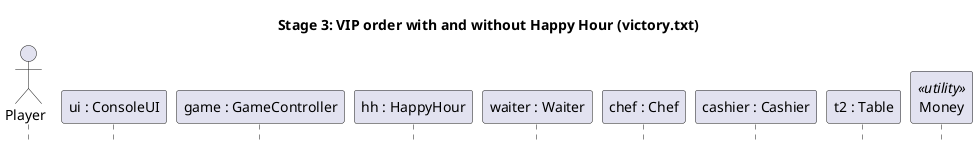

# PlantUML class relationships review

- Conversation ID: `5403a2ec-f59d-4c76-8b2f-885fbf143084`
- Started: 2026-11-11 12:14 UTC
- Last updated: 2026-11-11 15:28 UTC
- Tool: Claude (Anthropic), claude.ai
- Every prompt and reply is in original order. Tool calls are shown in full; long tool outputs are shortened.

---

## 1. Yunxi (prompt)  
_2026-11-11 12:14 UTC_

okay lets work on the class and the sequence diagrams now

---

## 2. Claude (reply)  
_2026-11-11 12:17 UTC_

**Tool call: `mcp__memory__memory_read`**

```json
{
  "path": [
    "/projects/01a0b3b2-d5ce-727b-9ef1-9a47d26f74f2/areas/sc2002-restaurant-rush.md",
    "/projects/01a0b3b2-d5ce-727b-9ef1-9a47d26f74f2/preferences.md"
  ]
}
```

<details><summary>Tool output</summary>

```text
=== /projects/01a0b3b2-d5ce-727b-9ef1-9a47d26f74f2/areas/sc2002-restaurant-rush.md ===
[updated: 2026-11-11T03:34:53.660874+00:00] [size: 671 of 49152 bytes — 48481 free] [version: d6e26626d022] (pass as if_version on your next write or edit of this path)
---
name: sc2002-restaurant-rush
description: SC2002 group assignment (Restaurant Rush Java CLI game) that Yunxi is doing in a group
sources: [cowork]
aliases: [Restaurant Rush, SC2002 group assignment]
---
- [stated] Working on the SC2002 Restaurant Rush group assignment in a group of 4
- [stated] Going with splitting the work by component ownership across all stages, not by stage
- [stated] Is member D in the group: owns the CLI and release role, and set up the group's GitHub repo
- [stated] Enoch is a groupmate with his own part of the work
- [stated] In Stage 3, taking over member C's portions (Happy Hour turn-flow wiring and Host) in addition to own CLI role

=== /projects/01a0b3b2-d5ce-727b-9ef1-9a47d26f74f2/preferences.md ===
[updated: 2026-09-21T06:13:19.291230+00:00] [size: 1347 of 49152 bytes — 47805 free] [version: fc56eb17ab08] (pass as if_version on your next write or edit of this path)
---
name: preferences
description: How to teach in this Java coursework project: bottom-up code, exam angles, direct correction, tight format, offline HTML study tools
sources: [chat]
aliases: [Java coursework project, project instructions]
---

- [stated] Project purpose: reach genuine competency in Java-based coursework, usuall
... [output truncated, 2515 characters in total]
```

</details>

**Tool call: `mcp__claude_ai__conversation_search`**

```json
{
  "max_results": 5,
  "query": "Restaurant Rush class diagram sequence diagram"
}
```

<details><summary>Tool output</summary>

```text
<chat url="https://claude.ai/chat/fadf5340-3801-4ab1-8001-bd0a370a27c6" updated_at="2026-10-15T05:29:19.963988+00:00" kind="summary">Title: Work division for 4 people
Work division for 4 people
&lt;chat_summary&gt;**Conversation overview**

The person is working on a group assignment for module SC2002 (an object-oriented design and programming course), building a turn-based Java CLI restaurant simulation game called "Restaurant Rush" with three other group members. The assignment requires three staged, git-tagged deliverables (stage-1, stage-2, stage-3), each adding features: Stage 1 covers regular customers, a basic menu, staff roles (Waiter, Chef, Cashier), tables, and the core turn loop; Stage 2 adds VIP and Critic customer types requiring polymorphism rather than instanceof checks; Stage 3 adds a Host role, combo meals, and a Happy Hour discount mechanic. Grading weights design evidence heavily (UML class diagram, sequence diagram, design discussion) alongside code and a video walkthrough.

Claude extracted the assignment brief from an uploaded document and proposed splitting work by subsystem (owned across all three stages by one person) rather than by stage, since stages are sequential and Stage 1 is the heaviest. The conversation progressed from a four-person subsystem split (engine, domain/customers, staff+CLI, evidence+QA) to a revised split covering turn engine, customers+pricing, menu+kitchen, and front-of-house+CLI, with corresponding documentation ownership (sequ
... [output truncated, 14282 characters in total]
```

</details>

**Tool call: `mcp__claude_ai__read_conversation`**

```json
{
  "conversation_id": "f5ce9860-9166-4d42-9df8-84777712029e",
  "max_turns": 10,
  "page_token": "e8QNXZd0odEp9vQrk8NfNiIgvo-_1o-_5GpcJpoECF4iw45kcFcffabSco_H714aR2Akb0mjEZg0103TCTeDTogg8CkizSDpK7-Eekw"
}
```

<details><summary>Tool output</summary>

```text
<chat url="https://claude.ai/chat/f5ce9860-9166-4d42-9df8-84777712029e" updated_at="2026-11-11T07:01:20.869030+00:00" total_turns="116" anchor="113" turns="110-115" prev_page_token="b110"><​title>Stage 3 git pull<​/title>

<turn n="110">Human: and since i am done with the design decisions what other non-code</turn>

<turn n="111">Assistant: &lt;tool name="mcp__remote-devices__device_bash"&gt;
&lt;parameter name="command"&gt;cd $HOME/mnt/sc2002-restaurant-rush &amp;&amp; git status --short; git log --oneline -4; sed -n 106p docs/design-decisions.md | grep -c "counts down one turn"&lt;/parameter&gt;
&lt;/tool&gt;
Design decisions are committed and clean (`9b46ac4`, with the step 5 row fixed). Here's everything non-code that's left, from the work plan.

## Yours (D), in order

| # | Task | Blocks |
|---|---|---|
| 1 | **README**: Stage 3 updates and a "Stage 2 to 3 changes" section | the tag |
| 2 | **Sequence diagram** (`docs/uml/stage-3-sequence.puml`), reviewed by Rajvi | the report |
| 3 | **Merge `stage3-docs`, then tag `stage-3`** | the video and the compare link |
| 4 | **Video**: record your segments **1** (game launching) and **6** (one victory and one defeat), then edit all segments together | submission |
| 5 | **Video timestamps in the README** | submission |
| 6 | **Package the zip** | submission |
| 7 | **Your GAI declaration** | submission |

Do 1 and 2 on `stage3-docs`, then merge and tag. The tag has to come before the video, because the brief marks "stage tag c
... [output truncated, 8817 characters in total]
```

</details>

**Tool call: `ToolSearch`**

```json
{
  "max_results": 3,
  "query": "select:mcp__remote-devices__device_bash,mcp__remote-devices__get_device_info,mcp__remote-devices__device_request_folder_access"
}
```

<details><summary>Tool output</summary>

_(no output)_

</details>

**Tool call: `mcp__remote-devices__get_device_info`**

```json
{}
```

<details><summary>Tool output</summary>

```text
{
  "platform": "darwin",
  "arch": "arm64",
  "appVersion": "5.1231.2",
  "electronVersion": "45.2.1",
  "nodeVersion": "24.22.1",
  "deviceName": "yunxis-mac-local",
  "connectedFolders": [],
  "homeDirectories": [
    {
      "name": ".cache"
    },
    {
      "name": ".codex"
    },
    {
      "name": ".config"
    },
    {
      "name": ".copilot"
    },
    {
      "name": ".cups"
    },
    {
      "name": ".idlerc"
    },
    {
      "name": ".ipynb_checkpoints"
    },
    {
      "name": ".ipython"
    },
    {
      "name": ".jupyter"
    },
    {
      "name": ".local"
    },
    {
      "name": ".matplotlib"
    },
    {
      "name": ".npm"
    },
    {
      "name": ".oracle_jre_usage"
    },
    {
      "name": ".Trash"
    },
    {
      "name": ".venv"
    },
    {
      "name": ".vscode"
    },
    {
      "name": ".vscode-shared"
    },
    {
      "name": ".zsh_sessions"
    },
    {
      "name": "bulls.py"
    },
    {
      "name": "code"
    },
    {
      "name": "Desktop",
      "requiresGrantBeforeListing": true
    },
    {
      "name": "Documents",
      "requiresGrantBeforeListing": true
    },
    {
      "name": "Downloads",
      "requiresGrantBeforeListing": true
    },
    {
      "name": "fg"
    },
    {
      "name": "lab7"
    },
    {
      "name": "Library"
    },
    {
      "name": "Movies"
    },
    {
      "name": "Music"
    },
    {
      "name": "OOP"
    },
    {
      "name": "Pictures"
    },
    {
      "name": "Public"

... [output truncated, 1739 characters in total]
```

</details>

**Tool call: `mcp__remote-devices__device_list_dir`**

```json
{
  "path": "~/code"
}
```

**Tool call: `mcp__remote-devices__device_list_dir`**

```json
{
  "path": "~/OOP"
}
```

<details><summary>Tool output</summary>

```text
{"skeleton":true,"directories":["sc2002-restaurant-rush"],"note":"Names only — this directory is not connected to this session, so file entries and contents are hidden. To work with files here, call device_request_folder_access with the folder you need (the user is asked to approve). The device_* tools honor only this session's connected folders (get_device_info.connectedFolders); a local MCP server's own folder settings are separate — neither list grants the other."}
```

</details>

<details><summary>Tool output</summary>

```text
{"skeleton":true,"directories":["Lab1","Lab2","Lab3","Lab4","Tut 1","Tut2 ","Tut3"],"note":"Names only — this directory is not connected to this session, so file entries and contents are hidden. To work with files here, call device_request_folder_access with the folder you need (the user is asked to approve). The device_* tools honor only this session's connected folders (get_device_info.connectedFolders); a local MCP server's own folder settings are separate — neither list grants the other."}
```

</details>

**Tool call: `mcp__remote-devices__device_request_folder_access`**

```json
{
  "paths": [
    "~/code/sc2002-restaurant-rush"
  ],
  "reason": "To read the Stage 3 code so the class and sequence diagrams match it exactly."
}
```

<details><summary>Tool output</summary>

```text
{"granted":["/Users/ngyunxi/code/sc2002-restaurant-rush"]}
```

</details>

**Tool call: `mcp__remote-devices__device_bash`**

```bash
cd $HOME/mnt/sc2002-restaurant-rush && git branch --show-current; git status --short; git log --oneline -4; find . -path ./.git -prune -o -type f -print | grep -v "/out/\|\.class$" | sort; wc -l $(find src -name "*.java") | tail -1
```

<details><summary>Tool output</summary>

```text
stage3-diagrams
769cc3e Merge pull request #23 from nyunxi/stage3-docs
deb95ac Docs: README for Stage 3
9b46ac4 Docs: Stage 3 design decisions and combo-choice rule
ae4167b Docs: Stage 3 design decisions and combo-choice rule
./.DS_Store
./.gitignore
./README.md
./docs/.DS_Store
./docs/design-decisions.md
./docs/test-notes-stage1.md
./docs/test-notes-stage2.md
./docs/test-notes-stage3.md
./docs/uml/stage-1-class.png
./docs/uml/stage-1-class.puml
./docs/uml/stage-1-class.svg
./docs/uml/stage-2-class.png
./docs/uml/stage-2-class.puml
./docs/uml/stage-2-class.svg
./src/restaurantrush/ActionResult.java
./src/restaurantrush/Cashier.java
./src/restaurantrush/Chef.java
./src/restaurantrush/ComboMeal.java
./src/restaurantrush/ConsoleUI.java
./src/restaurantrush/CriticCustomer.java
./src/restaurantrush/Customer.java
./src/restaurantrush/CustomerState.java
./src/restaurantrush/GameController.java
./src/restaurantrush/GameQuitException.java
./src/restaurantrush/HappyHour.java
./src/restaurantrush/Host.java
./src/restaurantrush/IllegalOrderStateException.java
./src/restaurantrush/InputReader.java
./src/restaurantrush/Main.java
./src/restaurantrush/Menu.java
./src/restaurantrush/MenuItem.java
./src/restaurantrush/Money.java
./src/restaurantrush/Order.java
./src/restaurantrush/OrderStatus.java
./src/restaurantrush/Table.java
./src/restaurantrush/VIPCustomer.java
./src/restaurantrush/Waiter.java
./tests/defeat.txt
./tests/failures.txt
./tests/happy.txt
./tests/rejects.txt
./tests/victory.tx
... [output truncated, 1513 characters in total]
```

</details>

**Tool call: `mcp__remote-devices__device_bash`**

```bash
cd $HOME/mnt/sc2002-restaurant-rush && cat docs/uml/stage-2-class.puml
```

<details><summary>Tool output</summary>

```text
@startuml
skinparam classAttributeIconSize 0
hide empty members
skinparam linetype ortho

class Table <<entity>> {
  - tableId : int {readOnly}
  + Table(tableId : int)
  + isFree() : boolean
  + seat(c : Customer) : ActionResult
  + free() : void
}

class Customer <<entity>> {
  - customerId : int {readOnly}
  - satisfaction : int
  - state : CustomerState
  + Customer(customerId : int)
  + chooseItem(menu : MenuItem[]) : MenuItem
  + getWaitingLoss() : int
  + getDiscountRate() : double
  + getCustomerType() : String
  + seat() : void
  + placeOrder(order : Order) : void
  + markServed() : void
  + finishEating() : void
  + markPaid() : void
  + leave() : void
  + loseWaitingSatisfaction() : void
  + hasLeft() : boolean
  - requireState(required : CustomerState, action : String) : void
}

class VIPCustomer <<entity>> {
  + VIPCustomer(customerId : int)
  + getWaitingLoss() : int
  + getDiscountRate() : double
  + getCustomerType() : String
}

class CriticCustomer <<entity>> {
  + CriticCustomer(customerId : int)
  + getWaitingLoss() : int
  + getCustomerType() : String
  + chooseItem(menu : MenuItem[]) : MenuItem
}

class Order <<entity>> {
  - {static} nextOrderNumber : int 
  - orderNumber : int {readOnly}
  - billCents : int {readOnly}
  - unitsDone : int
  - status : OrderStatus
  + Order(customer : Customer, item : MenuItem)
  + canAdvance() : boolean
  + advanceOneUnit() : boolean
  + markServed() : void 
  + markPaid() : void
  + cancel() : void
  + isReady() : boole
... [output truncated, 8836 characters in total]
```

</details>

**Tool call: `mcp__remote-devices__device_bash`**

```bash
cd $HOME/mnt/sc2002-restaurant-rush && git tag; git diff --stat stage-2 HEAD -- src; cat src/restaurantrush/Host.java src/restaurantrush/HappyHour.java src/restaurantrush/ComboMeal.java src/restaurantrush/MenuItem.java src/restaurantrush/Menu.java
```

<details><summary>Tool output</summary>

```text
stage-1
stage-2
 src/restaurantrush/ComboMeal.java      | 43 ++++++++++++++++++++++
 src/restaurantrush/ConsoleUI.java      | 57 +++++++++++++++++++++++++++--
 src/restaurantrush/Customer.java       | 11 ++++++
 src/restaurantrush/GameController.java | 66 ++++++++++++++++++++++++++++++++--
 src/restaurantrush/HappyHour.java      | 52 +++++++++++++++++++++++++++
 src/restaurantrush/Host.java           | 28 +++++++++++++++
 src/restaurantrush/Menu.java           | 11 ++++--
 src/restaurantrush/Order.java          | 24 ++++++++++---
 src/restaurantrush/Waiter.java         |  6 ++--
 9 files changed, 283 insertions(+), 15 deletions(-)
package restaurantrush;

public class Host {
    private boolean hasActed;

    public void startTurn(){
        hasActed = false;
    }

    public boolean hasActed(){
        return hasActed;
    }

    public ActionResult seat(Customer c, Table t) {
        if (hasActed) {
            return ActionResult.fail("The Host has already seated a customer this turn.");
        }
        if (c.getState() != CustomerState.WAITING) {
            return ActionResult.fail("Customer is not waiting to be seated.");
        }
        ActionResult result = t.seat(c);
        if (result.isSuccess()) {
            c.seat();
            hasActed = true;
        }
        return result;
    }
}
package restaurantrush;

public class HappyHour {
  public static final int DISCOUNT_PERCENT = 20;
  public static final int DURATION_TURNS = 2;
  public static final int SAT
... [output truncated, 7724 characters in total]
```

</details>

**Tool call: `mcp__remote-devices__device_bash`**

```bash
cd $HOME/mnt/sc2002-restaurant-rush && git diff stage-2 HEAD -- src/restaurantrush/Customer.java src/restaurantrush/GameController.java src/restaurantrush/Order.java src/restaurantrush/Waiter.java src/restaurantrush/ConsoleUI.java; git diff stage-2 HEAD -- src/restaurantrush/Money.java | head
```

<details><summary>Tool output</summary>

```text
diff --git a/src/restaurantrush/ConsoleUI.java b/src/restaurantrush/ConsoleUI.java
index d40a38e..97cadcf 100644
--- a/src/restaurantrush/ConsoleUI.java
+++ b/src/restaurantrush/ConsoleUI.java
@@ -18,9 +18,12 @@ public class ConsoleUI {
 
     public void run() {
         System.out.println("=== Restaurant Rush ===");
+        showMenu();
         while (!game.isGameOver()) {
             game.startTurn();
             showTurnState();
+            askHappyHour();
+            askHost();
             askWaiter();
             askChef();
             game.endTurn();
@@ -31,11 +34,19 @@ public class ConsoleUI {
 
     // ---------- Start-of-turn display ----------
 
+    private void showMenu(){
+        System.out.println("Menu:");
+        for (MenuItem item: game.getMenu()){
+            System.out.println(" " + item);
+        }
+    }
+
     private void showTurnState() {
         System.out.println();
         System.out.println("========== Turn " + game.getTurn() + " of " + GameController.TOTAL_TURNS + " ==========");
         System.out.println("Revenue: " + formatCents(game.getRevenueCents()));
         System.out.println("Average satisfaction (paid): " + formatAverage());
+        System.out.println(happyHourStatus());
 
         System.out.println("Waiting queue:");
         List<Customer> queue = game.getQueue();
@@ -55,7 +66,7 @@ public class ConsoleUI {
             }
         }
 
-        System.out.println("Staff this turn: Waiter (1 task), Chef (1 preparation u
... [output truncated, 13612 characters in total]
```

</details>

**Tool call: `mcp__remote-devices__device_bash`**

```bash
cd $HOME/mnt/sc2002-restaurant-rush && cat src/restaurantrush/Money.java | grep -n "static"; grep -n -A12 "chooseItem" src/restaurantrush/Customer.java src/restaurantrush/CriticCustomer.java; grep -n "getDiscountRate\|return 0" -A2 src/restaurantrush/VIPCustomer.java; grep -n -A12 "void placeOrder" src/restaurantrush/Customer.java; grep -n "public" src/restaurantrush/Customer.java; grep -n -i "sequence" docs/design-decisions.md README.md docs/test-notes-stage3.md
```

<details><summary>Tool output</summary>

```text
9:    public static String format(int cents) {
15:    public static int percentOff(int cents, int percent) {
25:    public static int applyDiscountRate(int cents, double rate) {
src/restaurantrush/Customer.java:43:    public MenuItem chooseItem(MenuItem[] menu) {
src/restaurantrush/Customer.java-44-        return menu[(customerId - 1) % menu.length];
src/restaurantrush/Customer.java-45-    }
src/restaurantrush/Customer.java-46-
src/restaurantrush/Customer.java-47-    // ---------- State changes ----------
src/restaurantrush/Customer.java-48-    // Each method allows only one move, so no class can skip a step (e.g. WAITING straight to PAID).
src/restaurantrush/Customer.java-49-    // Staff check the state before calling these, so an exception here means a bug, not a bad choice.
src/restaurantrush/Customer.java-50-
src/restaurantrush/Customer.java-51-    public void seat() {
src/restaurantrush/Customer.java-52-        requireState(CustomerState.WAITING, "be seated");
src/restaurantrush/Customer.java-53-        state = CustomerState.SEATED;
src/restaurantrush/Customer.java-54-    }
src/restaurantrush/Customer.java-55-
--
src/restaurantrush/CriticCustomer.java:20:    public MenuItem chooseItem(MenuItem[] menu) {
src/restaurantrush/CriticCustomer.java-21-        if (menu == null || menu.length == 0) {
src/restaurantrush/CriticCustomer.java-22-            throw new IllegalArgumentException("Menu cannot be empty.");
src/restaurantrush/CriticCustomer.java-23-        }
src/restaurantr
... [output truncated, 3949 characters in total]
```

</details>

**Tool call: `mcp__claude_ai__conversation_search`**

```json
{
  "max_results": 5,
  "query": "sequence diagram brief requirement Restaurant Rush one turn"
}
```

<details><summary>Tool output</summary>

```text
<chat url="https://claude.ai/chat/fadf5340-3801-4ab1-8001-bd0a370a27c6" updated_at="2026-10-15T05:29:19.963988+00:00" kind="summary">Title: Work division for 4 people
Work division for 4 people
&lt;chat_summary&gt;**Conversation overview**

The person is working on a group assignment for module SC2002 (an object-oriented design and programming course), building a turn-based Java CLI restaurant simulation game called "Restaurant Rush" with three other group members. The assignment requires three staged, git-tagged deliverables (stage-1, stage-2, stage-3), each adding features: Stage 1 covers regular customers, a basic menu, staff roles (Waiter, Chef, Cashier), tables, and the core turn loop; Stage 2 adds VIP and Critic customer types requiring polymorphism rather than instanceof checks; Stage 3 adds a Host role, combo meals, and a Happy Hour discount mechanic. Grading weights design evidence heavily (UML class diagram, sequence diagram, design discussion) alongside code and a video walkthrough.

Claude extracted the assignment brief from an uploaded document and proposed splitting work by subsystem (owned across all three stages by one person) rather than by stage, since stages are sequential and Stage 1 is the heaviest. The conversation progressed from a four-person subsystem split (engine, domain/customers, staff+CLI, evidence+QA) to a revised split covering turn engine, customers+pricing, menu+kitchen, and front-of-house+CLI, with corresponding documentation ownership (sequ
... [output truncated, 14258 characters in total]
```

</details>

**Tool call: `mcp__remote-devices__device_bash`**

```bash
cd $HOME/mnt/sc2002-restaurant-rush && which java javac; ls src/restaurantrush | wc -l
```

<details><summary>Tool output</summary>

```text
/usr/bin/java
23
```

</details>

**Tool call: `mcp__remote-devices__device_stage_files`**

```json
{
  "paths": [
    "/Users/ngyunxi/code/sc2002-restaurant-rush/src/restaurantrush/ActionResult.java",
    "/Users/ngyunxi/code/sc2002-restaurant-rush/src/restaurantrush/Cashier.java",
    "/Users/ngyunxi/code/sc2002-restaurant-rush/src/restaurantrush/Chef.java",
    "/Users/ngyunxi/code/sc2002-restaurant-rush/src/restaurantrush/ComboMeal.java",
    "/Users/ngyunxi/code/sc2002-restaurant-rush/src/restaurantrush/ConsoleUI.java",
    "/Users/ngyunxi/code/sc2002-restaurant-rush/src/restaurantrush/CriticCustomer.java",
    "/Users/ngyunxi/code/sc2002-restaurant-rush/src/restaurantrush/Customer.java",
    "/Users/ngyunxi/code/sc2002-restaurant-rush/src/restaurantrush/CustomerState.java",
    "/Users/ngyunxi/code/sc2002-restaurant-rush/src/restaurantrush/GameController.java",
    "/Users/ngyunxi/code/sc2002-restaurant-rush/src/restaurantrush/GameQuitException.java",
    "/Users/ngyunxi/code/sc2002-restaurant-rush/src/restaurantrush/HappyHour.java",
    "/Users/ngyunxi/code/sc2002-restaurant-rush/src/restaurantrush/Host.java",
    "/Users/ngyunxi/code/sc2002-restaurant-rush/src/restaurantrush/IllegalOrderStateException.java",
    "/Users/ngyunxi/code/sc2002-restaurant-rush/src/restaurantrush/InputReader.java",
    "/Users/ngyunxi/code/sc2002-restaurant-rush/src/restaurantrush/Main.java",
    "/Users/ngyunxi/code/sc2002-restaurant-rush/src/restaurantrush/Menu.java",
    "/Users/ngyunxi/code/sc2002-restaurant-rush/src/restaurantrush/MenuItem.java",
    "/Users/ngyunxi/code/sc2002-restaurant-rush/src/restaurantrush/Money.java",
    "/Users/ngyunxi/code/sc2002-restaurant-rush/src/restaurantrush/Order.java",
    "/Users/ngyunxi/code/sc2002-restaurant-rush/src/restaurantrush/OrderStatus.java",
    "/Users/ngyunxi/code/sc2002-restaurant-rush/src/restaurantrush/Table.java",
    "/Users/ngyunxi/code/sc2002-restaurant-rush/src/restaurantrush/VIPCustomer.java",
    "/Users/ngyunxi/code/sc2002-restaurant-rush/src/restaurantrush/Waiter.java",
    "/Users/ngyunxi/code/sc2002-restaurant-rush/tests/victory.txt",
    "/Users/ngyunxi/code/sc2002-restaurant-rush/tests/defeat.txt",
    "/Users/ngyunxi/code/sc2002-restaurant-rush/docs/uml/stage-2-class.puml",
    "/Users/ngyunxi/code/sc2002-restaurant-rush/docs/design-decisions.md"
  ]
}
```

<details><summary>Tool output</summary>

```text
{"staged":[{"devicePath":"/Users/ngyunxi/code/sc2002-restaurant-rush/src/restaurantrush/ActionResult.java","stagedPath":"/mnt/user-data/uploads/sc2002-restaurant-rush/src/restaurantrush/ActionResult.java","mtimeMs":1794058847364,"bytes":745,"ok":true,"dispatched":true},{"devicePath":"/Users/ngyunxi/code/sc2002-restaurant-rush/src/restaurantrush/Cashier.java","stagedPath":"/mnt/user-data/uploads/sc2002-restaurant-rush/src/restaurantrush/Cashier.java","mtimeMs":1794149938742,"bytes":1384,"ok":true,"dispatched":true},{"devicePath":"/Users/ngyunxi/code/sc2002-restaurant-rush/src/restaurantrush/Chef.java","stagedPath":"/mnt/user-data/uploads/sc2002-restaurant-rush/src/restaurantrush/Chef.java","mtimeMs":1794058847365,"bytes":693,"ok":true,"dispatched":true},{"devicePath":"/Users/ngyunxi/code/sc2002-restaurant-rush/src/restaurantrush/ComboMeal.java","stagedPath":"/mnt/user-data/uploads/sc2002-restaurant-rush/src/restaurantrush/ComboMeal.java","mtimeMs":1794335383722,"bytes":1317,"ok":true,"dispatched":true},{"devicePath":"/Users/ngyunxi/code/sc2002-restaurant-rush/src/restaurantrush/ConsoleUI.java","stagedPath":"/mnt/user-data/uploads/sc2002-restaurant-rush/src/restaurantrush/ConsoleUI.java","mtimeMs":1794380487340,"bytes":12188,"ok":true,"dispatched":true},{"devicePath":"/Users/ngyunxi/code/sc2002-restaurant-rush/src/restaurantrush/CriticCustomer.java","stagedPath":"/mnt/user-data/uploads/sc2002-restaurant-rush/src/restaurantrush/CriticCustomer.java","mtimeMs":1794216483785,"bytes
... [output truncated, 6780 characters in total]
```

</details>

**Tool call: `Bash`**

```bash
rm -rf /home/claude/s3 && mkdir -p /home/claude/s3 && cp -r /mnt/user-data/uploads/sc2002-restaurant-rush/src /home/claude/s3/ && cd /home/claude/s3 && javac --release 17 -d out src/restaurantrush/*.java 2>&1 | grep -v JAVA_TOOL; U=/mnt/user-data/uploads/sc2002-restaurant-rush; cat $U/tests/victory.txt | tr '\n' ' '; echo; java -cp out restaurantrush.Main < $U/tests/victory.txt 2>&1 | grep -v JAVA_TOOL | grep -E "Turn [0-9]+ of|Customer 2|Happy Hour is ON|Host seated|Cashier|paid|VICTORY|DEFEAT|Average" | head -90
```

<details><summary>Tool output</summary>

```text
0 0 1 1 1 0 0 2 1 1 1 0 3 1 0 0 0 1 1 2 0 0 0 0 0 0 0 0 0 1 1 1 0 0 2 1 1 1 0 0 1 1 0 3 1 0 0 0 0 0 0 0 0 1 2 1 2 1 1 1 1 2 2 1 1 3 1 1 2 3 2 0 0 0 0 1 1 1 0 
========== Turn 1 of 18 ==========
Average satisfaction (paid): N/A
Staff this turn: Host (seats 1), Waiter (1 task), Chef (1 preparation unit), Cashier (automatic)
Revenue: $0.00 | Average satisfaction (paid): N/A
========== Turn 2 of 18 ==========
Average satisfaction (paid): N/A
Staff this turn: Host (seats 1), Waiter (1 task), Chef (1 preparation unit), Cashier (automatic)
Revenue: $0.00 | Average satisfaction (paid): N/A
========== Turn 3 of 18 ==========
Average satisfaction (paid): N/A
Staff this turn: Host (seats 1), Waiter (1 task), Chef (1 preparation unit), Cashier (automatic)
Revenue: $0.00 | Average satisfaction (paid): N/A
========== Turn 4 of 18 ==========
Average satisfaction (paid): N/A
  Customer 2 (VIP) | satisfaction 100 | WAITING
Staff this turn: Host (seats 1), Waiter (1 task), Chef (1 preparation unit), Cashier (automatic)
  1. Customer 2 (VIP) | satisfaction 100 | WAITING
Choose (1-1): Which table (1-2)? Waiter seated Customer 2 at Table 2.
Revenue: $0.00 | Average satisfaction (paid): N/A
========== Turn 5 of 18 ==========
Average satisfaction (paid): N/A
  Table 2: Customer 2 (VIP) | satisfaction 95 | SEATED
Staff this turn: Host (seats 1), Waiter (1 task), Chef (1 preparation unit), Cashier (automatic)
Revenue: $9.00 | Average satisfaction (paid): 84.0
========== Turn 6 of 18 ==========
Averag
... [output truncated, 5384 characters in total]
```

</details>

**Tool call: `Bash`**

```bash
cd /home/claude/s3 && U=/mnt/user-data/uploads/sc2002-restaurant-rush; java -cp out restaurantrush.Main < $U/tests/victory.txt 2>&1 | sed -n '/Turn 16 of/,$p' | grep -v "^ *[0-9]\. \|Choose\|Menu\|^$" | head -70
```

<details><summary>Tool output</summary>

```text
========== Turn 16 of 18 ==========
Revenue: $27.00
Average satisfaction (paid): 80.0
Happy Hour: used
Waiting queue:
  Customer 4 (Critic) | satisfaction 58 | WAITING
  Customer 6 (Regular) | satisfaction 100 | WAITING
Tables:
  Table 1: Customer 5 (Regular) | satisfaction 100 | EATING | Salad + Burger Combo 2/2 units Served
  Table 2: Customer 2 (VIP) | satisfaction 70 | ORDERED | Burger 1/1 units Ready to serve
Staff this turn: Host (seats 1), Waiter (1 task), Chef (1 preparation unit), Cashier (automatic)

Waiter: 1 Seat a customer | 2 Take an order | 3 Serve a ready order | 0 Wait | q Quit

Chef: 1 Prepare an order | 0 Wait | q Quit

--- End of turn 16 ---
Served: 4 | Paid: 2 | Unhappy departures: 0
Revenue: $27.00 | Average satisfaction (paid): 80.0
Turns used: 16 of 18

========== Turn 17 of 18 ==========
Revenue: $27.00
Average satisfaction (paid): 80.0
Happy Hour: used
Waiting queue:
  Customer 4 (Critic) | satisfaction 46 | WAITING
  Customer 6 (Regular) | satisfaction 92 | WAITING
Tables:
  Table 1: Customer 5 (Regular) | satisfaction 100 | READY_TO_PAY | Salad + Burger Combo 2/2 units Served
  Table 2: Customer 2 (VIP) | satisfaction 70 | EATING | Burger 1/1 units Served
Staff this turn: Host (seats 1), Waiter (1 task), Chef (1 preparation unit), Cashier (automatic)

Waiter: 1 Seat a customer | 2 Take an order | 3 Serve a ready order | 0 Wait | q Quit

Chef: 1 Prepare an order | 0 Wait | q Quit

--- End of turn 17 ---
Served: 4 | Paid: 3 | Unhappy departures: 0
Re
... [output truncated, 2462 characters in total]
```

</details>

**Tool call: `Bash`**

```bash
cd /home/claude/s3/src/restaurantrush && cat Chef.java Cashier.java Table.java | grep -v "^\s*$\|^import\|^package"; sed -n '/public ActionResult seat/,/^    }/p;/public ActionResult serve/,/^    }/p' Waiter.java; grep -n "waiterSeat\|waiterServe\|chefPrepare\|waiterWait\|public void endTurn" -A8 GameController.java | head -60; sed -n '/private void payOldest/,/^    }/p;/private void finishEating/,/^    }/p;/private void applyWaitingLoss/,/^    }/p' GameController.java; sed -n '/askWaiter/,/^    }/p' ConsoleUI.java | head -40; cat Money.java
```

<details><summary>Tool output</summary>

```text
public class Chef {
    private boolean hasActed;
    public void startTurn() {
        this.hasActed = false;
    }
    public ActionResult prepare(Order o) {
        if (hasActed) {
            return ActionResult.fail("Chef has already worked on this turn.");
        } else if (!o.canAdvance()) {
            return ActionResult.fail("Order cannot advance.");
        } else {
            try {
                o.advanceOneUnit();
            } catch (IllegalOrderStateException e) {
                return ActionResult.fail(e.getMessage());
            }
            hasActed = true;
        }
        return ActionResult.ok();
    }
}
public class Cashier {
    private boolean hasActed;
    private int revenueCents;
    private int paidCount;
    private int satisfactionTotal;
    public void startTurn() {
        hasActed = false;
    }
    public ActionResult processPayment(Order o, Table t) {
        if (hasActed) {
            return ActionResult.fail("Cashier has already taken a payment this turn.");
        }
        Customer c = o.getCustomer();
        if (c.getState() != CustomerState.READY_TO_PAY) {
            return ActionResult.fail("Customer is not ready to pay yet.");
        }
        try {
            o.markPaid(); // Put most fail-able step first
        } catch (IllegalOrderStateException e) {
            return ActionResult.fail(e.getMessage());
        }
        c.markPaid(); // Update state if successful
        t.free();
        reven
... [output truncated, 8873 characters in total]
```

</details>

**Tool call: `Bash`**

```bash
cd /home/claude/s3/src/restaurantrush && grep -nE "^\s*(public|private|protected)[^=]*\(|^\s*private (static )?(final )?[A-Za-z<>\[\], ]+ [a-zA-Z]+( =|;)" GameController.java ConsoleUI.java Order.java Main.java; cat Main.java | sed -n '1,40p'
```

<details><summary>Tool output</summary>

```text
GameController.java:11:    private final MenuItem[] menu;
GameController.java:12:    private final List<Customer> queue = new LinkedList<>(); // Waiting customers (FIFO)
GameController.java:13:    private final List<Customer> customers = new ArrayList<>(); // All customers
GameController.java:14:    private final Table[] tables = {new Table(1), new Table(2)};
GameController.java:15:    private final List <Order> orders = new ArrayList<>(); // Oldest first 
GameController.java:16:    private final Map<Order, Integer> servedOnTurn = new HashMap<>();
GameController.java:17:    private final Waiter waiter = new Waiter();
GameController.java:18:    private final Host host = new Host(); //Stage 3 addition
GameController.java:19:    private final Chef chef = new Chef();
GameController.java:20:    private final Cashier cashier = new Cashier();
GameController.java:21:    private int turn = 0;
GameController.java:22:    private int nextCustomerId = 1;
GameController.java:23:    private int unhappyDepartures = 0;
GameController.java:25:    private final HappyHour happyHour = new HappyHour(); //Stage 3: Introduction of HappyHour
GameController.java:26:    private boolean turnInProgress = false; //true between startTurn() and endTurn()
GameController.java:28:    public GameController(MenuItem[] menu) {
GameController.java:39:    public void startTurn() {
GameController.java:60:    private Customer createCustomer(int id){
GameController.java:69:    public ActionResult waiterSeat(Customer c
... [output truncated, 8437 characters in total]
```

</details>

**Tool call: `Bash`**

```bash
cd /home/claude && rm -rf s3b && cp -r s3 s3b && cd s3b && cat src/restaurantrush/InputReader.java | sed -n '1,40p'
```

<details><summary>Tool output</summary>

```text
package restaurantrush;

import java.util.Scanner;

public class InputReader {
    private final Scanner scanner;

    public InputReader(Scanner scanner) {
        this.scanner = scanner;
    }

    public int readInt(String prompt, int min, int max) {
        if (min > max) {
            throw new IllegalArgumentException("min (" + min + ") cannot be greater than max.");
        }
        while (true) {
            System.out.print(prompt);
            if (!scanner.hasNextLine()) {
                throw new GameQuitException("input ended");
            }
            String line = scanner.nextLine().trim();
            if (line.equalsIgnoreCase("q")) {
                throw new GameQuitException("you quit");
            }
            try {
                int value = Integer.parseInt(line);
                if (value >= min && value <= max) {
                    return value;
                }
                System.out.println("Enter a number from " + min + " to " + max + ".");
            } catch (NumberFormatException e) {
                System.out.println("'" + line + "' is not a number.");
            }
        }
    }
}
```

</details>

**Tool call: `Bash`**

```bash
cd /home/claude/s3b && sed -i 's/    private final Scanner scanner;/    private final Scanner scanner; static int n=0;/; s/String line = scanner.nextLine().trim();/String line = scanner.nextLine().trim(); n++; System.out.print("[[L"+n+"]]");/' src/restaurantrush/InputReader.java && javac --release 17 -d out src/restaurantrush/*.java 2>&1 | grep -v JAVA_TOOL; V=/mnt/user-data/uploads/sc2002-restaurant-rush/tests/victory.txt; java -cp out restaurantrush.Main < $V | grep -o "Activate Happy Hour now? (1 Yes/ 0 No): \[\[L[0-9]*\]\]" | tail -2; grep -c "" $V
```

<details><summary>Tool output</summary>

```text
Picked up JAVA_TOOL_OPTIONS: -Djavax.net.ssl.trustStore=/etc/ssl/certs/java/cacerts -Djavax.net.ssl.trustStoreType=JKS -Dhttps.proxyHost=127.0.0.1 -Dhttps.proxyPort=39991 -Dhttp.nonProxyHosts=localhost|127.0.0.1|::1|127.*|0.*|::|169.254.*|api.anthropic.com|api-staging.anthropic.com|api-pr-preview.anthropic.com|mcp-proxy.anthropic.com|mcp-proxy-staging.anthropic.com|registry.npmjs.org|jsr.io|npm.jsr.io|pypi.org|files.pythonhosted.org|index.crates.io|proxy.golang.org|host.docker.internal|10.*|172.16.*|172.17.*|172.18.*|172.19.*|172.20.*|172.21.*|172.22.*|172.23.*|172.24.*|172.25.*|172.26.*|172.27.*|172.28.*|172.29.*|172.30.*|172.31.*|192.168.*|100.64.0.0/10|*.svc.cluster.local|*.svc.cluster.local -Djdk.http.auth.tunneling.disabledSchemes= -Djdk.http.auth.proxying.disabledSchemes=
Activate Happy Hour now? (1 Yes/ 0 No): [[L53]]
Activate Happy Hour now? (1 Yes/ 0 No): [[L61]]
79
```

</details>

**Tool call: `Bash`**

```bash
cd /home/claude/s3b && python3 - <<'EOF'
p='src/restaurantrush/ConsoleUI.java'; s=open(p).read()
s=s.replace("if (!game.canActivateHappyHour()){","if (!game.canActivateHappyHour() || game.getTurn()>=14){",1)
open(p,'w').write(s)
EOF
javac --release 17 -d out src/restaurantrush/*.java 2>&1 | grep -v JAVA_TOOL; V=/mnt/user-data/uploads/sc2002-restaurant-rush/tests/victory.txt; sed '61d' $V > /tmp/nohh.txt; java -cp out restaurantrush.Main < /tmp/nohh.txt 2>/dev/null | sed 's/\[\[L[0-9]*\]\]//g' | grep -E "Customer 2's order|GAME OVER|VICTORY|DEFEAT|need" ; java -cp out restaurantrush.Main < /tmp/nohh.txt 2>/dev/null | sed 's/\[\[L[0-9]*\]\]//g' | grep -E "Table 2: Customer 2" | tail -3
```

<details><summary>Tool output</summary>

```text
Choose (1-2): Waiter took Customer 2's order: Burger, $13.50.
========== GAME OVER ==========
VICTORY
Paid customers: 4 (need 4)
Revenue: $62.10 (need $45.00)
Average satisfaction (paid): 71.0 (need 60)
  Table 2: Customer 2 (VIP) | satisfaction 40 | ORDERED | Burger 1/1 units Ready to serve
  Table 2: Customer 2 (VIP) | satisfaction 40 | EATING | Burger 1/1 units Served
  Table 2: Customer 2 (VIP) | satisfaction 40 | READY_TO_PAY | Burger 1/1 units Served
```

</details>

---

## 3. Yunxi (prompt)  
_2026-11-11 12:17 UTC_

i only want a guide

---

## 4. Claude (reply)  
_2026-11-11 12:18 UTC_

# Stage 3 class and sequence diagram guide

I checked everything below against your `stage3-diagrams` branch and ran `victory.txt`.

**One correction first.** An earlier plan said Happy Hour turns defeat into victory. That isn't true with the current code. I reran `victory.txt` with Happy Hour declined and it's still a **VICTORY** ($62.10, average 71.0). So the sequence diagram should show that Happy Hour **changes the price and satisfaction**. It should not say Happy Hour wins the game.

---

## Part 1: Class diagram

Start by copying the Stage 2 file, so the Stage 2 version stays for the README comparison:
```bash
cp docs/uml/stage-2-class.puml docs/uml/stage-3-class.puml
```

### 1a. Three new class blocks

| Class | Fields | Methods |
|---|---|---|
| `Host <<entity>>` | `- hasActed : boolean` | `+ startTurn() : void`, `+ hasActed() : boolean`, `+ seat(c : Customer, t : Table) : ActionResult` |
| `HappyHour <<entity>>` | `+ {static} DISCOUNT_PERCENT : int = 20 {readOnly}`, also `DURATION_TURNS = 2` and `SATISFACTION_RECOVERY = 15`, `- used : boolean`, `- turnsRemaining : int` | `canActivate()`, `activate()`, `isActive()`, `getTurnsRemaining()`, `hasBeenUsed()`, `endTurn()`, `applyTo(cents : int) : int`, `toString()` |
| `ComboMeal <<entity>>` | `+ {static} PRICE_PERCENT : int = 90 {readOnly}` | constructor `ComboMeal(first : MenuItem, second : MenuItem)`, `getComponents() : List<MenuItem>`, `getSeparatePriceCents() : int`, `toString()`, plus `- {static} comboName(...)` and `- {static} comboPriceCents(...)` |

Don't list `first` and `second` as fields in `ComboMeal`. They're references to other classes, so you show them as an arrow (step 1c). Writing them in both places is a common marking error.

### 1b. Additions to existing classes

| Class | Add |
|---|---|
| `Customer` | `+ recoverHappyHourSatisfaction() : void` |
| `Order` | `- happyHourPrice : boolean {readOnly}`, a second constructor `+ Order(customer : Customer, item : MenuItem, happyHour : HappyHour)`, `+ isHappyHourPrice() : boolean` |
| `Waiter` | `takeOrder(...)` gets a 4th parameter, `happyHour : HappyHour` |
| `GameController` | `- turnInProgress : boolean`; public `canHostSeat()`, `hostSeat(c, t)`, `canActivateHappyHour()`, `activateHappyHour() : ActionResult`, `isHappyHourActive()`, `isHappyHourUsed()`, `getHappyHourTurnsRemaining()`; private `hasFreeTable()`, `recoverWaitingCustomers()` |
| `ConsoleUI` | private `showMenu()`, `askHappyHour()`, `askHost()`, `happyHourStatus() : String` |
| `Money` | `+ {static} percentOff(cents : int, percent : int) : int` and `+ {static} applyDiscountRate(cents : int, rate : double) : int`. **These existed in Stage 2 too, but the Stage 2 diagram leaves them out.** |

### 1c. Relationships

```
GameController "1" *-- "1" Host : host
GameController "1" *-- "1" HappyHour : happyHour
Menu "1" *-- "5" MenuItem : items
ComboMeal --|> MenuItem
ComboMeal "*" o-- "2" MenuItem : first, second
Order ..> HappyHour
Waiter ..> HappyHour
Host ..> Customer
Host ..> Table
Host ..> ActionResult : <<create>>
HappyHour ..> Money
ComboMeal ..> Money
Customer ..> HappyHour
```
The `Menu` line replaces the old `"3"` line. You can colour the dotted arrows grey like the Stage 2 ones.

How to read each arrow type:
- **`*--` (filled diamond, composition):** `GameController` creates `Host` and `HappyHour` with `new` in its own fields, and they exist only inside that one game.
- **`o--` (hollow diamond, aggregation):** a combo doesn't own its parts. The same Salad object is shared by `Menu` and **both** combos. That sharing is why this isn't composition.
- **`--|>` (hollow triangle):** a `ComboMeal` *is a* `MenuItem`.
- **`..>` (dotted, dependency):** the class uses another class without keeping a field for it. `Order` reads `HappyHour` once in its constructor and stores only a `boolean`, so this is a dependency, not an association. Expect this one in exams.

### 1d. Notes

- **ComboMeal (inheritance and substitution):** `Customer.chooseItem`, `Order` and `Chef` work with combos without any change, because a combo is a `MenuItem`. The price (90% of both items) and the prep units (the two items' units added together) are calculated once in the constructor.
- **HappyHour (encapsulation):** it can only be used once (`activate()` throws an exception if `used` is already true). The Happy Hour price is locked into `Order.billCents` when the order is taken.
- **Host:** it doesn't use the Waiter's task. It's a separate class, not a subclass of a `Staff` class. That's a good "alternative design" for Enoch's design discussion.
- **Legend:** change it to say "Stage 3".

---

## Part 2: Sequence diagram (`stage-3-sequence.puml`)

**Scenario:** follow the VIP (Customer 2) through `victory.txt`. These are the facts from the run:

| Turn | What happens to the VIP |
|---|---|
| 14 | Happy Hour is switched on (satisfaction goes from 50 to 65). The Host skips because both tables are full. The Waiter takes the order: Burger, $15.00, then $13.50 after the VIP's 10% off, then **$10.80** after Happy Hour |
| 15 | The recovery at the start of the turn gives 60 to 75. The Chef prepares 1 of 1 units, so the order is READY |
| 16 | The Waiter serves it, so the VIP is EATING |
| 17 | At the end of the turn, `finishEating()` makes the VIP READY_TO_PAY. Customer 5 is paid first, because only one customer can pay per turn |
| 18 | At the end of the turn, the Cashier takes $10.80, then `isVictory()` returns true |

Without Happy Hour, the bill is $13.50 and the VIP pays at satisfaction 40 instead of 70.

### 2a. Participants (left to right)

`actor Player`, `ui : ConsoleUI`, `game : GameController`, `hh : HappyHour`, `waiter : Waiter`, `vip : VIPCustomer`, `order : Order`, `Money`, `chef : Chef`, `cashier : Cashier`, `t2 : Table`

The VIP's lifeline is `vip : VIPCustomer`, even though it runs `chooseItem` inherited from `Customer`. A lifeline is the **object**, not the class where the method is written. `Money` has no `name :` part because it's a class whose static methods you call directly.

### 2b. PlantUML syntax you need

| Syntax | Meaning |
|---|---|
| `a -> b : m(x)` | a calls method `m` on b (solid arrow) |
| `b --> a : 1080` | b returns a value to a (dashed arrow) |
| `a -> b ++` / `return v` | turns b's activation bar on, and `return` ends it |
| `create order` then `waiter -> order : <<create>> Order(vip, burger, hh)` | the `order` lifeline starts at this point, not at the top |
| `alt [guard]` / `else` / `end` | two alternative paths |
| `opt [guard]` / `end` | one optional path |
| `loop [each customer]` / `end` | a repeated part |
| `== Turn 15 ==` | divider between turns |
| `...` | time passes |

### 2c. Turn 14 message order (follows `ConsoleUI.run()`)

1. `ui -> game : startTurn()`
2. `ui -> game : canActivateHappyHour()`, which calls `hh.canActivate()` and returns `true`
3. `Player -> ui : 1` (yes)
4. `ui -> game : activateHappyHour()`, then `game -> hh : activate()`, then `loop [each customer]` with `game -> vip : recoverHappyHourSatisfaction()`
5. `ui -> game : canHostSeat()` returns `false`. Add a note: "both tables full, the Host prompt is skipped"
6. `ui -> game : waiterTakeOrder(vip)`, then `game -> waiter : takeOrder(vip, menu, orders, hh)`
7. `waiter -> vip : chooseItem(menu)` returns Burger. That's `menu[(2-1) % 5]`
8. `create order`, then `waiter -> order : <<create>> Order(vip, burger, hh)`
9. `order -> vip : getDiscountRate()` returns 0.10. This is the VIP's override, so the call is polymorphic
10. `order -> Money : applyDiscountRate(1500, 0.10)` returns 1350
11. `order -> hh : isActive()`, then:
    ```
    alt [Happy Hour active]
      order -> hh : applyTo(1350)
      hh -> Money : percentOff(1350, 20)
      hh --> order : 1080
    else [not active]
      note over order : billCents stays 1350
    end
    ```
    This `alt` is the "with and without Happy Hour" part your README promises.
12. `waiter -> vip : placeOrder(order)`. The VIP is now ORDERED
13. Add a note for the Chef: "Chef works on Customer 5's combo (not shown)"
14. `ui -> game : endTurn()`, then `game -> vip : loseWaitingSatisfaction()` and `game -> hh : endTurn()`. Turns left go from 2 to 1

### 2d. Turns 15 to 18 (short versions)

- **15:** `startTurn()`, `hh.isActive()` is true, then the recovery loop again. Then `chefPrepare(order)`, `chef.prepare(order)`, `order.canAdvance()`, `order.advanceOneUnit()`. The order is READY. Then `hh.endTurn()`, and turns left go to 0
- **16:** `waiterServe(order)`, `waiter.serve(order)`, `order.isReady()`, `order.markServed()`, `vip.markServed()`. The VIP is EATING
- **17:** `endTurn()`, then `vip.finishEating()`. The VIP is READY_TO_PAY. Add a note that the payment step runs **before** `finishEating()`, so the VIP can't pay until turn 18
- **18:** `endTurn()`, `cashier.processPayment(order, t2)`, `order.markPaid()`, `vip.markPaid()`, `t2.free()`, `order.getBillCents()` returns 1080. Then `ui -> game : isVictory()` returns `true`

### 2e. Common mistakes

- Return arrows must be **dashed**, and calls are solid.
- **Every message must be a real method** with the exact name from the code. Graders check this against the class diagram.
- `order` must not appear at the top of the diagram. It's created in turn 14.
- Don't draw the Player calling `GameController` directly. The Player only talks to `ConsoleUI`, which is the boundary class.

---

Order of work: draw the class diagram first, because the sequence diagram's method names have to match it. Then render both (`plantuml -tsvg`), commit, and send the sequence diagram to Rajvi to review.

---

## 5. Yunxi (prompt)  
_2026-11-11 12:24 UTC_

Attached: `excerpt_from_previous_claude_message.txt`, `excerpt_from_previous_claude_message.txt`

_[document attached]_

how do all the additions look like

---

## 6. Claude (reply)  
_2026-11-11 12:25 UTC_

Each block below shows what to add and where. Everything else in the class stays as it is.

### Customer
Put this after `+ hasLeft() : boolean`:
```
  + recoverHappyHourSatisfaction() : void
```

### Order
Put this field after `- billCents : int {readOnly}`:
```
  - happyHourPrice : boolean {readOnly}
```
Put this constructor after the existing `+ Order(customer : Customer, item : MenuItem)`:
```
  + Order(customer : Customer, item : MenuItem, happyHour : HappyHour)
```
Put this method after `+ getBillDisplay() : String`:
```
  + isHappyHourPrice() : boolean
```
Keep both constructors. The 2-argument one still exists in the code (it calls the 3-argument one with `null`). Two constructors with different parameters is **overloading**, which is a likely exam question.

### Waiter
Replace the `takeOrder` line:
```
  + takeOrder(c : Customer, menu : MenuItem[], orders : List<Order>, happyHour : HappyHour) : ActionResult
```

### GameController
Put this field after `- waiterDone : boolean`:
```
  - turnInProgress : boolean
```
Put these public methods after `+ chefPrepare(o : Order) : ActionResult`:
```
  + canHostSeat() : boolean
  + hostSeat(c : Customer, t : Table) : ActionResult
  + canActivateHappyHour() : boolean
  + activateHappyHour() : ActionResult
  + isHappyHourActive() : boolean
  + isHappyHourUsed() : boolean
  + getHappyHourTurnsRemaining() : int
```
Put these private methods after `- createCustomer(id : int) : Customer`:
```
  - hasFreeTable() : boolean
  - recoverWaitingCustomers() : void
```
Don't add `host` or `happyHour` as fields. The composition arrows in 1c already show them, the same way the Stage 2 diagram doesn't list `waiter` or `chef` as fields.

### ConsoleUI
Put these after `- showTurnState() : void`:
```
  - showMenu() : void
  - askHappyHour() : void
  - askHost() : void
  - happyHourStatus() : String
```

### Money
Put these after `+ {static} format(cents : int) : String`:
```
  + {static} percentOff(cents : int, percent : int) : int
  + {static} applyDiscountRate(cents : int, rate : double) : int
```

### Reading the notation
- `+` means public and `-` means private.
- `{static}` is underlined when the diagram is rendered. It means you call the method on the class, as in `Money.percentOff(...)`, without creating an object.
- `{readOnly}` marks a `final` field.
- The format is always `name(param : Type) : ReturnType`. In UML the type comes after the name, which is the opposite of Java, and mixing the two up is a common mistake.

To check your work after rendering, count the methods in each changed class in the `.java` file. Each count should match the diagram, except for the simple getters the legend says you left out.

---

## 7. Yunxi (prompt)  
_2026-11-11 12:38 UTC_

Attached: `excerpt_from_previous_claude_message.txt`, `excerpt_from_previous_claude_message.txt`

_[document attached]_

the relationships are just add ons or edits right and is there no need for labels

---

## 8. Claude (reply)  
_2026-11-11 12:38 UTC_

They're add-ons, apart from one edit. Labels go on some lines but not all; there's a rule for which.

## Edit vs add

| Line | Action |
|---|---|
| `Menu "1" *-- "3" MenuItem : items` | **Edit** to `"5"`. This is the only existing line that changes. |
| All the others in 1c | **Add** them as new lines. |

Every other Stage 2 relationship still matches the code, so keep it.

## When to label

The Stage 2 diagram already follows this rule, so keep using it:

| Arrow type | Label? | What the label says |
|---|---|---|
| Composition `*--` / association `-->` | **Yes** | The **field name** that holds the reference (`: host`, `: happyHour`). This is the UML *role name*. |
| Aggregation `o--` | **Yes** | The field names: `: first, second` |
| Inheritance `--\|>` | **No** | The triangle already means "is a". |
| Dependency `..>` | **Only if it adds information** | A stereotype such as `<<create>>` or `<<throws>>`, or a short verb (Stage 2 uses `chooses`). A plain "uses" gets no label. |

So the 1c block is correctly labelled as written. In particular:
- `Host ..> ActionResult : <<create>>` has a label because Host makes new `ActionResult` objects, the same as the other staff classes in Stage 2.
- `Order ..> HappyHour`, `Waiter ..> HappyHour` and `Customer ..> HappyHour` have no label. Each one only reads from or passes along an object (or a constant) it doesn't keep, so a label would add nothing.

Two formatting points:
1. **Make the new dependencies grey,** to match Stage 2: `Order .[#999999].> HappyHour`. Otherwise they render black and look as important as the compositions.
2. **Multiplicities belong on structural arrows only** (`*--`, `o--`, `-->`). Never put them on `..>` or `--|>`.

## Exam angle

`ComboMeal` both **inherits from** `MenuItem` and **aggregates 2** `MenuItem`s. That shape is the **Composite pattern** (outside your materials): a whole that's the same type as its parts, so the code can treat a combo exactly like a single dish. If the design discussion mentions it, name the pattern and point to these two arrows.

---

## 9. Yunxi (prompt)  
_2026-11-11 12:39 UTC_

so this relationship portion is okay 

```plantuml
GameController "1" *-- "2" Table : tables
GameController "1" *-- "1" Waiter : waiter
GameController "1" *-- "1" Chef : chef
GameController "1" *-- "1" Cashier : cashier
GameController "1" *-- "0..6" Customer : customers
GameController "1" *-- "1" Host : host
GameController "1" *-- "1" HappyHour : happyHour
Menu "1" *-- "5" MenuItem : items

GameController "0..1" --> "*" Customer : queue
GameController "1" --> "*" Order : orders
GameController --> "1..*" MenuItem : menu
ComboMeal --|> MenuItem
ComboMeal "*" o-- "2" MenuItem : first, second
Order ..> HappyHour
Order "*" --> "1" MenuItem : item
Waiter ..> HappyHour
Host ..> Customer
Host ..> Table
Host ..> ActionResult : <<create>>
HappyHour ..> Money
ComboMeal ..> Money
Customer ..> HappyHour
Table "0..1" --> "0..1" Customer : customer
ConsoleUI "1" --> "1" GameController : game
ConsoleUI "1" --> "1" InputReader : input

Customer "1" -- "0..1" Order : order / customer

IllegalOrderStateException --|> IllegalStateException
IllegalStateException --|> RuntimeException
GameQuitException --|> RuntimeException
VIPCustomer --|> Customer
CriticCustomer --|> Customer
```

---

## 10. Claude (reply)  
_2026-11-11 12:39 UTC_

The relationships are all correct. There are two formatting fixes and one check.

## 1. Move the new dependencies into the grey block

The six new `..>` lines are mixed in with the structural arrows and will render black. Take them out of this block and put them with Stage 2's grey dependencies (the `Main .[#999999].>` / `Waiter .[#999999].>` section), written like this:

```plantuml
Order .[#999999].> HappyHour
Waiter .[#999999].> HappyHour
Host .[#999999].> Customer
Host .[#999999].> Table
Host .[#999999].> ActionResult : <<create>>
HappyHour .[#999999].> Money
ComboMeal .[#999999].> Money
Customer .[#999999].> HappyHour
```

## 2. Move `ComboMeal --|> MenuItem` down with the other inheritance lines

It works where it is, but Stage 2 groups every `--|>` at the bottom, so put it after `CriticCustomer --|> Customer`. Keep the `o--` line where it is, with the other structural arrows.

## 3. Check that the Stage 2 dependency block is still there

Your paste stops at the inheritance lines. If the grey section (`Main ... <<create>>`, `Waiter ... Order : <<create>>`, `InputReader ... <<throws>>` and so on) and the notes are still below it in your file, you're fine. If you deleted them, copy them back from `stage-2-class.puml`. Those arrows are still true in Stage 3.

## After rendering, check one thing

`ComboMeal` now has two arrows to `MenuItem` (the triangle and the diamond). With `skinparam linetype ortho`, the two lines can sit on top of each other and look like one. If they overlap, give one of them a direction:

```plantuml
ComboMeal -up-|> MenuItem
```

`-up-` only changes where the arrow is drawn, not what it means.

---

## 11. Yunxi (prompt)  
_2026-11-11 12:40 UTC_

give me the full relationships and dependencies

---

## 12. Claude (reply)  
_2026-11-11 12:40 UTC_

---

## 13. Yunxi (prompt)  
_2026-11-11 12:40 UTC_

```plantuml
GameController "1" *-- "2" Table : tables
GameController "1" *-- "1" Waiter : waiter
GameController "1" *-- "1" Chef : chef
GameController "1" *-- "1" Cashier : cashier
GameController "1" *-- "0..6" Customer : customers
GameController "1" *-- "1" Host : host
GameController "1" *-- "1" HappyHour : happyHour
Menu "1" *-- "5" MenuItem : items

GameController "0..1" --> "*" Customer : queue
GameController "1" --> "*" Order : orders
GameController --> "1..*" MenuItem : menu
ComboMeal --|> MenuItem
ComboMeal "*" o-- "2" MenuItem : first, second
Order ..> HappyHour
Order "*" --> "1" MenuItem : item
Waiter ..> HappyHour
Host ..> Customer
Host ..> Table
Host ..> ActionResult : <<create>>
HappyHour ..> Money
ComboMeal ..> Money
Customer ..> HappyHour
Table "0..1" --> "0..1" Customer : customer
ConsoleUI "1" --> "1" GameController : game
ConsoleUI "1" --> "1" InputReader : input

Customer "1" -- "0..1" Order : order / customer

IllegalOrderStateException --|> IllegalStateException
IllegalStateException --|> RuntimeException
GameQuitException --|> RuntimeException
VIPCustomer --|> Customer
CriticCustomer --|> Customer

Main .[#999999].> Menu : <<create>>
Main .[#999999].> GameController : <<create>>
Main .[#999999].> InputReader : <<create>>
Main .[#999999].> ConsoleUI : <<create>>
Main .[#999999].> GameQuitException : catches

Waiter .[#999999].> Order : <<create>>
Waiter .[#999999].> Customer
Waiter .[#999999].> Table
Chef .[#999999].> Order
Cashier .[#999999].> Order
Cashier .[#999999].> Table
Customer .[#999999].> MenuItem : chooses

Waiter .[#999999].> ActionResult : <<create>>
Chef .[#999999].> ActionResult : <<create>>
Cashier .[#999999].> ActionResult : <<create>>
Table .[#999999].> ActionResult : <<create>>
GameController .[#999999].> ActionResult : <<create>>
GameController .[#999999].> VIPCustomer : <<create>>
GameController .[#999999].> CriticCustomer : <<create>>
ConsoleUI .[#999999].> ActionResult

InputReader .[#999999].> GameQuitException : <<throws>>
Order .[#999999].> IllegalOrderStateException : <<throws>>

MenuItem .[#999999].> Money
Order .[#999999].> Money
ConsoleUI .[#999999].> Money
```

---

## 14. Claude (reply)  
_2026-11-11 12:40 UTC_

Here's the full block. Paste it over everything from the first relationship line down to just before the first `note`. I added 10 lines; each one has a `' Stage 3` comment above it.

```plantuml
' ---------- Composition ----------
GameController "1" *-- "2" Table : tables
GameController "1" *-- "1" Waiter : waiter
GameController "1" *-- "1" Chef : chef
GameController "1" *-- "1" Cashier : cashier
GameController "1" *-- "0..6" Customer : customers
' Stage 3
GameController "1" *-- "1" Host : host
GameController "1" *-- "1" HappyHour : happyHour
Menu "1" *-- "5" MenuItem : items

' ---------- Aggregation ----------
' Stage 3
ComboMeal "*" o-- "2" MenuItem : first, second

' ---------- Association ----------
GameController "0..1" --> "*" Customer : queue
GameController "1" --> "*" Order : orders
GameController --> "1..*" MenuItem : menu
Order "*" --> "1" MenuItem : item
Table "0..1" --> "0..1" Customer : customer
ConsoleUI "1" --> "1" GameController : game
ConsoleUI "1" --> "1" InputReader : input
Customer "1" -- "0..1" Order : order / customer

' ---------- Inheritance ----------
IllegalOrderStateException --|> IllegalStateException
IllegalStateException --|> RuntimeException
GameQuitException --|> RuntimeException
VIPCustomer --|> Customer
CriticCustomer --|> Customer
' Stage 3
ComboMeal --|> MenuItem

' ---------- Dependencies ----------
Main .[#999999].> Menu : <<create>>
Main .[#999999].> GameController : <<create>>
Main .[#999999].> InputReader : <<create>>
Main .[#999999].> ConsoleUI : <<create>>
Main .[#999999].> GameQuitException : catches

Waiter .[#999999].> Order : <<create>>
Waiter .[#999999].> Customer
Waiter .[#999999].> Table
Chef .[#999999].> Order
Cashier .[#999999].> Order
Cashier .[#999999].> Table
Customer .[#999999].> MenuItem : chooses
' Stage 3
Host .[#999999].> Customer
Host .[#999999].> Table
Waiter .[#999999].> HappyHour
Order .[#999999].> HappyHour
Customer .[#999999].> HappyHour
Menu .[#999999].> ComboMeal : <<create>>

Waiter .[#999999].> ActionResult : <<create>>
Chef .[#999999].> ActionResult : <<create>>
Cashier .[#999999].> ActionResult : <<create>>
Table .[#999999].> ActionResult : <<create>>
GameController .[#999999].> ActionResult : <<create>>
GameController .[#999999].> VIPCustomer : <<create>>
GameController .[#999999].> CriticCustomer : <<create>>
ConsoleUI .[#999999].> ActionResult
' Stage 3
Host .[#999999].> ActionResult : <<create>>

InputReader .[#999999].> GameQuitException : <<throws>>
Order .[#999999].> IllegalOrderStateException : <<throws>>
' Stage 3
HappyHour .[#999999].> IllegalStateException : <<throws>>

MenuItem .[#999999].> Money
Order .[#999999].> Money
ConsoleUI .[#999999].> Money
' Stage 3
HappyHour .[#999999].> Money
ComboMeal .[#999999].> Money
```

**Two lines I added that weren't in my earlier list:**
- `Menu ..> ComboMeal : <<create>>`: `Menu()` creates the combos with `new ComboMeal(...)`. The composition arrow only says "Menu owns MenuItems", so this line names the subclass it creates. It follows the same pattern as `GameController ..> VIPCustomer : <<create>>`.
- `HappyHour ..> IllegalStateException : <<throws>>`: `activate()` throws it when Happy Hour has already been used. It follows the same pattern as `Order ..> IllegalOrderStateException`.

**About the `'` lines:** in PlantUML, `'` starts a comment, so the section headers and `' Stage 3` markers don't appear in the image. You can delete them if you prefer, but the Stage 3 markers help Rajvi see what changed when she reviews.

---

## 15. Yunxi (prompt)  
_2026-11-11 12:46 UTC_

give me the edited notes

---

## 16. Claude (reply)  
_2026-11-11 12:46 UTC_

These replace every `note` and the `legend` from the Stage 2 file, so paste the whole block over them. The ones marked `' Stage 3` are new; the rest are Stage 2 notes with edits.

```plantuml
note right of Customer
  <b>Encapsulation</b>
  State changes only through seat(), placeOrder(),
  markServed(), finishEating(), markPaid(), leave().
  Each checks the current state first via private
  requireState(), so no class can skip a step
  (e.g. WAITING straight to PAID).
  recoverHappyHourSatisfaction() changes satisfaction
  only, never state, and is capped at 100.
end note

note bottom of VIPCustomer
  <b>Polymorphism (inheritance + overriding)</b>
  VIP and Critic override getWaitingLoss(),
  getDiscountRate(), getCustomerType(), chooseItem().
  GameController and ConsoleUI only call Customer
  methods; there is no instanceof anywhere.
  Critic's "most expensive item" now includes combos
  with no change to its code.
end note

note bottom of Order
  <b>Encapsulation</b>
  billCents is final: the price is locked when
  the order is taken. Customer discount first,
  then Happy Hour 20% off if active
  (VIP Burger: $15.00 -> $13.50 -> $10.80).
  HappyHour is only read in the constructor,
  so it is a dependency, not a field.
  Status changes are guarded by requireStatus().
end note

note left of GameController
  <b>Composition</b>
  Creates and owns the 2 Tables, the staff
  (Host, Waiter, Chef, Cashier), the HappyHour
  and every Customer for the whole game.
  <b>Single creation point</b>
  createCustomer() is the only place that names
  the Customer subclasses (customer 2 VIP, 4 Critic).
  <b>Encapsulation</b>
  getQueue(), getTables(), getOrders(), getCustomers()
  return unmodifiable lists; getMenu() returns a copy.
  turnInProgress and waiterDone limit Happy Hour
  to the start of a turn.
end note

note right of MenuItem
  <b>Polymorphism</b>
  MenuItem, ComboMeal and Order override
  Object.toString().
  Staff catch IllegalOrderStateException; Main
  catches GameQuitException (both RuntimeException
  subtypes).
end note

' Stage 3
note bottom of ComboMeal
  <b>Inheritance + aggregation</b>
  A ComboMeal is a MenuItem made of 2 MenuItems,
  so Customer, Order and Chef handle it like any
  dish. Price (90% of both) and prep units (sum)
  are fixed in the constructor.
  The same Salad object is shared by Menu and
  both combos, hence aggregation, not composition.
end note

' Stage 3
note right of HappyHour
  <b>Encapsulation</b>
  Once per game: activate() throws if already used.
  Lasts 2 turns; endTurn() counts down.
  applyTo() is the only place the 20% is applied.
end note

' Stage 3
note right of Host
  <b>Single responsibility</b>
  Seats at most 1 customer per turn and does not
  use the Waiter's task. A separate class, not a
  Staff superclass (see design discussion).
end note

legend top left
  Stage 3 class diagram
  New in Stage 3: Host, HappyHour, ComboMeal.
  Simple getters and unused status checks omitted.
  ConsoleUI picking and formatting helpers omitted.
endlegend
```

Before committing, check two things:
- **"No instanceof anywhere"**: I checked this against the Stage 3 source earlier today. If anyone adds code after this, run `grep -rn instanceof src/` again before you tag.
- **Note positions:** five notes now sit around `GameController`, `Customer` and `MenuItem`, so they may overlap when rendered. If they do, change `right` or `bottom` to another side, such as `note top of HappyHour`. That changes only where the note is drawn.

---

## 17. Yunxi (prompt)  
_2026-11-11 12:47 UTC_

_[document attached]_

check the entire puml

---

## 18. Claude (reply)  
_2026-11-11 12:48 UTC_

**Tool call: `Bash`**

```bash
which plantuml java dot; ls ~/.m2 2>/dev/null; pip download plantuml 2>&1 | tail -1
```

<details><summary>Tool output</summary>

```text
/usr/bin/java
/usr/bin/dot
Successfully downloaded plantuml httplib2 pyparsing
```

</details>

**Tool call: `Bash`**

```bash
cd /home/claude && mkdir -p pu && cd pu && (curl -sSL -o plantuml.jar https://github.com/plantuml/plantuml/releases/download/v1.2024.7/plantuml-1.2024.7.jar && ls -la plantuml.jar) 2>&1 | tail -2
```

<details><summary>Tool output</summary>

```text
-rw-r--r-- 1 root root 22073496 Nov 11 20:48 plantuml.jar
```

</details>

**Tool call: `Bash`**

```bash
cd /home/claude/pu && cp /mnt/user-data/uploads/4e0285ba-attachment.txt orig.puml && java -jar plantuml.jar -tsvg orig.puml 2>&1 | grep -v JAVA_TOOL; python3 - <<'EOF'
s=open('orig.puml').read()
s=s.replace("  + takeOrder(c : Customer, menu : MenuItem[], orders : List<Order>) : ActionResult, happyHour : HappyHour : ActionResult",
"  + takeOrder(c : Customer, menu : MenuItem[], orders : List<Order>, happyHour : HappyHour) : ActionResult")
s=s.replace("  + Order(customer : Customer, item : MenuItem, happyHour : HappyHour)\n",
"  + Order(customer : Customer, item : MenuItem)\n  + Order(customer : Customer, item : MenuItem, happyHour : HappyHour)\n")
new='''class ComboMeal <<entity>> {
  + {static} PRICE_PERCENT : int = 90 {readOnly}
  + ComboMeal(first : MenuItem, second : MenuItem)
  + getComponents() : List<MenuItem>
  + getSeparatePriceCents() : int
  + toString() : String
  - {static} comboName(first : MenuItem, second : MenuItem) : String
  - {static} comboPriceCents(first : MenuItem, second : MenuItem) : int
}

class Host <<entity>> {
  - hasActed : boolean
  + startTurn() : void
  + hasActed() : boolean
  + seat(c : Customer, t : Table) : ActionResult
}

class HappyHour <<entity>> {
  + {static} DISCOUNT_PERCENT : int = 20 {readOnly}
  + {static} DURATION_TURNS : int = 2 {readOnly}
  + {static} SATISFACTION_RECOVERY : int = 15 {readOnly}
  - used : boolean
  - turnsRemaining : int
  + canActivate() : boolean
  + activate() : void
  + isActive() : boolean
  + getTurnsRemaining() : int
  + hasBeenUsed() : boolean
  + endTurn() : void
  + applyTo(cents : int) : int
  + toString() : String
}

class Menu <<entity>> {'''
s=s.replace("class Menu <<entity>> {",new,1)
open('fixed.puml','w').write(s)
EOF
java -jar plantuml.jar -tsvg -tpng fixed.puml 2>&1 | grep -v JAVA_TOOL; ls; diff orig.puml fixed.puml | head -60
```

<details><summary>Tool output</summary>

```text
Permission for this action was denied by the Claude Code auto mode classifier. Reason: [Code from External]. If you have other tasks that don't depend on this action, continue working on those. IMPORTANT: You *may* attempt to accomplish this action using other tools that might naturally be used to accomplish this goal, e.g. using head instead of cat. But you *should not* attempt to work around this denial in malicious ways, e.g. do not use your ability to run tests to execute non-test actions. You should only try to work around this restriction in reasonable ways that do not attempt to bypass the intent behind this denial. If you believe this capability is essential to complete the user's request, first try a safer method. Get as much of the rest of the task done as you can, then STOP and explain to the user what you were trying to do and why you need this permission. Let the user decide how to proceed.
```

</details>

The relationships, notes and legend are all correct. There are three problems in the class blocks, and the first one is serious.

## 1. The `Host`, `HappyHour` and `ComboMeal` class blocks are missing

PlantUML **won't show an error** for this. When an arrow names a class that has no block, PlantUML quietly draws an empty box. Because of `hide empty members`, the three new classes would show up as bare names with no stereotype, fields or methods. Those are the three classes Stage 3 is graded on.

Paste these 3 blocks in, for example just before `class Menu <<entity>> {`:

```plantuml
class ComboMeal <<entity>> {
  + {static} PRICE_PERCENT : int = 90 {readOnly}
  + ComboMeal(first : MenuItem, second : MenuItem)
  + getComponents() : List<MenuItem>
  + getSeparatePriceCents() : int
  + toString() : String
  - {static} comboName(first : MenuItem, second : MenuItem) : String
  - {static} comboPriceCents(first : MenuItem, second : MenuItem) : int
}

class Host <<entity>> {
  - hasActed : boolean
  + startTurn() : void
  + hasActed() : boolean
  + seat(c : Customer, t : Table) : ActionResult
}

class HappyHour <<entity>> {
  + {static} DISCOUNT_PERCENT : int = 20 {readOnly}
  + {static} DURATION_TURNS : int = 2 {readOnly}
  + {static} SATISFACTION_RECOVERY : int = 15 {readOnly}
  - used : boolean
  - turnsRemaining : int
  + canActivate() : boolean
  + activate() : void
  + isActive() : boolean
  + getTurnsRemaining() : int
  + hasBeenUsed() : boolean
  + endTurn() : void
  + applyTo(cents : int) : int
  + toString() : String
}
```

## 2. Line 162: the `Waiter.takeOrder` signature is broken

The new parameter ended up after the return type, and `: ActionResult` appears twice:
```
+ takeOrder(c : Customer, menu : MenuItem[], orders : List<Order>) : ActionResult, happyHour : HappyHour : ActionResult
```
Replace the line with:
```plantuml
  + takeOrder(c : Customer, menu : MenuItem[], orders : List<Order>, happyHour : HappyHour) : ActionResult
```
The parameter list ends at `)`, and only the return type comes after it.

## 3. Line 56: the 2-argument `Order` constructor was deleted

You replaced it, but the code still has both constructors (`Order.java` lines 15 and 19). Put this back above line 56:
```plantuml
  + Order(customer : Customer, item : MenuItem)
```
Two constructors with different parameter lists is **overloading**. Leaving one out means the diagram no longer matches the code, and the brief says the diagram must match.

## Everything else matches the code

The Customer, Order fields, GameController, ConsoleUI and Money blocks, the relationships, the notes and the legend all match the Stage 3 source I read earlier. The only things missing are the simple getters, which your legend already says are left out.

I couldn't render the diagram here, so render it yourself after the fixes (`plantuml -tsvg docs/uml/stage-3-class.puml`) and check:
- `Host`, `HappyHour` and `ComboMeal` each show their stereotype and methods.
- The two `ComboMeal` → `MenuItem` arrows don't sit on top of each other. If they do, use `-up-|>` as before.
- The notes don't cover each other.

---

## 19. Yunxi (prompt)  
_2026-11-11 12:52 UTC_

_[document attached]_

check again

---

## 20. Claude (reply)  
_2026-11-11 12:52 UTC_

It's correct, and all three fixes are in:

- The `ComboMeal`, `Host` and `HappyHour` blocks are present, and their fields and methods match the code.
- `Waiter.takeOrder` (line 196) now has all 4 parameters and one return type.
- `Order` (lines 56 and 57) has both constructors again.

I found nothing else to fix. One thing that might look like a mistake but isn't: `Host` has both a field called `hasActed` and a method called `hasActed()`. Java allows a field and a method to share a name, and so does UML, so leave both.

**Next:**
1. Render it (`plantuml -tsvg -tpng docs/uml/stage-3-class.puml`) and check that the notes don't overlap and the two `ComboMeal` → `MenuItem` arrows are both visible.
2. Commit:
   ```bash
   git add docs/uml/stage-3-class.*
   git commit -m "Docs: Stage 3 class diagram"
   ```

After that, the sequence diagram is next. Its method names must match this file exactly.

---

## 21. Yunxi (prompt)  
_2026-11-11 12:53 UTC_

what is the code for git push

---

## 22. Claude (reply)  
_2026-11-11 12:53 UTC_

You're on the new `stage3-diagrams` branch, so the first push needs `-u`:

```bash
git push -u origin stage3-diagrams
```

- `origin` is your GitHub repo.
- `stage3-diagrams` is the branch you're pushing.
- `-u` links your local branch to the GitHub one, so from now on a plain `git push` works on this branch.

If it says `Everything up-to-date`, you haven't committed yet. Run the `git add` and `git commit` from my last message first.

**Don't open the PR yet.** The sequence diagram goes on this same branch. Commit and push it the same way, then open one PR for both diagrams. Tag `stage-3` only after that PR is merged.

---

## 23. Yunxi (prompt)  
_2026-11-11 12:54 UTC_

Attached: `excerpt_from_previous_claude_message.txt`, `excerpt_from_previous_claude_message.txt`

_[document attached]_

so this sequence diagram is only needed for stage 3?

---

## 24. Claude (reply)  
_2026-11-11 12:54 UTC_

**Tool call: `mcp__claude_ai__conversation_search`**

```json
{
  "max_results": 5,
  "query": "brief \"sequence diagram\" deliverables report UML"
}
```

<details><summary>Tool output</summary>

```text
<chat url="https://claude.ai/chat/fadf5340-3801-4ab1-8001-bd0a370a27c6" updated_at="2026-10-15T05:29:19.963988+00:00" kind="summary">Title: Work division for 4 people
Work division for 4 people
&lt;chat_summary&gt;**Conversation overview**

The person is working on a group assignment for module SC2002 (an object-oriented design and programming course), building a turn-based Java CLI restaurant simulation game called "Restaurant Rush" with three other group members. The assignment requires three staged, git-tagged deliverables (stage-1, stage-2, stage-3), each adding features: Stage 1 covers regular customers, a basic menu, staff roles (Waiter, Chef, Cashier), tables, and the core turn loop; Stage 2 adds VIP and Critic customer types requiring polymorphism rather than instanceof checks; Stage 3 adds a Host role, combo meals, and a Happy Hour discount mechanic. Grading weights design evidence heavily (UML class diagram, sequence diagram, design discussion) alongside code and a video walkthrough.

Claude extracted the assignment brief from an uploaded document and proposed splitting work by subsystem (owned across all three stages by one person) rather than by stage, since stages are sequential and Stage 1 is the heaviest. The conversation progressed from a four-person subsystem split (engine, domain/customers, staff+CLI, evidence+QA) to a revised split covering turn engine, customers+pricing, menu+kitchen, and front-of-house+CLI, with corresponding documentation ownership (sequ
... [output truncated, 14431 characters in total]
```

</details>

Yes. There's **one sequence diagram for the whole submission** (20 marks in your work plan). That's why the Stage 1 and 2 folders only have class diagrams. Draw it from the final Stage 3 code, because that's the version that gets tagged and graded.

The requirement I'm working from is my summary of brief section 5 from an earlier chat; the brief itself isn't uploaded in this project. It asks for **one complete scenario in which a manager's choice changes the outcome**, including:
- the customer's arrival and order
- the Waiter and Chef actions
- the order going from READY to SERVED
- eating
- payment
- the result check
- one Stage 2 or 3 behaviour
- messages between the CLI, the controller, the staff and the domain objects, with guards and loops

Checking my guide against that list turned up **two gaps you need to fix**:

1. **Arrival is missing.** My guide starts at turn 14, but the VIP arrives and is seated on **turn 4**. Add this at the top:
   - `== Turn 4 ==`
   - `ui -> game : startTurn()`, then `game -> game : createCustomer(2)`, then `create vip` with `<<create>> VIPCustomer(2)`. This is where the subclass is chosen.
   - `ui -> game : waiterSeat(vip, t2)`, then `game -> waiter : seat(vip, t2)`, then `t2.seat(vip)` and `vip.seat()`. The VIP is SEATED.
   - Then use `...` to skip turns 5 to 13. Add a note: "VIP seated, waiting; loses 5 per turn".
2. **There's no loop around the turns.** Wrap everything in `loop [turn 1..18]` and keep the `== Turn ==` dividers inside it. Also keep the `loop [each customer]` for the recovery step.

**One judgement call for your group to make:** the brief says "changes the outcome". In this run, Happy Hour changes the VIP's bill ($10.80 vs $13.50) and satisfaction at payment (70 vs 40), so the game's revenue and average change too, but the game is a victory either way.
- If the markers read "outcome" as **these figures**, this scenario works.
- If they mean **win vs loss**, it doesn't.

Read the exact sentence in section 5. If it says win or loss, tell me, and I'll find a choice in the scripted runs that actually flips the result.

---

## 25. Yunxi (prompt)  
_2026-11-11 13:37 UTC_

okay i need to extract the puml

---

## 26. Claude (reply)  
_2026-11-11 13:38 UTC_

If "extract" means exporting the `.puml` file as images (the same `.png` and `.svg` files Stages 1 and 2 have), here are three ways.

## Option 1: VS Code (easiest, since you already use it)

1. Install the **PlantUML** extension by jebbs (Extensions sidebar, search "PlantUML").
2. It needs Java and Graphviz. Check that both are installed in Terminal:
   ```bash
   java -version
   dot -V
   ```
   If `dot` isn't found, run `brew install graphviz`. Your diagram uses `skinparam linetype ortho`, which needs Graphviz.
3. Open `docs/uml/stage-3-class.puml` and press **Option + D** to preview it. Check the layout there first.
4. Press **Cmd + Shift + P**, choose **PlantUML: Export Current Diagram**, and pick `png`. Do it again and pick `svg`.
5. The extension saves the images in an `out/` folder by default. Move them next to the Stage 2 ones:
   ```bash
   mv out/docs/uml/stage-3-class/stage-3-class.* docs/uml/
   ```
   The exact path may differ, so check where the files actually landed.

## Option 2: Terminal

```bash
brew install plantuml
plantuml -tpng -tsvg docs/uml/stage-3-class.puml
```
This writes `stage-3-class.png` and `stage-3-class.svg` next to the `.puml` file, so there's nothing to move.

## Option 3: Online, no install

Paste the file into the PlantUML web editor (plantuml.com/plantuml) and download the PNG and SVG. Note that this sends your diagram to their server.

## Then commit all three files

```bash
git add docs/uml/stage-3-class.puml docs/uml/stage-3-class.png docs/uml/stage-3-class.svg
git commit -m "Docs: Stage 3 class diagram"
git push -u origin stage3-diagrams
```

If you meant something else, like the full code for `stage-3-sequence.puml` instead of the guide, tell me.

---

## 27. Yunxi (prompt)  
_2026-11-11 13:42 UTC_

guide me on how the sequence diagram should go

---

## 28. Claude (reply)  
_2026-11-11 13:43 UTC_

Below is the full structure from top to bottom, with the fixes from my last message (arrival on turn 4, and the turn loop) included. Every message is a real method from the Stage 3 code, and every number comes from the `victory.txt` run.

**The scenario:** follow the VIP (Customer 2) from arrival to payment. The manager's choice is turning on Happy Hour at turn 14.

---

## 1. Header and participants



- `hide footbox` stops PlantUML from repeating the participant names at the bottom of the diagram.
- `autonumber` numbers every message. That makes Rajvi's review easier ("message 23 is wrong").
- **`vip` and `order` are left out on purpose.** They're created partway through, so you declare them at that point (sections 3 and 4).
- `game`, `hh`, the staff and `t2` all exist before turn 1, because `GameController` creates them in its fields. That's the composition from the class diagram.

## 2. Open the turn loop

```plantuml
loop while !isGameOver()  [turns 1..18]
```

This matches `while (!game.isGameOver())` in `ConsoleUI.run()`. Everything in sections 3 to 7 goes inside the loop, and the loop closes with `end` in section 8.

## 3. Turn 4: the VIP arrives and is seated

```plantuml
== Turn 4: VIP arrives ==
ui -> game ++ : startTurn()
game -> game : createCustomer(2)
create participant "vip : VIPCustomer" as vip
game -> vip : <<create>> VIPCustomer(2)
note right of game : id 2 -> VIPCustomer.\nOnly place a subclass is named.\nvip added to queue.
return

note over Player, ui : Happy Hour prompt answered 0 (No)

Player -> ui : 1 (Waiter: seat)
ui -> game ++ : waiterSeat(vip, t2)
game -> waiter ++ : seat(vip, t2)
waiter -> t2 ++ : seat(vip)
return ok
waiter -> vip : seat()
note right of vip : WAITING -> SEATED
return ok
return ok

ui -> game ++ : endTurn()
game -> vip : loseWaitingSatisfaction()
note right of vip : 100 -> 95
return
```

How the syntax works:
- **`a -> b ++ : m()`** draws a solid call arrow and starts b's activation bar (the thin box on b's lifeline).
- **`return x`** draws the dashed return arrow back to whoever made the call and ends the bar. You don't need to say who to return to, because PlantUML matches each `return` to the most recent open `++`.
- **`game -> game`** is a self-call. Use it for private methods like `createCustomer`.
- **`create participant ... as vip`** makes the VIP's lifeline start at this point instead of at the top. This is the exam point: the object doesn't exist before turn 4.

## 4. Turns 5 to 13: skip

```plantuml
...
== Turns 5 to 13 ==
note over vip : SEATED, waiting. Loses 5 per turn (95 -> 50)
...
```

`...` shows time passing. Skipping turns is fine: the brief asks for one scenario, not every turn.

## 5. Turn 14: the manager's choice (most marks are here)

```plantuml
== Turn 14: Happy Hour decision ==
ui -> game : startTurn()

ui -> game ++ : canActivateHappyHour()
game -> hh : canActivate()
return true

opt Player answers 1 (Yes)
  Player -> ui : 1
  ui -> game ++ : activateHappyHour()
  game -> hh : activate()
  note right of hh : used = true, 2 turns
  loop each customer
    game -> vip : recoverHappyHourSatisfaction()
  end
  note right of vip : 50 -> 65 (SEATED, so it recovers)
  return ok
end

ui -> game ++ : canHostSeat()
return false
note right of game : both tables full, Host skipped

Player -> ui : 2 (Waiter: take order)
ui -> game ++ : waiterTakeOrder(vip)
game -> waiter ++ : takeOrder(vip, menu, orders, hh)
waiter -> vip ++ : chooseItem(menu)
return Burger
note right of vip : inherited from Customer:\nmenu[(2 - 1) % 5]

create participant "order : Order" as order
waiter -> order ++ : <<create>> Order(vip, Burger, hh)
order -> vip ++ : getDiscountRate()
return 0.10
order -> Money ++ : applyDiscountRate(1500, 0.10)
return 1350
order -> hh ++ : isActive()
return

alt Happy Hour active
  order -> hh ++ : applyTo(1350)
  hh -> Money ++ : percentOff(1350, 20)
  return 1080
  return 1080
  note right of order : billCents = 1080 ($10.80), locked
else not active
  note right of order : billCents = 1350 ($13.50), locked
end
return

waiter -> vip : placeOrder(order)
note right of vip : SEATED -> ORDERED
return ok
return ok

note over chef : Chef works on Customer 5's combo (not shown)

ui -> game ++ : endTurn()
game -> vip : loseWaitingSatisfaction()
game -> hh : endTurn()
note right of hh : 2 -> 1 turn left
return
```

Why it's built this way:
- **`opt` is for the choice itself.** The Player can say yes or no. **`alt` is for its effect on the price**, and both branches are shown. Together they're the "manager choice changes the outcome" requirement.
- **Two `return`s in a row inside the `alt`:** the first closes `Money`'s bar and goes back to `hh`, and the second closes `hh`'s bar and goes back to `order`.
- **`getDiscountRate()` returns 0.10** because the object is a VIPCustomer, and VIPCustomer overrides that method. This is the Stage 2 behaviour the brief asks for, shown through polymorphism.
- **`chooseItem` has a note** because VIPCustomer *doesn't* override it. The arrow still goes to `vip`, because a lifeline is the object, not the class where the method is written.

## 6. Turns 15 and 16: prepare, then serve

```plantuml
== Turn 15: prepare ==
ui -> game ++ : startTurn()
game -> hh ++ : isActive()
return true
loop each customer
  game -> vip : recoverHappyHourSatisfaction()
end
return
note right of vip : 60 -> 75

note over waiter : Waiter acts first (waiterDone guard)

Player -> ui : 1 (Chef: prepare)
ui -> game ++ : chefPrepare(order)
game -> chef ++ : prepare(order)
chef -> order ++ : canAdvance()
return true
chef -> order ++ : advanceOneUnit()
note right of order : 1/1 units: READY
return true
return ok
return ok

ui -> game ++ : endTurn()
game -> vip : loseWaitingSatisfaction()
game -> hh : endTurn()
note right of hh : 1 -> 0, Happy Hour over
return

== Turn 16: serve ==
Player -> ui : 3 (Waiter: serve)
ui -> game ++ : waiterServe(order)
game -> waiter ++ : serve(order)
waiter -> order ++ : isReady()
return true
waiter -> order : markServed()
waiter -> vip : markServed()
note right of vip : ORDERED -> EATING (satisfaction 70)
return ok
note right of game : servedOnTurn.put(order, 16)
return ok
```

The Waiter-first note covers a rule from Stage 1: `chefPrepare` fails unless `waiterDone` is true.

## 7. Turns 17 and 18: eating, then payment

```plantuml
== Turn 17: eat ==
ui -> game ++ : endTurn()
note right of game : payOldestReadyCustomer() pays\nCustomer 5 first (1 payment per turn)
game -> vip : finishEating()
note right of vip : EATING -> READY_TO_PAY\n(served on 16 < 17)
return

== Turn 18: pay ==
ui -> game ++ : endTurn()
game -> cashier ++ : processPayment(order, t2)
cashier -> order : markPaid()
cashier -> vip : markPaid()
cashier -> t2 : free()
cashier -> order ++ : getBillCents()
return 1080
note right of cashier : revenue += 1080\nsatisfaction 70 recorded
return ok
return
```

The turn 17 note explains why the VIP doesn't pay until turn 18: `endTurn()` runs the payment step before `finishEating()`.

## 8. Close the loop and check the result

```plantuml
end

ui -> game ++ : isVictory()
game -> cashier : getPaidCount()
game -> cashier : getRevenueCents()
game -> cashier : getAverageSatisfaction()
return true

note over ui, cashier
  With Happy Hour: VIP pays $10.80 at satisfaction 70.
  Final: $59.40, average 82.5, VICTORY.
  Without: VIP pays $13.50 at satisfaction 40.
  Final: $62.10, average 71.0, VICTORY.
end note
@enduml
```

The final note is the evidence for "the choice changes the outcome". Happy Hour gives up $2.70 of revenue and gains 30 satisfaction points on the VIP. If the brief's wording turns out to mean win vs loss, this note is the part to rework.

---

## Before committing, check

- [ ] Every `++` has a matching `return`. If they don't match, PlantUML either throws an error or draws the activation bars wrong.
- [ ] Every method name appears in your class diagram exactly as written. Look out for `waiterTakeOrder` vs `takeOrder`, which are different methods on different classes.
- [ ] Render it and confirm that the `vip` and `order` lifelines start partway down the page.
- [ ] Commit `stage-3-sequence.puml` plus the `.png` and `.svg` exports on `stage3-diagrams`, push, then send it to Rajvi to review before you open the PR.

---

## 29. Yunxi (prompt)  
_2026-11-11 13:44 UTC_

how to create and what is the purpose of this sequence diagram

---

## 30. Claude (reply)  
_2026-11-11 13:45 UTC_

## Purpose

The **class diagram** shows the code's *structure*: which classes exist and how they're connected. It doesn't show what happens when the game runs.

A **sequence diagram** shows *behaviour*: one scenario, step by step, in time order. Time runs down the page.
- Each column (a **lifeline**) is one **object** while the game is running, such as `vip : VIPCustomer`.
- Each arrow is one **method call** between objects, in the order the calls happen.

For this assignment, it proves three things the class diagram can't:
1. **The design actually works together.** The markers can trace a dish from the Player's choice through `ConsoleUI` → `GameController` → staff → domain objects, and see that the boundary, control and entity layers keep to their own jobs.
2. **The Stage 2 and 3 features work through the design.** For example, `getDiscountRate()` returns 0.10 because the object is a VIPCustomer (polymorphism), and the Happy Hour price is locked inside `Order`'s constructor.
3. **A manager choice has a visible effect.** That's the `opt` and `alt` around Happy Hour.

It's worth 20 marks in your work plan, and the markers check it against the code. That's why every arrow has to use a real method name.

## How to create it

1. **Create the file** in your repo, on the `stage3-diagrams` branch:
   ```bash
   git branch --show-current
   touch docs/uml/stage-3-sequence.puml
   code docs/uml/stage-3-sequence.puml
   ```
   The first line confirms you're on `stage3-diagrams`. `touch` creates an empty file, and `code` opens it in VS Code.

2. **Build it one section at a time**, following my guide in order (sections 1 to 8). After each section:
   - Press **Option + D** to preview it.
   - Fix any error before adding the next section. An error is easiest to find while the section you just added is small.

   Two checks while you build:
   - **Until you paste section 8, the preview will error,** because `loop` (section 2) only closes with `end` in section 8. To preview early, add a temporary `end` and `@enduml` at the bottom, and delete them before pasting section 8.
   - If an activation bar looks wrong, a `++` is missing its `return`.

3. **Check it against the code.** For each arrow, confirm the method exists on the class the arrow points to. The class diagram you just finished is your checklist.

4. **Export and commit:**
   ```bash
   plantuml -tpng -tsvg docs/uml/stage-3-sequence.puml
   git add docs/uml/stage-3-sequence.*
   git commit -m "Docs: Stage 3 sequence diagram"
   git push
   ```
   If you export from VS Code instead, move the images out of `out/` first, as with the class diagram.

5. **Send it to Rajvi to review**, then open the PR for both diagrams.

## Likely exam questions

- **Class diagram vs sequence diagram:** structure vs behaviour. One shows every class; the other shows one scenario.
- **Lifeline names:** `object : Class`. The name is the object, not the class where the method is written.
- **Solid vs dashed arrows:** a solid arrow is a call, and a dashed arrow is a return.
- **`opt`, `alt` and `loop`:** `opt` is an if with no else, `alt` is an if/else, and `loop` repeats. Each has a guard in square brackets.
- **`create`:** the object comes into existence at that point on the page, not at the top.

---

## 31. Yunxi (prompt)  
_2026-11-11 13:47 UTC_

Attached: `Screenshot 2026-11-11 at 9.47.31PM.png`

_[image attached]_

---

## 32. Claude (reply)  
_2026-11-11 13:47 UTC_

The file was created; `touch` worked. Only the `code` shortcut failed: VS Code is installed, but its terminal command isn't. Your class diagram push also went through, since `stage3-diagrams` is now on GitHub.

**Quickest fix:** you're already in VS Code's terminal, so open the file from the Explorer sidebar under `docs/uml/stage-3-sequence.puml`. Or press **Cmd + P**, type `stage-3-sequence`, and press Enter.

**To make `code` work from now on (optional):**
1. Press **Cmd + Shift + P**.
2. Type and choose **Shell Command: Install 'code' command in PATH**.
3. Open a new terminal tab. `code docs/uml/stage-3-sequence.puml` will now work.

Then paste section 1 of the guide into the file, press **Option + D** to preview, and add the sections one at a time.

---

## 33. Yunxi (prompt)  
_2026-11-11 14:04 UTC_

Attached: `excerpt_from_previous_claude_message.txt`, `excerpt_from_previous_claude_message.txt`

_[document attached]_

help me understand it why is turn 4 the VIP arrive, so that means only at turn 4 the second customer comes in, also so im basically building 8 scenarios, but is this all shouldnt the sequence diagram cover all grounds. And though it is understandable can me make it more easy to comprehend

---

## 34. Claude (reply)  
_2026-11-11 14:04 UTC_

## 1. Why the VIP arrives on turn 4

There are two rules in `GameController`:

```java
private static final int[] ARRIVAL_TURNS = {1, 4, 7, 10, 13, 16};
private static final int VIP_CUSTOMER_ID = 2;
```

- **One customer arrives on each of those turns**, and IDs are given out in order (`nextCustomerId++`). So Customer 1 arrives on turn 1, Customer 2 on turn 4, Customer 3 on turn 7, and so on.
- **`createCustomer(id)` makes Customer 2 a VIP** and Customer 4 a Critic. Everyone else is Regular.

So yes, the second customer to arrive is the VIP, and that happens on turn 4. Nobody else arrives on turns 2 or 3.

## 2. You're not building 8 scenarios

The 8 sections aren't separate diagrams. They're **8 parts of one diagram**, pasted into **one file**, telling **one story**. Sections 1, 2 and 8 are just the setup and the ending; the story itself is sections 3 to 7.

Think of it like tracking **one parcel** through a delivery company. You don't draw every parcel, only one, from pickup to doorstep. Here, the parcel is the VIP's Burger order.

## 3. It shouldn't cover everything

This is a common misunderstanding, so to be direct: **a sequence diagram shows one scenario on purpose.**

| Diagram | Answers | Covers |
|---|---|---|
| Class diagram | "What exists and how is it connected?" | **Everything**: every class |
| Sequence diagram | "What happens, in what order, when *this* runs?" | **One path** through the program |

If you drew every customer type, every staff action and both win and lose endings, you'd get hundreds of arrows that nobody could read. The brief asks for **one complete scenario**, as I noted earlier. The `opt`, `alt` and `loop` boxes are how a single diagram still shows the branches that matter.

The other paths are still covered in your submission, just elsewhere:
- **Critic, defeat, rejected actions:** your test notes and the test scripts (`defeat.txt`, `rejects.txt`)
- **The Host seating someone:** the video
- **Every class and method:** the class diagram

## 4. The whole diagram in plain words

This is the full story the diagram tells. Read it before the code, and each section will make more sense.

| Turn | What happens in the game | Main arrow in the diagram |
|---|---|---|
| **4** | The VIP walks in. The Waiter seats them at Table 2. | `createCustomer(2)`, then `waiterSeat(vip, t2)` |
| **5 to 13** | The VIP sits waiting, getting less happy (95 down to 50). | skipped with `...` |
| **14** | **The manager's choice:** turn on Happy Hour? The VIP cheers up (to 65). The Waiter takes their order: a Burger. The price is $15.00, then $13.50 after the VIP's 10% off, then $10.80 with Happy Hour. | `activateHappyHour()`, then `waiterTakeOrder(vip)` and `<<create>> Order`, then `alt` on the price |
| **15** | The Chef cooks the Burger. It's READY. | `chefPrepare(order)` |
| **16** | The Waiter serves it. The VIP starts eating. | `waiterServe(order)` |
| **17** | The VIP finishes eating and is ready to pay. | `finishEating()` |
| **18** | The Cashier takes $10.80 and frees Table 2. | `processPayment(order, t2)` |
| **End** | Did we win? Yes. | `isVictory()` |

Every row follows the same three-step pattern:

**Player chooses → `ConsoleUI` asks `GameController` → `GameController` tells a staff member, who updates the VIP and the order.**

That pattern is the boundary, control and entity split. Once you notice it, every section reads the same way.

---

## 35. Yunxi (prompt)  
_2026-11-11 14:06 UTC_

Attached: `Screenshot 2026-11-11 at 10.06.33PM.png`

_[image attached]_

---

## 36. Claude (reply)  
_2026-11-11 14:06 UTC_

This confirms the scenario works. The brief says a choice changes **"an outcome"**, not "the result". The VIP's bill ($10.80 vs $13.50) and their satisfaction when paying (70 vs 40) are both outcomes, so the win-vs-loss question from earlier is settled and you can keep the scenario.

## The diagram checked against the brief

| Requirement | Where it is |
|---|---|
| Customer arrival and order | Turn 4 `createCustomer(2)`, turn 14 `waiterTakeOrder` |
| Waiter and Chef assignments | `waiterSeat`, `waiterTakeOrder`, `waiterServe`, `chefPrepare` |
| READY then SERVED | Turns 15 and 16, **but needs one small fix (below)** |
| Eating | Turn 17 `finishEating()` |
| Payment | Turn 18 `processPayment` |
| Result check | `isVictory()` |
| One Stage 2 or 3 behaviour | Both: the VIP's 10% off (Stage 2) and Happy Hour (Stage 3) |
| CLI, controller, staff and domain messages | `ui` → `game` → `waiter`/`chef`/`cashier` → `vip`/`order` |
| **Guards** and loops | Loops are there; **the guards need brackets (below)** |

## Two small fixes

**1. Make READY → SERVED appear on `order`.** At the moment only the VIP's state change is labelled at serve time. In section 6, after `waiter -> order : markServed()`, add:
```plantuml
note right of order : READY -> SERVED
```
The brief names this transition, so it should appear word for word.

**2. Put the guards in square brackets.** In UML, a guard is the condition in `[ ]`. Change these lines:

| Section | From | To |
|---|---|---|
| 2 | `loop while !isGameOver()  [turns 1..18]` | `loop [!isGameOver(), turns 1..18]` |
| 5 | `opt Player answers 1 (Yes)` | `opt [Player answers 1 (Yes)]` |
| 5 and 6 | `loop each customer` | `loop [for each customer]` |
| 5 | `alt Happy Hour active` | `alt [hh.isActive()]` |
| 5 | `else not active` | `else [else]` |

PlantUML prints the text as you write it, so the brackets will show in the rendered diagram, which is what the markers look for.

## Also useful to know

- **Class diagram row:** your file already covers it. Enums are there, and the notes annotate encapsulation, polymorphism and composition.
- **Design discussion row**, "how the player's choices change a result": send Enoch the comparison from the diagram's final note: with Happy Hour, $59.40 and an average of 82.5; without, $62.10 and 71.0. It's an evidence-based trade-off (less revenue, happier customers), which is the kind of point that section asks for.

---

## 37. Yunxi (prompt)  
_2026-11-11 14:07 UTC_

so you made sure that you covered all grounds already right

---

## 38. Claude (reply)  
_2026-11-11 14:07 UTC_

I covered every item in the brief's sequence diagram row, but there are two things I haven't been able to verify.

**Verified:**
- **Every brief requirement is covered**, using the table from my last message plus the two fixes.
- **Every method name** comes from the Stage 3 source I read today.
- **Every number** (satisfaction 95, 50, 65, 75 and 70; $10.80 and $13.50; $59.40 and 82.5 with Happy Hour; $62.10 and 71.0 without) comes from actually running `victory.txt`, plus a second run with Happy Hour declined.
- **The turn of each event** (arrival 4, order 14, ready 15, served 16, finished eating 17, paid 18) matches the run's output.

**Not verified:**
1. **That the PlantUML compiles and renders cleanly.** I couldn't run PlantUML here, so the syntax is checked by reading, not by rendering. The riskiest parts are the nested `return`s inside the `alt` in section 5. If something renders wrong, paste me your file and I'll fix it.
2. **Your SC2002 slides' notation.** I followed standard UML (`object : Class` lifelines, dashed returns, guards in `[ ]`). Your lecture slides aren't uploaded here, so check their sequence diagram slide to confirm they use the same style. If they differ, follow the slides, since that's what your markers will use.

So the content is right. When you've built the file, render it and send it to me, and I'll check the finished version line by line, the same way I checked the class diagram.

---

## 39. Yunxi (prompt)  
_2026-11-11 14:10 UTC_

okayy give me the clearer code for the sequence diagram again

---

## 40. Claude (reply)  
_2026-11-11 14:11 UTC_

Attached: `stage-3-sequence.puml`, `stage-3-sequence.puml`

**Tool call: `Write`**

File: `/mnt/user-data/outputs/stage-3-sequence.puml`

```
@startuml
hide footbox
autonumber
title Stage 3 sequence diagram: the VIP's order, with and without Happy Hour (tests/victory.txt)

' ============================================================
' PARTICIPANTS
' vip and order are NOT declared here: they are created
' partway down the page (turn 4 and turn 14).
' ============================================================
actor Player
participant "ui : ConsoleUI" as ui
participant "game : GameController" as game
participant "hh : HappyHour" as hh
participant "waiter : Waiter" as waiter
participant "chef : Chef" as chef
participant "cashier : Cashier" as cashier
participant "t2 : Table" as t2
participant Money <<utility>>

' ============================================================
' THE TURN LOOP (ConsoleUI.run)
' ============================================================
loop [!isGameOver(), turns 1..18]

  ' ----------------------------------------------------------
  == Turns 1 to 3 ==
  note over ui, game : Customer 1 arrives on turn 1 (not shown)

  ' ----------------------------------------------------------
  == Turn 4: the VIP arrives and is seated ==
  ui -> game ++ : startTurn()
  game -> game : createCustomer(2)
  create participant "vip : VIPCustomer" as vip
  game -> vip : <<create>> VIPCustomer(2)
  note right of game
    ARRIVAL_TURNS: one customer on turns 1, 4, 7, 10, 13, 16.
    Id 2 -> VIPCustomer. Only place a subclass is named.
    vip joins the waiting queue.
  end note
  return

  note over Player, ui : Happy Hour answered 0 (No). Host seats no one.

  Player -> ui : 1 (Waiter: seat)
  ui -> game ++ : waiterSeat(vip, t2)
  game -> waiter ++ : seat(vip, t2)
  waiter -> t2 ++ : seat(vip)
  return ok
  waiter -> vip : seat()
  note right of vip : WAITING -> SEATED
  return ok
  return ok

  ui -> game ++ : endTurn()
  game -> vip : loseWaitingSatisfaction()
  note right of vip : satisfaction 100 -> 95
  return

  ' ----------------------------------------------------------
  ...
  == Turns 5 to 13 ==
  note over vip : SEATED and waiting. Loses 5 per turn (95 -> 50).
  ...

  ' ----------------------------------------------------------
  == Turn 14: the manager's choice (Happy Hour) ==
  ui -> game : startTurn()

  ui -> game ++ : canActivateHappyHour()
  game -> hh ++ : canActivate()
  return true
  return true

  opt [Player answers 1 (Yes)]
    Player -> ui : 1
    ui -> game ++ : activateHappyHour()
    game -> hh : activate()
    note right of hh : used = true, 2 turns left
    loop [for each customer]
      game -> vip : recoverHappyHourSatisfaction()
    end
    note right of vip : satisfaction 50 -> 65
    return ok
  end

  ui -> game ++ : canHostSeat()
  return false
  note right of game : both tables full, Host skipped

  Player -> ui : 2 (Waiter: take order)
  ui -> game ++ : waiterTakeOrder(vip)
  game -> waiter ++ : takeOrder(vip, menu, orders, hh)

  waiter -> vip ++ : chooseItem(menu)
  return Burger
  note right of vip : inherited from Customer:\nmenu[(2 - 1) % 5] = Burger ($15.00)

  create participant "order : Order" as order
  waiter -> order ++ : <<create>> Order(vip, Burger, hh)

  order -> vip ++ : getDiscountRate()
  return 0.10
  note right of vip : VIPCustomer override (polymorphism)

  order -> Money ++ : applyDiscountRate(1500, 0.10)
  return 1350

  order -> hh ++ : isActive()
  return

  alt [hh.isActive()]
    order -> hh ++ : applyTo(1350)
    hh -> Money ++ : percentOff(1350, 20)
    return 1080
    return 1080
    note right of order : billCents = 1080 ($10.80), locked
  else [else]
    note right of order : billCents = 1350 ($13.50), locked
  end
  return order

  waiter -> vip : placeOrder(order)
  note right of vip : SEATED -> ORDERED
  return ok
  return ok

  note over chef : Chef works on Customer 5's combo (not shown)

  ui -> game ++ : endTurn()
  game -> vip : loseWaitingSatisfaction()
  game -> hh : endTurn()
  note right of hh : 2 -> 1 turn left
  return

  ' ----------------------------------------------------------
  == Turn 15: the Chef prepares ==
  ui -> game ++ : startTurn()
  game -> hh ++ : isActive()
  return true
  loop [for each customer]
    game -> vip : recoverHappyHourSatisfaction()
  end
  note right of vip : satisfaction 60 -> 75
  return

  note over waiter : Waiter acts first (the Chef is blocked until waiterDone)

  Player -> ui : 1 (Chef: prepare)
  ui -> game ++ : chefPrepare(order)
  game -> chef ++ : prepare(order)
  chef -> order ++ : canAdvance()
  return true
  chef -> order ++ : advanceOneUnit()
  note right of order : 1/1 units: IN_PREPARATION -> READY
  return true
  return ok
  return ok

  ui -> game ++ : endTurn()
  game -> vip : loseWaitingSatisfaction()
  game -> hh : endTurn()
  note right of hh : 1 -> 0, Happy Hour over
  return

  ' ----------------------------------------------------------
  == Turn 16: the Waiter serves ==
  Player -> ui : 3 (Waiter: serve)
  ui -> game ++ : waiterServe(order)
  game -> waiter ++ : serve(order)
  waiter -> order ++ : isReady()
  return true
  waiter -> order : markServed()
  note right of order : READY -> SERVED
  waiter -> vip : markServed()
  note right of vip : ORDERED -> EATING (satisfaction 70)
  return ok
  note right of game : servedOnTurn.put(order, 16)
  return ok

  ' ----------------------------------------------------------
  == Turn 17: the VIP eats ==
  ui -> game ++ : endTurn()
  note right of game : payOldestReadyCustomer() pays Customer 5 first\n(only 1 payment per turn)
  game -> vip : finishEating()
  note right of vip : EATING -> READY_TO_PAY\n(served on turn 16 < 17)
  return

  ' ----------------------------------------------------------
  == Turn 18: the VIP pays ==
  ui -> game ++ : endTurn()
  game -> cashier ++ : processPayment(order, t2)
  cashier -> order : markPaid()
  cashier -> vip : markPaid()
  cashier -> t2 : free()
  cashier -> order ++ : getBillCents()
  return 1080
  note right of cashier : revenue += 1080\nsatisfaction 70 recorded
  return ok
  return

end

' ============================================================
' RESULT CHECK (ConsoleUI.showFinalResult)
' ============================================================
ui -> game ++ : isVictory()
game -> cashier : getPaidCount()
game -> cashier : getRevenueCents()
game -> cashier : getAverageSatisfaction()
return true

note over ui, cashier
  <b>How the manager's choice changes the outcome</b>
  With Happy Hour:    VIP pays $10.80 at satisfaction 70. Final: $59.40, average 82.5, VICTORY.
  Without Happy Hour: VIP pays $13.50 at satisfaction 40. Final: $62.10, average 71.0, VICTORY.
end note
@enduml

```

<details><summary>Tool output</summary>

```text
File created successfully at: /mnt/user-data/outputs/stage-3-sequence.puml (file state is current in your context — no need to Read it back)
```

</details>

**Tool call: `SendUserFile`**

```json
{
  "caption": "The full sequence diagram in one file, with both fixes applied.",
  "display": "attach",
  "files": [
    "/mnt/user-data/outputs/stage-3-sequence.puml"
  ],
  "status": "normal"
}
```

<details><summary>Tool output</summary>

```text
1 file delivered to user.
  /mnt/user-data/outputs/stage-3-sequence.puml → file_uuid: d4e54d75-750b-4045-a54a-82a69374db51
Each file shows as a card whose position relative to your text depends on the app the user is reading in, so refer to a file by its name, never as above or below.
```

</details>

I've sent you `stage-3-sequence.puml`, the whole diagram in one file. Copy everything into your `docs/uml/stage-3-sequence.puml`, replacing anything you've already pasted.

It's laid out to be easier to follow than the 8 separate sections:
- **One `== Turn ==` heading per stage of the story**, in the same order as the plain-words table from before. Turns 1 to 3 now get a short note too, so the timeline starts at turn 1.
- **`'` comment banners** (participants, turn loop, result check) so you can find your place quickly. They don't appear in the image.
- **Both fixes are in:** guards in `[ ]`, and `READY -> SERVED` labelled on `order`.
- **Every state change has a note on its lifeline** (WAITING → SEATED → ORDERED → EATING → READY_TO_PAY), so the markers can follow the VIP without reading the code.

I still couldn't render it here, so press **Option + D** to preview. If anything shows an error or an activation bar looks wrong, paste me the error message or a screenshot and I'll fix it.

---

## 41. Yunxi (prompt)  
_2026-11-11 14:21 UTC_

Here are some comments i have : 

* declare all the participants at the beginning 
* include the reason why satisfaction increased by 15 
* what is the portion on alt[hh.isActive()] about 

check this against the deliverables once again and if possible make it even clearer

---

## 42. Claude (reply)  
_2026-11-11 14:22 UTC_

Attached: `stage-3-sequence.puml`, `stage-3-sequence.puml`

**Tool call: `Write`**

File: `/mnt/user-data/outputs/stage-3-sequence.puml`

```
@startuml
hide footbox
autonumber
title Stage 3 sequence diagram: the VIP's order, with and without Happy Hour (tests/victory.txt)

legend top left
  <b>How to read this</b>
  Follow one customer: the VIP (Customer 2), from arrival to payment.
  Solid arrow = method call. Dashed arrow = return value.
  <b>Manager choice:</b> switch on Happy Hour at turn 14 (opt box),
  which changes the VIP's price (alt box) and satisfaction.
endlegend

' ============================================================
' PARTICIPANTS (all declared here, left to right)
' vip and order only start existing later: see the
' "create" lines at turn 4 and turn 14.
' ============================================================
actor Player
participant "ui : ConsoleUI" as ui
participant "game : GameController" as game
participant "hh : HappyHour" as hh
participant "waiter : Waiter" as waiter
participant "chef : Chef" as chef
participant "cashier : Cashier" as cashier
participant "t2 : Table" as t2
participant "vip : VIPCustomer" as vip
participant "order : Order" as order
participant Money <<utility>>

' ============================================================
' THE TURN LOOP (ConsoleUI.run)
' ============================================================
loop [!isGameOver(), turns 1..18]

  ' ----------------------------------------------------------
  == Turns 1 to 3 ==
  note over ui, game : Customer 1 arrives on turn 1 (not shown)

  ' ----------------------------------------------------------
  == Turn 4: the VIP arrives and is seated ==
  ui -> game ++ : startTurn()
  game -> game : createCustomer(2)
  create vip
  game -> vip : <<create>> VIPCustomer(2)
  note right of game
    One customer arrives on turns 1, 4, 7, 10, 13, 16,
    so Customer 2 arrives on turn 4.
    Id 2 -> VIPCustomer (the only place a subclass is named).
    vip joins the waiting queue.
  end note
  return

  note over Player, ui : Happy Hour answered 0 (No). Host seats no one.

  Player -> ui : 1 (Waiter: seat)
  ui -> game ++ : waiterSeat(vip, t2)
  game -> waiter ++ : seat(vip, t2)
  waiter -> t2 ++ : seat(vip)
  return ok
  waiter -> vip : seat()
  note right of vip : WAITING -> SEATED
  return ok
  return ok

  ui -> game ++ : endTurn()
  game -> vip : loseWaitingSatisfaction()
  note right of vip : satisfaction 100 -> 95
  return

  ' ----------------------------------------------------------
  ...
  == Turns 5 to 13 ==
  note over vip : SEATED and waiting. Loses 5 per turn (95 -> 50).
  ...

  ' ----------------------------------------------------------
  == Turn 14: the manager's choice (Happy Hour) ==
  ui -> game : startTurn()

  ui -> game ++ : canActivateHappyHour()
  game -> hh ++ : canActivate()
  return true
  return true

  opt [Player answers 1 (Yes)]
    Player -> ui : 1
    ui -> game ++ : activateHappyHour()
    game -> hh : activate()
    note right of hh : used = true, 2 turns left
    loop [for each customer]
      game -> vip : recoverHappyHourSatisfaction()
    end
    note right of vip
      satisfaction 50 -> 65
      <b>Why +15:</b> Happy Hour's recovery rule
      (HappyHour.SATISFACTION_RECOVERY = 15).
      Every customer still waiting (WAITING, SEATED
      or ORDERED) gains 15, capped at 100.
      Given when switched on, and again at the
      start of each later Happy Hour turn.
    end note
    return ok
  end

  ui -> game ++ : canHostSeat()
  return false
  note right of game : both tables full, Host skipped

  Player -> ui : 2 (Waiter: take order)
  ui -> game ++ : waiterTakeOrder(vip)
  game -> waiter ++ : takeOrder(vip, menu, orders, hh)

  waiter -> vip ++ : chooseItem(menu)
  return Burger
  note right of vip : inherited from Customer:\nmenu[(2 - 1) % 5] = Burger ($15.00)

  create order
  waiter -> order ++ : <<create>> Order(vip, Burger, hh)

  order -> vip ++ : getDiscountRate()
  return 0.10
  note right of vip : VIPCustomer override (polymorphism):\n10% off, $15.00 -> $13.50

  order -> Money ++ : applyDiscountRate(1500, 0.10)
  return 1350

  note over order
    <b>Is Happy Hour on right now?</b>
    The Order constructor checks once, so the
    price is fixed (locked) at the moment of ordering.
  end note
  order -> hh ++ : isActive()
  return true

  alt [hh.isActive(): Happy Hour ON (this run)]
    order -> hh ++ : applyTo(1350)
    hh -> Money ++ : percentOff(1350, 20)
    return 1080
    return 1080
    note right of order : 20% off: $13.50 -> $10.80\nbillCents = 1080, locked
  else [Happy Hour OFF (Player answered 0)]
    note right of order : no extra discount\nbillCents = 1350 ($13.50), locked
  end
  return order

  waiter -> vip : placeOrder(order)
  note right of vip : SEATED -> ORDERED
  return ok
  return ok

  note over chef : Chef works on Customer 5's combo (not shown)

  ui -> game ++ : endTurn()
  game -> vip : loseWaitingSatisfaction()
  note right of vip : satisfaction 65 -> 60
  game -> hh : endTurn()
  note right of hh : 2 -> 1 turn left
  return

  ' ----------------------------------------------------------
  == Turn 15: the Chef prepares ==
  ui -> game ++ : startTurn()
  game -> hh ++ : isActive()
  return true
  loop [for each customer]
    game -> vip : recoverHappyHourSatisfaction()
  end
  note right of vip : second Happy Hour turn: +15 again\nsatisfaction 60 -> 75
  return

  note over waiter : Waiter acts first (the Chef is blocked until waiterDone)

  Player -> ui : 1 (Chef: prepare)
  ui -> game ++ : chefPrepare(order)
  game -> chef ++ : prepare(order)
  chef -> order ++ : canAdvance()
  return true
  chef -> order ++ : advanceOneUnit()
  note right of order : 1/1 units: IN_PREPARATION -> READY
  return true
  return ok
  return ok

  ui -> game ++ : endTurn()
  game -> vip : loseWaitingSatisfaction()
  note right of vip : satisfaction 75 -> 70
  game -> hh : endTurn()
  note right of hh : 1 -> 0, Happy Hour over
  return

  ' ----------------------------------------------------------
  == Turn 16: the Waiter serves ==
  Player -> ui : 3 (Waiter: serve)
  ui -> game ++ : waiterServe(order)
  game -> waiter ++ : serve(order)
  waiter -> order ++ : isReady()
  return true
  waiter -> order : markServed()
  note right of order : READY -> SERVED
  waiter -> vip : markServed()
  note right of vip : ORDERED -> EATING\n(eating customers lose no satisfaction)
  return ok
  note right of game : servedOnTurn.put(order, 16)
  return ok

  ' ----------------------------------------------------------
  == Turn 17: the VIP eats ==
  ui -> game ++ : endTurn()
  note right of game : payOldestReadyCustomer() pays Customer 5 first\n(only 1 payment per turn)
  game -> vip : finishEating()
  note right of vip : EATING -> READY_TO_PAY\n(served on turn 16 < 17)
  return

  ' ----------------------------------------------------------
  == Turn 18: the VIP pays ==
  ui -> game ++ : endTurn()
  game -> cashier ++ : processPayment(order, t2)
  cashier -> order : markPaid()
  cashier -> vip : markPaid()
  cashier -> t2 : free()
  cashier -> order ++ : getBillCents()
  return 1080
  note right of cashier : revenue += 1080\nsatisfaction 70 recorded
  return ok
  return

end

' ============================================================
' RESULT CHECK (ConsoleUI.showFinalResult)
' ============================================================
ui -> game ++ : isVictory()
game -> cashier : getPaidCount()
game -> cashier : getRevenueCents()
game -> cashier : getAverageSatisfaction()
return true

note over ui, cashier
  <b>How the manager's choice changes an outcome</b>
  With Happy Hour:    VIP pays $10.80 at satisfaction 70. Final: $59.40, average 82.5, VICTORY.
  Without Happy Hour: VIP pays $13.50 at satisfaction 40. Final: $62.10, average 71.0, VICTORY.
  Trade-off: $2.70 less revenue for a much happier VIP (+30).
end note
@enduml

```

<details><summary>Tool output</summary>

```text
The file /mnt/user-data/outputs/stage-3-sequence.puml has been updated successfully. (file state is current in your context — no need to Read it back)
```

</details>

**Tool call: `SendUserFile`**

```json
{
  "caption": "Updated sequence diagram with all three of your comments applied.",
  "display": "attach",
  "files": [
    "/mnt/user-data/outputs/stage-3-sequence.puml"
  ],
  "status": "normal"
}
```

<details><summary>Tool output</summary>

```text
1 file delivered to user.
  /mnt/user-data/outputs/stage-3-sequence.puml → file_uuid: 4461141b-1e24-432e-a487-aeed08e1477f
Each file shows as a card whose position relative to your text depends on the app the user is reading in, so refer to a file by its name, never as above or below.
```

</details>

I've sent the updated `stage-3-sequence.puml`. Here's what changed for each of your comments, then the deliverables check.

## Your three comments

**1. All participants are now declared at the top,** including `vip` and `order`, so the left-to-right order is fixed. I kept `create vip` (turn 4) and `create order` (turn 14), because in UML those two objects don't exist until then, and their boxes should appear at those points.
- **Check this in the preview, since I couldn't render it here.** The `vip` box should appear at turn 4 and `order` at turn 14. If either one appears at the top instead, or the preview shows an error on a `create` line, delete just the two `create` lines. The `<<create>>` labels on the arrows still show where each object is made.

**2. The +15 now has a reason.** It's Happy Hour's recovery rule, `HappyHour.SATISFACTION_RECOVERY = 15`, in `Customer.recoverHappyHourSatisfaction()`:
- Every customer who's still waiting (WAITING, SEATED or ORDERED) gains 15, up to a maximum of 100.
- It happens when Happy Hour is switched on (turn 14: 50 → 65), and again at the start of the next Happy Hour turn (turn 15: 60 → 75).

**3. What `alt [hh.isActive()]` is about.** It's where Happy Hour actually changes the price:
- When the Waiter creates the `Order`, the constructor asks once whether Happy Hour is on right now. The answer is fixed into the bill for good. That's the "price locked at order time" rule.
- **ON branch** (what happened in this run): 20% off on top of the VIP's 10%, so $13.50 → **$10.80**.
- **OFF branch** (if the Player had answered 0 at the `opt`): the bill stays **$13.50**.

So the `opt` box is the choice and the `alt` box is its effect on the price. Both are now labelled in plain words, and a note above the `alt` explains why the check happens inside `Order`. I also added a legend that tells the reader how to follow the diagram.

## Checked against the brief

| Brief requirement | In the diagram |
|---|---|
| One complete scenario where a manager choice changes an outcome | `opt` (choice) + `alt` (price) + final note (bill, satisfaction, revenue, average) |
| Customer arrival and order | Turn 4 `createCustomer(2)`; turn 14 `waiterTakeOrder` |
| Waiter and Chef assignments | `waiterSeat`, `waiterTakeOrder`, `waiterServe`, `chefPrepare` |
| READY then SERVED | Turn 15 `IN_PREPARATION -> READY`; turn 16 `READY -> SERVED` |
| Eating | Turn 16 `EATING`; turn 17 `finishEating()` |
| Payment | Turn 18 `processPayment` |
| Result check | `isVictory()` |
| Stage 2 or 3 behaviour | Both: VIP 10% off (Stage 2) and Happy Hour (Stage 3) |
| CLI, controller, staff and domain messages | `ui` → `game` → `waiter`/`chef`/`cashier` → `vip`/`order`/`t2` |
| Guards and loops | `loop [!isGameOver()...]`, `loop [for each customer]`, `opt [...]`, `alt [...]` |

I also added the turn 14 and 15 satisfaction drops (65 → 60 and 75 → 70), so the VIP's satisfaction can be traced at every step without a gap.

Replace your file with this one, preview it, and send me a screenshot if anything looks off.

---

## 43. Yunxi (prompt)  
_2026-11-11 14:25 UTC_

so this file is different fromt he claude outputs already in

---

## 44. Claude (reply)  
_2026-11-11 14:25 UTC_

**Tool call: `mcp__remote-devices__device_bash`**

```bash
cd $HOME/mnt/sc2002-restaurant-rush && ls -la docs/uml/; wc -l docs/uml/stage-3-sequence.puml; grep -c "SATISFACTION_RECOVERY\|legend top left" docs/uml/stage-3-sequence.puml; ls ~/mnt/ 2>/dev/null
```

<details><summary>Tool output</summary>

```text
total 2152
drwx------ 12 rcw-01najvjrte6fzj7ku6kxmmbd rcw-01najvjrte6fzj7ku6kxmmbd    384 Nov 11 13:46 .
drwx------  8 rcw-01najvjrte6fzj7ku6kxmmbd rcw-01najvjrte6fzj7ku6kxmmbd    256 Nov 11 07:01 ..
-rw-------  1 rcw-01najvjrte6fzj7ku6kxmmbd rcw-01najvjrte6fzj7ku6kxmmbd 492742 Nov  8 17:07 stage-1-class.png
-rw-------  1 rcw-01najvjrte6fzj7ku6kxmmbd rcw-01najvjrte6fzj7ku6kxmmbd   7611 Nov  8 17:07 stage-1-class.puml
-rw-------  1 rcw-01najvjrte6fzj7ku6kxmmbd rcw-01najvjrte6fzj7ku6kxmmbd  85593 Nov  8 17:07 stage-1-class.svg
-rw-------  1 rcw-01najvjrte6fzj7ku6kxmmbd rcw-01najvjrte6fzj7ku6kxmmbd 566454 Nov  9 09:28 stage-2-class.png
-rw-------  1 rcw-01najvjrte6fzj7ku6kxmmbd rcw-01najvjrte6fzj7ku6kxmmbd   8836 Nov  9 09:28 stage-2-class.puml
-rw-------  1 rcw-01najvjrte6fzj7ku6kxmmbd rcw-01najvjrte6fzj7ku6kxmmbd  95827 Nov  9 09:28 stage-2-class.svg
-rw-------  1 rcw-01najvjrte6fzj7ku6kxmmbd rcw-01najvjrte6fzj7ku6kxmmbd 788320 Nov 11 13:38 stage-3-class.png
-rw-------  1 rcw-01najvjrte6fzj7ku6kxmmbd rcw-01najvjrte6fzj7ku6kxmmbd  12630 Nov 11 12:58 stage-3-class.puml
-rw-------  1 rcw-01najvjrte6fzj7ku6kxmmbd rcw-01najvjrte6fzj7ku6kxmmbd 123716 Nov 11 13:39 stage-3-class.svg
-rw-------  1 rcw-01najvjrte6fzj7ku6kxmmbd rcw-01najvjrte6fzj7ku6kxmmbd      0 Nov 11 13:47 stage-3-sequence.puml
0 docs/uml/stage-3-sequence.puml
0
sc2002-restaurant-rush
```

</details>

**Tool call: `mcp__remote-devices__device_commit_files`**

```json
{
  "files": [
    {
      "fileUuid": "4461141b-1e24-432e-a487-aeed08e1477f",
      "devicePath": "/Users/ngyunxi/code/sc2002-restaurant-rush/docs/uml/stage-3-sequence.puml"
    }
  ]
}
```

<details><summary>Tool output</summary>

```text
Permission for this action was denied by the Claude Code auto mode classifier. Reason: [Irreversible Local Destruction]. If you have other tasks that don't depend on this action, continue working on those. IMPORTANT: You *may* attempt to accomplish this action using other tools that might naturally be used to accomplish this goal, e.g. using head instead of cat. But you *should not* attempt to work around this denial in malicious ways, e.g. do not use your ability to run tests to execute non-test actions. You should only try to work around this restriction in reasonable ways that do not attempt to bypass the intent behind this denial. If you believe this capability is essential to complete the user's request, first try a safer method. Get as much of the rest of the task done as you can, then STOP and explain to the user what you were trying to do and why you need this permission. Let the user decide how to proceed.
```

</details>

Yes, they're different. I've sent you `stage-3-sequence.puml` twice tonight:

| Version | What it has |
|---|---|
| **1st** (22:1x) | The first clean version |
| **2nd** (the latest) | Your 3 comments applied: all participants at the top, the +15 reason, the `alt` explained, plus the legend and the extra satisfaction notes |

**Use only the 2nd one.** Because both have the same name, the download may arrive as `stage-3-sequence-1.puml` or similar. Open it and check it's the right one: it has a `legend top left` near the top and mentions `SATISFACTION_RECOVERY` in turn 14.

**Your repo file is still empty.** I just checked: `docs/uml/stage-3-sequence.puml` is 0 bytes. I tried to write the new version straight into it, but that permission was declined here, so copy it in yourself:

1. Open the downloaded file and select everything (**Cmd + A**, **Cmd + C**).
2. Open `docs/uml/stage-3-sequence.puml` in VS Code, paste (**Cmd + V**) and save (**Cmd + S**).
3. Press **Option + D** to preview it.

Or, from Terminal, if it downloaded to Downloads:
```bash
cp ~/Downloads/stage-3-sequence.puml docs/uml/stage-3-sequence.puml
```
If the downloaded name ends in `-1`, use that name in the command.

---

## 45. Yunxi (prompt)  
_2026-11-11 14:38 UTC_

Attached: `stage-3-sequence.svg`, `stage-3-sequence.svg`

_[document attached]_

how to futher improve this i really need an A+ for this

---

## 46. Claude (reply)  
_2026-11-11 14:40 UTC_

Attached: `image-0-0.png`, `image-0-0.png`, `image-0-0.png`, `image-0-0.png`, `image-0-0.png`, `image-0-0.png`, `stage-3-sequence.puml`, `stage-3-sequence.puml`

**Tool call: `Bash`**

```bash
cd /home/claude && mkdir -p sv && cp /mnt/user-data/uploads/6f84fb6a-stage-3-sequence.svg sv/s.svg && cd sv && (which rsvg-convert inkscape; python3 -c "import cairosvg" && echo cairo) 2>&1; head -c 600 s.svg; echo; grep -o 'viewBox="[^"]*"\|width="[0-9]*px"\|height="[0-9]*px"' s.svg | head -3
```

<details><summary>Tool output</summary>

```text
/usr/bin/rsvg-convert
Traceback (most recent call last):
  File "<string>", line 1, in <module>
    import cairosvg
ModuleNotFoundError: No module named 'cairosvg'
<?xml version="1.0" encoding="us-ascii" standalone="no"?><svg xmlns="http://www.w3.org/2000/svg" xmlns:xlink="http://www.w3.org/1999/xlink" contentStyleType="text/css" height="5070px" preserveAspectRatio="none" style="width:1685px;height:5070px;background:#FFFFFF;" version="1.1" viewBox="0 0 1685 5070" width="1685px" zoomAndPan="magnify"><defs/><g><text fill="#000000" font-family="sans-serif" font-size="14" font-weight="bold" lengthAdjust="spacing" textLength="655" x="511" y="28.5352">Stage 3 sequence diagram: the VIP's order, with and without Happy Hour (tests/victory.txt)</text><rect fill="#
height="5070px"
viewBox="0 0 1685 5070"
width="1685px"
```

</details>

**Tool call: `Bash`**

```bash
cd /home/claude/sv && rsvg-convert -w 1685 s.svg -o full.png && python3 -c "
from PIL import Image
im=Image.open('full.png'); w,h=im.size; print(w,h)
n=6; step=h//n+1
for i in range(n):
    im.crop((0,i*step,w,min(h,(i+1)*step))).save(f'p{i}.png')
"
```

<details><summary>Tool output</summary>

```text
1685 5070
```

</details>

**Tool call: `Read`**

```json
{
  "file_path": "/home/claude/sv/p0.png"
}
```

<details><summary>Tool output</summary>

```text
[image output]
```

</details>

**Tool call: `Read`**

```json
{
  "file_path": "/home/claude/sv/p1.png"
}
```

**Tool call: `Read`**

```json
{
  "file_path": "/home/claude/sv/p2.png"
}
```

<details><summary>Tool output</summary>

```text
[image output]
```

</details>

<details><summary>Tool output</summary>

```text
[image output]
```

</details>

**Tool call: `Read`**

```json
{
  "file_path": "/home/claude/sv/p3.png"
}
```

**Tool call: `Read`**

```json
{
  "file_path": "/home/claude/sv/p4.png"
}
```

<details><summary>Tool output</summary>

```text
[image output]
```

</details>

**Tool call: `Read`**

```json
{
  "file_path": "/home/claude/sv/p5.png"
}
```

<details><summary>Tool output</summary>

```text
[image output]
```

</details>

<details><summary>Tool output</summary>

```text
[image output]
```

</details>

**Tool call: `Bash`**

```bash
python3 -c "
s='''@startuml
A -> B : x
loop ~[!isGameOver(), turns 1..18~]
A -> B : y
end
opt <U+005B>Player answers 1 (Yes)<U+005D>
A -> B : z
end
alt [hh.isActive()]
A -> B : w
end
@enduml'''
print('https://www.plantuml.com/plantuml/svg/~h'+s.encode().hex())"
```

<details><summary>Tool output</summary>

```text
https://www.plantuml.com/plantuml/svg/~h407374617274756d6c0a41202d3e2042203a20780a6c6f6f70207e5b21697347616d654f76657228292c207475726e7320312e2e31387e5d0a41202d3e2042203a20790a656e640a6f7074203c552b303035423e506c6179657220616e737765727320312028596573293c552b303035443e0a41202d3e2042203a207a0a656e640a616c74205b68682e697341637469766528295d0a41202d3e2042203a20770a656e640a40656e64756d6c
```

</details>

**Tool call: `WebFetch`**

```json
{
  "prompt": "This is an SVG. List verbatim every <text> element's content, in order, and say whether any <a> (hyperlink) elements exist and what text they wrap.",
  "url": "https://www.plantuml.com/plantuml/svg/~h407374617274756d6c0a41202d3e2042203a20780a6c6f6f70207e5b21697347616d654f76657228292c207475726e7320312e2e31387e5d0a41202d3e2042203a20790a656e640a6f7074203c552b303035423e506c6179657220616e737765727320312028596573293c552b303035443e0a41202d3e2042203a207a0a656e640a616c74205b68682e697341637469766528295d0a41202d3e2042203a20770a656e640a40656e64756d6c"
}
```

<details><summary>Tool output</summary>

```text
{"error_type":"PROXY_REJECTED","source":"proxy","message":"The WebFetch proxy rejected the request (HTTP 403): url exceeds the maximum fetchable length"}
```

</details>

**Tool call: `Bash`**

```bash
python3 -c "
import zlib
s='''@startuml
A->B:x
loop ~[a b~]
A->B:y
end
opt <U+005B>c d<U+005D>
A->B:z
end
alt [e f]
A->B:w
end
@enduml'''
z=zlib.compress(s.encode(),9)[2:-4]
a='0123456789ABCDEFGHIJKLMNOPQRSTUVWXYZabcdefghijklmnopqrstuvwxyz-_'
def e3(b1,b2,b3):
  c1=b1>>2;c2=((b1&3)<<4)|(b2>>4);c3=((b2&15)<<2)|(b3>>6);c4=b3&63
  return a[c1]+a[c2]+a[c3]+a[c4]
r='';z=z+b'\0\0'
for i in range(0,len(z)-2,3): r+=e3(z[i],z[i+1],z[i+2])
print('https://www.plantuml.com/plantuml/svg/'+r)"
```

<details><summary>Tool output</summary>

```text
https://www.plantuml.com/plantuml/svg/SoWkIImgAStDuNBKjNEogk3AoSylKAYBJbH8gek5Y5LofUQbSEKNb2ZOX6eR69WwsIKhf42OBdOG9LLW9Oav9GhHgGffK7tbO447856QcmC0
```

</details>

**Tool call: `WebFetch`**

```json
{
  "prompt": "This is an SVG. List verbatim the content of every <text> element, in order, and say whether any <a> hyperlink elements exist and which text they wrap.",
  "url": "https://www.plantuml.com/plantuml/svg/SoWkIImgAStDuNBKjNEogk3AoSylKAYBJbH8gek5Y5LofUQbSEKNb2ZOX6eR69WwsIKhf42OBdOG9LLW9Oav9GhHgGffK7tbO447856QcmC0"
}
```

<details><summary>Tool output</summary>

```text
{"error_type":"SERVER_ERROR","source":"target","message":"There was an error while fetching."}
```

</details>

**Tool call: `Write`**

File: `/mnt/user-data/outputs/stage-3-sequence.puml`

```
@startuml
hide footbox
autonumber
title Stage 3 sequence diagram: the VIP's order, with and without Happy Hour (tests/victory.txt)

legend top left
  <b>How to read this</b>
  Follow one customer: the VIP (Customer 2), from arrival to payment.
  Solid arrow = method call. Dashed arrow = return value (void returns not drawn).
  <b>Manager choice:</b> switch on Happy Hour at turn 14 (opt box),
  which changes the VIP's price (alt box) and satisfaction.
endlegend

' ============================================================
' PARTICIPANTS (all declared here, left to right)
' vip and order only start existing later: see the
' "create" lines at turn 4 and turn 14.
' ============================================================
actor Player
participant "ui : ConsoleUI" as ui
participant "game : GameController" as game
participant "hh : HappyHour" as hh
participant "waiter : Waiter" as waiter
participant "chef : Chef" as chef
participant "cashier : Cashier" as cashier
participant "t2 : Table" as t2
participant "vip : VIPCustomer" as vip
participant "order : Order" as order
participant Money <<utility>>

' ============================================================
' THE TURN LOOP (ConsoleUI.run)
' Guard text is written WITHOUT [ ]: PlantUML adds the brackets.
' ============================================================
loop while !isGameOver() (turns 1..18)

  ' ----------------------------------------------------------
  == Turns 1 to 3 ==
  note over ui, game : Customer 1 arrives on turn 1 (not shown)

  ' ----------------------------------------------------------
  == Turn 4: the VIP arrives and is seated ==
  ui -> game ++ : startTurn()
  game -> game : createCustomer(2)
  create vip
  game -> vip : <<create>> VIPCustomer(2)
  note right of game
    One customer arrives on turns 1, 4, 7, 10, 13, 16,
    so Customer 2 arrives on turn 4.
    Id 2 -> VIPCustomer (the only place a subclass is named).
    vip joins the waiting queue.
  end note
  deactivate game

  note over Player, ui : Happy Hour prompt: 0 (No). Host seats no one.

  Player -> ui : 1 (Waiter: seat a customer)
  ui -> game ++ : waiterSeat(vip, t2)
  game -> waiter ++ : seat(vip, t2)
  waiter -> t2 ++ : seat(vip)
  return ok
  waiter -> vip : seat()
  note right of vip : WAITING -> SEATED
  return ok
  return ok

  ui -> game ++ : endTurn()
  game -> game : applyWaitingLoss()
  loop for each waiting customer
    game -> vip : loseWaitingSatisfaction()
  end
  note right of vip : satisfaction 100 -> 95
  deactivate game

  ' ----------------------------------------------------------
  ...
  == Turns 5 to 13 ==
  note over vip : SEATED and waiting. Loses 5 per turn (95 -> 50).
  ...

  ' ----------------------------------------------------------
  == Turn 14: the manager's choice (Happy Hour) ==
  ui -> game : startTurn()

  ui -> game ++ : canActivateHappyHour()
  game -> hh ++ : canActivate()
  return true
  return true

  opt Player answers 1 (Yes)
    Player -> ui : 1 (Yes: switch on Happy Hour)
    ui -> game ++ : activateHappyHour()
    game -> hh : activate()
    note right of hh : used = true, 2 turns left
    game -> game : recoverWaitingCustomers()
    loop for each customer
      game -> vip : recoverHappyHourSatisfaction()
    end
    note right of vip
      satisfaction 50 -> 65
      <b>Why +15:</b> Happy Hour's recovery rule
      (HappyHour.SATISFACTION_RECOVERY = 15).
      Every customer still waiting (WAITING, SEATED
      or ORDERED) gains 15, capped at 100.
      Given when switched on, and again at the
      start of each later Happy Hour turn.
    end note
    return ok
  end

  ui -> game ++ : canHostSeat()
  return false
  note right of game : both tables full, Host skipped

  Player -> ui : 2 (Waiter: take an order)
  ui -> game ++ : waiterTakeOrder(vip)
  game -> waiter ++ : takeOrder(vip, menu, orders, hh)

  waiter -> vip ++ : chooseItem(menu)
  return Burger
  note right of vip : inherited from Customer:\nmenu[(2 - 1) % 5] = Burger ($15.00)

  create order
  waiter -> order ++ : <<create>> Order(vip, Burger, hh)

  order -> vip ++ : getDiscountRate()
  return 0.10
  note right of vip : VIPCustomer override (polymorphism):\n10% off, $15.00 -> $13.50

  order -> Money ++ : applyDiscountRate(1500, 0.10)
  return 1350

  note over order
    <b>Is Happy Hour on right now?</b>
    The Order constructor checks once, so the
    price is fixed (locked) at the moment of ordering.
  end note
  order -> hh ++ : isActive()
  return true

  alt hh.isActive() == true: Happy Hour ON (this run)
    order -> hh ++ : applyTo(1350)
    hh -> Money ++ : percentOff(1350, 20)
    return 1080
    return 1080
    note right of order : 20% off: $13.50 -> $10.80\nbillCents = 1080, locked
  else hh.isActive() == false: Happy Hour OFF (Player answered 0)
    note right of order : no extra discount\nbillCents = 1350 ($13.50), locked
  end
  return order

  note right of waiter : orders.add(order)
  waiter -> vip : placeOrder(order)
  note right of vip : SEATED -> ORDERED
  return ok
  return ok

  note over chef : Chef works on Customer 5's combo (not shown)

  ui -> game ++ : endTurn()
  game -> game : applyWaitingLoss()
  loop for each waiting customer
    game -> vip : loseWaitingSatisfaction()
  end
  note right of vip : satisfaction 65 -> 60
  game -> hh : endTurn()
  note right of hh : 2 -> 1 turn left
  deactivate game

  ' ----------------------------------------------------------
  == Turn 15: the Chef prepares ==
  ui -> game ++ : startTurn()
  game -> hh ++ : isActive()
  return true
  game -> game : recoverWaitingCustomers()
  loop for each customer
    game -> vip : recoverHappyHourSatisfaction()
  end
  note right of vip : second Happy Hour turn: +15 again\nsatisfaction 60 -> 75
  deactivate game

  note over waiter : Waiter acts first (the Chef is blocked until waiterDone)

  Player -> ui : 1 (Chef: prepare an order)
  ui -> game ++ : chefPrepare(order)
  game -> chef ++ : prepare(order)
  chef -> order ++ : canAdvance()
  return true
  chef -> order ++ : advanceOneUnit()
  note right of order : 1/1 units: IN_PREPARATION -> READY
  return true
  return ok
  return ok

  ui -> game ++ : endTurn()
  game -> game : applyWaitingLoss()
  loop for each waiting customer
    game -> vip : loseWaitingSatisfaction()
  end
  note right of vip : satisfaction 75 -> 70
  game -> hh : endTurn()
  note right of hh : 1 -> 0, Happy Hour over
  deactivate game

  ' ----------------------------------------------------------
  == Turn 16: the Waiter serves ==
  Player -> ui : 3 (Waiter: serve a ready order)
  ui -> game ++ : waiterServe(order)
  game -> waiter ++ : serve(order)
  waiter -> order ++ : isReady()
  return true
  waiter -> order : markServed()
  note right of order : READY -> SERVED
  waiter -> vip : markServed()
  note right of vip : ORDERED -> EATING\n(eating customers lose no satisfaction)
  return ok
  note right of game : servedOnTurn.put(order, 16)
  return ok

  ' ----------------------------------------------------------
  == Turn 17: the VIP eats ==
  ui -> game ++ : endTurn()
  game -> game : payOldestReadyCustomer()
  note right of game : pays Customer 5 first\n(only 1 payment per turn)
  game -> game : finishEating()
  game -> vip : finishEating()
  note right of vip : EATING -> READY_TO_PAY\n(served on turn 16 < 17)
  deactivate game

  ' ----------------------------------------------------------
  == Turn 18: the VIP pays ==
  ui -> game ++ : endTurn()
  game -> game : payOldestReadyCustomer()
  game -> cashier ++ : processPayment(order, t2)
  cashier -> order : markPaid()
  note right of order : SERVED -> PAID
  cashier -> vip : markPaid()
  note right of vip : READY_TO_PAY -> PAID
  cashier -> t2 : free()
  cashier -> order ++ : getBillCents()
  return 1080
  cashier -> vip ++ : getSatisfaction()
  return 70
  note right of cashier : revenue += 1080\nsatisfaction 70 recorded
  return ok
  deactivate game

end

' ============================================================
' RESULT CHECK (ConsoleUI.showFinalResult)
' ============================================================
ui -> game ++ : isVictory()
game -> cashier ++ : getPaidCount()
return 4
game -> cashier ++ : getRevenueCents()
return 5940
game -> cashier ++ : getAverageSatisfaction()
return 82.5
return true
note right of game : 4 >= 4, $59.40 >= $45.00, 82.5 >= 60

note over ui, cashier
  <b>How the manager's choice changes an outcome</b>
  With Happy Hour:    VIP pays $10.80 at satisfaction 70. Final: $59.40, average 82.5, VICTORY.
  Without Happy Hour: VIP pays $13.50 at satisfaction 40. Final: $62.10, average 71.0, VICTORY.
  Trade-off: $2.70 less revenue for a much happier VIP (+30).
end note
@enduml

```

<details><summary>Tool output</summary>

```text
The file /mnt/user-data/outputs/stage-3-sequence.puml has been updated successfully. (file state is current in your context — no need to Read it back)
```

</details>

**Tool call: `Bash`**

```bash
cd /home/claude/s3/src/restaurantrush && sed -n '/public void markPaid/,/^    }/p' Order.java Customer.java; grep -n "getSatisfaction\|getCustomer()" Cashier.java
```

<details><summary>Tool output</summary>

```text
public void markPaid() {
        requireStatus(OrderStatus.SERVED, "paid for");
        status = OrderStatus.PAID;
    }
    public void markPaid() {
        requireState(CustomerState.READY_TO_PAY, "pay");
        state = CustomerState.PAID;
    }
17:        Customer c = o.getCustomer();
29:        satisfactionTotal += c.getSatisfaction(); // Update satisfaction total for average calculation (recorded at moment of payment)
```

</details>

**Tool call: `SendUserFile`**

```json
{
  "caption": "Revised sequence diagram: guard labels fixed, private calls shown, empty returns removed.",
  "display": "attach",
  "files": [
    "/mnt/user-data/outputs/stage-3-sequence.puml"
  ],
  "status": "normal"
}
```

<details><summary>Tool output</summary>

```text
1 file delivered to user.
  /mnt/user-data/outputs/stage-3-sequence.puml → file_uuid: ee9ae73c-2005-4a1e-ad26-2bb65b611068
Each file shows as a card whose position relative to your text depends on the app the user is reading in, so refer to a file by its name, never as above or below.
```

</details>

I rendered your SVG and read the whole diagram. It's in good shape: both `create` lines work (the `vip` box appears at message 3 and `order` at message 33), and every brief requirement is covered. But one visible bug would cost marks, and a few things would make it more precise. All of them are fixed in the updated `stage-3-sequence.puml` I've sent you.

## 1. Bug: the guards are broken (this one was my mistake)

In your render, every guard is **blue, underlined, and missing its first word**:
- `loop [!isGameOver(), turns 1..18]` shows only "turns 1..18"
- `opt [Player answers 1 (Yes)]` shows only "answers 1 (Yes)"
- `loop [for each customer]` shows only "each customer"

PlantUML adds the `[ ]` around guard text by itself. Writing your own brackets made it read the text as a hyperlink and drop the first word as the link address. I told you to add the brackets, and that was wrong. In the new file, the guards are written without brackets, for example `alt hh.isActive() == true: Happy Hour ON (this run)`, and they should render as normal black `[guard]` text.

## 2. More faithful to the code (what an A+ marker checks)

- **Private self-calls are shown.** `endTurn()` doesn't call `vip` directly; in the code it goes through `payOldestReadyCustomer()`, `finishEating()` and `applyWaitingLoss()`, and Happy Hour recovery goes through `recoverWaitingCustomers()`. These now appear as `game -> game` arrows, and the satisfaction loops are labelled `for each waiting customer`, matching the code.
- **Returns that carry a value now show it.** `isVictory()` now shows its three checks returning 4, 5940 and 82.5, with a note giving the thresholds (4 ≥ 4, $59.40 ≥ $45.00, 82.5 ≥ 60). In turn 18, `processPayment` now shows `getSatisfaction()` returning 70, which is where "satisfaction 70 recorded" comes from in `Cashier`.
- **Every state change is labelled.** Payment now shows `SERVED -> PAID` on `order` and `READY_TO_PAY -> PAID` on `vip`, so both objects' full lifecycles can be traced. Both are checked against `Order.markPaid()` and `Customer.markPaid()`.
- **`orders.add(order)`** is now a note on the Waiter, because `takeOrder` does it in the code.

## 3. Easier to read

- **The empty return arrows are gone.** The arrows labelled with only a number (4, 15, 51, 56, 69, 81, 90) were returns from `void` methods, which carry no information. Those calls now end with `deactivate` instead, so the activation bar stops and no arrow is drawn. The legend says so.
- **The Player's inputs are spelled out:** "1 (Yes: switch on Happy Hour)" instead of just "1".

## Before you submit

1. Copy the new version in (check it says `loop while !isGameOver()` near the top), then preview and export the `.png` and `.svg` again.
2. **Check the guards render as black `[ ... ]` text.** If any still show blue, send me a screenshot.
3. **Have Rajvi review it,** which is also in your work plan. A second person checking that the arrows match the code is the best protection against a lost mark.

---

## 47. Yunxi (prompt)  
_2026-11-11 14:52 UTC_

Attached: `stage-3-sequence.png`

_[image attached]_

why does the bottom half of the png get cut off when i open it

---

## 48. Claude (reply)  
_2026-11-11 14:52 UTC_

The diagram isn't broken; PlantUML is cropping the PNG. **PlantUML cuts any PNG at 4096 pixels** in width or height, and your diagram is about 5,000 pixels tall, so everything below turn 16 gets cut off. SVGs don't have this limit, which is why your earlier SVG showed the whole thing.

The good news from your screenshot: **the guards now render properly** (`[while !isGameOver() (turns 1..18)]`, `[Player answers 1 (Yes)]`, `[hh.isActive() == true: ...]`), and the self-calls and loops all show correctly.

## Fix: raise the limit

**If you export from Terminal:**
```bash
PLANTUML_LIMIT_SIZE=16384 plantuml -tpng -tsvg docs/uml/stage-3-sequence.puml
```
`PLANTUML_LIMIT_SIZE=16384` raises the limit for that one command only.

**If you export from VS Code:**
1. Press **Cmd + ,** to open Settings.
2. Search for **plantuml jar args** and find **Plantuml: Jar Args**.
3. Click **Add Item** and enter `-DPLANTUML_LIMIT_SIZE=16384`.
4. Export the PNG again.

Then check that the new PNG ends with the green-yellow "How the manager's choice changes an outcome" note at the bottom.

## For the PDF report

The full diagram is very tall, so on one A4 page the text would be too small to read. Two options:
- **Use the SVG in the report.** It stays sharp at any zoom, so markers can zoom in on the PDF.
- **Split it across two pages**, for example turns 1 to 14 on one page and turns 15 to 18 plus the result on the next, with a caption on each page.

Ask Paige which one fits, since she's putting the diagrams into the PDF.

---

## 49. Yunxi (prompt)  
_2026-11-11 14:52 UTC_

so does this happen with the jpeg

---

## 50. Claude (reply)  
_2026-11-11 14:52 UTC_

Yes. PlantUML can't export a JPEG directly. Its image formats are PNG, which is cropped at 4096 pixels, and SVG, which isn't. A JPEG would have to be converted from the PNG, so it would already be cut off.

JPEG is also a poor choice for diagrams. Its compression blurs thin lines and small text, which would make your arrow labels harder to read.

So:
- **For the repo:** commit the `.puml`, the `.svg`, and the PNG re-exported with `PLANTUML_LIMIT_SIZE=16384`.
- **For the PDF report:** use the SVG, or the full-height PNG split across two pages.

---

## 51. Yunxi (prompt)  
_2026-11-11 14:53 UTC_

it says the command is not found

---

## 52. Claude (reply)  
_2026-11-11 14:53 UTC_

That means the `plantuml` command isn't installed on your Mac. You've been exporting through the VS Code extension, which has its own copy of PlantUML built in. You have two options.

## Option 1: VS Code only (no install)

1. Press **Cmd + ,** to open Settings.
2. Search for **plantuml jar args**.
3. Under **Plantuml: Jar Args**, click **Add Item**, enter the line below, and click **OK**:
   ```
   -DPLANTUML_LIMIT_SIZE=16384
   ```
4. Open `stage-3-sequence.puml`, press **Cmd + Shift + P**, and choose **PlantUML: Export Current Diagram**, then `png`.

If you don't see a **Jar Args** setting, search for **plantuml command args** instead and add the same line there.

## Option 2: install the command

```bash
brew install plantuml
```
Then the command from before works:
```bash
PLANTUML_LIMIT_SIZE=16384 plantuml -tpng -tsvg docs/uml/stage-3-sequence.puml
```
If `brew` is also "command not found", Homebrew isn't installed either. In that case, use Option 1.

Option 1 is quicker tonight. After exporting, open the PNG and check that it reaches the "How the manager's choice changes an outcome" note at the bottom.

---

## 53. Yunxi (prompt)  
_2026-11-11 14:56 UTC_

Attached: `Screenshot 2026-11-11 at 10.56.42PM.png`

_[image attached]_

like add it here?

---

## 54. Claude (reply)  
_2026-11-11 14:56 UTC_

Yes, put it inside the empty `[ ]` on line 7, in double quotes:

```json
    "plantuml.jarArgs": [
        "-DPLANTUML_LIMIT_SIZE=16384"
    ]
```

- **Keep the double quotes.** Each item in a JSON list has to be a string.
- **Don't add a comma after `]`.** It's the last setting before the closing `}`, and JSON doesn't allow a trailing comma there.

Then:
1. Save with **Cmd + S**. If VS Code underlines anything in red, the JSON has a typo.
2. Close and reopen VS Code, so the extension picks up the new setting.
3. Open `stage-3-sequence.puml`, press **Cmd + Shift + P**, choose **PlantUML: Export Current Diagram**, then **png**.

Check that the new PNG goes all the way down to the final "How the manager's choice changes an outcome" note.

---

## 55. Yunxi (prompt)  
_2026-11-11 14:58 UTC_

it still gets cut off at the same place though

---

## 56. Claude (reply)  
_2026-11-11 14:58 UTC_

The limit setting probably isn't reaching PlantUML. There are two likely reasons, and one fix that works either way.

## Most likely cause: the extension renders on a server

The VS Code extension can render diagrams either on your Mac ("Local") or by sending them to PlantUML's website ("PlantUMLServer"). The `jarArgs` setting only applies to Local, and the website keeps its own 4096-pixel limit.

To check: in Settings (**Cmd + ,**), search for **plantuml render**.
- If it says **PlantUMLServer**, that's the problem. Use the fix below.
- If it says **Local**, make sure you fully quit VS Code with **Cmd + Q**, not just closed the window, before exporting again.

Also check you're opening the **new** PNG. The extension saves to `out/`, so you may be looking at an older copy somewhere else.

## Fix that works with any renderer

Shrink the diagram so it fits under the limit. Add this as the second line of `stage-3-sequence.puml`, right after `@startuml`:

```plantuml
scale max 4000 height
```

This tells PlantUML to scale the whole image down until it's at most 4000 pixels tall. Nothing changes in the content; it's just drawn smaller, so the text in the PNG will be a little smaller.

Export the PNG again and check that it reaches the bottom note.

**For the report, still prefer the SVG.** It isn't affected by any of this and stays sharp when zoomed. The scaled PNG is fine for the repo and for quick viewing.

---

## 57. Yunxi (prompt)  
_2026-11-11 14:59 UTC_

ohh i didnt close the entire vs code

---

## 58. Claude (reply)  
_2026-11-11 14:59 UTC_

Then that's the likely cause. The extension only reads `jarArgs` when it starts, so VS Code has to fully restart.

1. Press **Cmd + Q** to quit VS Code completely. Closing the window isn't enough, because VS Code keeps running in the background.
2. Open VS Code again.
3. Open `stage-3-sequence.puml`, press **Cmd + Shift + P**, choose **PlantUML: Export Current Diagram**, then `png`.
4. Open the new PNG and check that it reaches the "How the manager's choice changes an outcome" note at the bottom.

If it still gets cut off after a full restart, add the `scale max 4000 height` line from my last message. That works regardless of the setting.

---

## 59. Yunxi (prompt)  
_2026-11-11 15:03 UTC_

omfg i did that and it still got cut off should i check my settings again

---

## 60. Claude (reply)  
_2026-11-11 15:03 UTC_

Don't spend more time on the settings tonight. Use the fix that doesn't depend on them.

Add this as line 2 of `stage-3-sequence.puml`, directly under `@startuml`:

```plantuml
@startuml
scale max 4000 height
hide footbox
```

Save, export the PNG again, and open it.

This works no matter how the extension is set up, because the diagram itself is drawn under the 4096-pixel limit, so nothing has to be raised.

If it **still** cuts off after this, the PNG you're opening isn't the new export. To check: right-click the `.puml` tab, choose **Reveal in Finder**, then look in the `out/` folder for the PNG with the newest **Date Modified**.

---

## 61. Yunxi (prompt)  
_2026-11-11 15:07 UTC_

Attached: `UML Sequence Diagram.png`

_[image attached]_

this is a sample of my seniors sequence diagram should i improve mine anywhere

---

## 62. Claude (reply)  
_2026-11-11 15:07 UTC_

Mostly no. Your diagram already does more of what **your** brief asks for. Your senior's diagram is useful as a contrast, but it was written for a different assignment with a different requirement, and you don't know what grade it got.

## Where they differ

| | Senior's | Yours | What your brief asks for |
|---|---|---|---|
| Scope | Every menu option, one after another | **One complete scenario** | "One complete scenario" |
| Guards (`[ ]`) | One loop, no `alt` or `opt` | `loop`, `opt` and `alt`, each with a guard | "relevant guards and loops" |
| Manager choice changing an outcome | Not shown | `opt` plus `alt`, and the final note | Required |
| Lifeline names | Class only (`Internship`) | `object : Class` (`vip : VIPCustomer`) | UML convention, so a plus for yours |
| Message labels | Several aren't methods ("Filter by title", "Validate login", "Set loggedIn = false") | All real methods from the code | Markers check against the code |
| Lifelines | Some are never used (`Student`), and the user appears twice (actor + `rep`) | Every lifeline is used | Cleaner |

**Don't copy their structure.** Covering every option would go against your brief's "one complete scenario".

## One thing worth borrowing

Their menu **talks back to the user** ("Prompt for internship details", then the user enters details). Yours only has the Player sending inputs, so the console's prompts aren't visible. Adding that once, at the moment that matters most, makes the manager's choice clearer and shows `ConsoleUI`'s job as the boundary class.

In turn 14, change the start of the `opt` block to this:

```plantuml
  ui -> Player : "Activate Happy Hour now? (1 Yes / 0 No)"
  opt Player answers 1 (Yes)
    Player -> ui : 1 (Yes: switch on Happy Hour)
```

Add it **only here**, not before every input. Adding it everywhere would make the diagram much longer for no extra marks.

Apart from that, your diagram is done. Re-export it, commit, and send it to Rajvi.

---

## 63. Yunxi (prompt)  
_2026-11-11 15:10 UTC_

Attached: `UML Class Diagram.jpg`

_[image attached]_

how about for the class diagram

---

## 64. Claude (reply)  
_2026-11-11 15:10 UTC_

Same answer: yours already covers more of what your brief asks for. There's one gap worth fixing.

## Checked against your brief's class diagram row

| Brief asks for | Senior's | Yours |
|---|---|---|
| Entity, control and boundary classes | Yes (`<<boundary>>`, `<<controller>>`) | Yes (`<<entity>>`, `<<control>>`, `<<boundary>>`) |
| Relevant enums | Yes, **with arrows to the classes that use them** | Present, **but not connected to anything** |
| Attributes and operations with visibility | Yes | Yes |
| Inheritance | Yes | Yes (customers, `ComboMeal`, exceptions) |
| Associations with multiplicities | Partly; some lines have none | Yes, plus role names |
| Annotate encapsulation, polymorphism, **composition** | Encapsulation and polymorphism, but **no composition anywhere** | All three, tied to specific methods |

Their notes are also generic ("Attributes are private/protected"), while yours point to specific code (`requireState()`, `billCents` locked, `createCustomer()`). Markers give more credit for the specific kind.

## The one thing to borrow: connect your enums

At the moment `CustomerState` and `OrderStatus` sit on their own. The fields `state : CustomerState` and `status : OrderStatus` show the link in text, but no line shows it, so the enums look unused. Add these to your dependencies section:

```plantuml
' Stage 3: show which classes use the enums
Customer .[#999999].> CustomerState
Order .[#999999].> OrderStatus
```

Use dependency arrows here rather than associations, because the field is already listed in the class box, and drawing both would show the same link twice.

## Don't copy these from theirs

- **Their sticky notes on general OOP ideas** (Abstraction, Dependency). Your brief only asks for encapsulation, polymorphism and composition, and you already have those.
- **An `<<abstract>>` superclass.** They have one because their `User` really is abstract. Your `Customer` is **not**: Regular customers are plain `Customer` objects. Marking it abstract would make the diagram not match the code. If you're asked about this in an exam, that's the reason.

After adding the two lines, re-export the class diagram, commit it, and you're done with both diagrams.

---

## 65. Yunxi (prompt)  
_2026-11-11 15:15 UTC_

please help check the changes

---

## 66. Claude (reply)  
_2026-11-11 15:16 UTC_

Attached: `image-0-0.png`, `image-0-0.jpg`, `image-0-0.png`

**Tool call: `mcp__remote-devices__device_bash`**

```bash
cd $HOME/mnt/sc2002-restaurant-rush && git branch --show-current; git status --short; git log --oneline -3; ls -la docs/uml/ out 2>/dev/null; md5sum docs/uml/stage-3-sequence.puml
```

<details><summary>Tool output</summary>

```text
stage3-diagrams
 M docs/uml/stage-3-class.puml
5758c5b Made changes by connecting customerstate and orderstate
7e552af Re-exported the png of the sequence diagram to prevent the cut off
71672d8 Edited the sequence diagram to fix bugs and improve readability
docs/uml/:
total 2820
drwx------ 14 rcw-01najvjrte6fzj7ku6kxmmbd rcw-01najvjrte6fzj7ku6kxmmbd    448 Nov 11 15:14 .
drwx------  8 rcw-01najvjrte6fzj7ku6kxmmbd rcw-01najvjrte6fzj7ku6kxmmbd    256 Nov 11 07:01 ..
-rw-------  1 rcw-01najvjrte6fzj7ku6kxmmbd rcw-01najvjrte6fzj7ku6kxmmbd 492742 Nov  8 17:07 stage-1-class.png
-rw-------  1 rcw-01najvjrte6fzj7ku6kxmmbd rcw-01najvjrte6fzj7ku6kxmmbd   7611 Nov  8 17:07 stage-1-class.puml
-rw-------  1 rcw-01najvjrte6fzj7ku6kxmmbd rcw-01najvjrte6fzj7ku6kxmmbd  85593 Nov  8 17:07 stage-1-class.svg
-rw-------  1 rcw-01najvjrte6fzj7ku6kxmmbd rcw-01najvjrte6fzj7ku6kxmmbd 566454 Nov  9 09:28 stage-2-class.png
-rw-------  1 rcw-01najvjrte6fzj7ku6kxmmbd rcw-01najvjrte6fzj7ku6kxmmbd   8836 Nov  9 09:28 stage-2-class.puml
-rw-------  1 rcw-01najvjrte6fzj7ku6kxmmbd rcw-01najvjrte6fzj7ku6kxmmbd  95827 Nov  9 09:28 stage-2-class.svg
-rw-------  1 rcw-01najvjrte6fzj7ku6kxmmbd rcw-01najvjrte6fzj7ku6kxmmbd 777175 Nov 11 15:12 stage-3-class.png
-rw-------  1 rcw-01najvjrte6fzj7ku6kxmmbd rcw-01najvjrte6fzj7ku6kxmmbd  12742 Nov 11 15:12 stage-3-class.puml
-rw-------  1 rcw-01najvjrte6fzj7ku6kxmmbd rcw-01najvjrte6fzj7ku6kxmmbd 124446 Nov 11 15:12 stage-3-class.svg
-rw-------  1 rcw-01najvjrte6fzj7ku6kx
... [output truncated, 2366 characters in total]
```

</details>

**Tool call: `mcp__remote-devices__device_bash`**

```bash
cd $HOME/mnt/sc2002-restaurant-rush && git diff docs/uml/stage-3-class.puml; echo ===; git show --stat HEAD | tail -5; echo ===; grep -n "CustomerState\|OrderStatus" docs/uml/stage-3-class.puml | grep "\.\.>\|--"; echo ===; cat .gitignore; git ls-files out | head; echo ===; head -5 docs/uml/stage-3-sequence.puml; grep -n "ui -> Player\|opt \|loop \|alt \|else \|scale" docs/uml/stage-3-sequence.puml
```

<details><summary>Tool output</summary>

```text
diff --git a/docs/uml/stage-3-class.puml b/docs/uml/stage-3-class.puml
index a7c6e1a..5bf0f74 100644
--- a/docs/uml/stage-3-class.puml
+++ b/docs/uml/stage-3-class.puml
@@ -345,6 +345,10 @@ ConsoleUI .[#999999].> Money
 HappyHour .[#999999].> Money
 ComboMeal .[#999999].> Money
 
+' Stage 3: show which classes use the enums
+Customer .[#999999].> CustomerState
+Order .[#999999].> OrderStatus
+
 note right of Customer
   <b>Encapsulation</b>
   State changes only through seat(), placeOrder(),
===
    Made changes by connecting customerstate and orderstate

 docs/uml/stage-3-class.png | Bin 788320 -> 777175 bytes
 docs/uml/stage-3-class.svg |   2 +-
 2 files changed, 1 insertion(+), 1 deletion(-)
===
===
# Compiled class file
*.class

# Log file
*.log

# BlueJ files
*.ctxt

# Mobile Tools for Java (J2ME)
.mtj.tmp/

# Package Files #
*.jar
*.war
*.nar
*.ear
*.zip
*.tar.gz
*.rar

# virtual machine crash logs, see http://www.java.com/en/download/help/error_hotspot.xml
hs_err_pid*
replay_pid*

out/
.vscode/
.idea/
.DS_Store
===
@startuml
hide footbox
autonumber
title Stage 3 sequence diagram: the VIP's order, with and without Happy Hour (tests/victory.txt)

10:  <b>Manager choice:</b> switch on Happy Hour at turn 14 (opt box),
11:  which changes the VIP's price (alt box) and satisfaction.
33:loop while !isGameOver() (turns 1..18)
67:  loop for each waiting customer
88:  opt Player answers 1 (Yes)
94:    loop for each customer
139:  alt hh.isActive() == true: Happy Hour ON (this run
... [output truncated, 1674 characters in total]
```

</details>

**Tool call: `mcp__remote-devices__device_stage_files`**

```json
{
  "paths": [
    "/Users/ngyunxi/code/sc2002-restaurant-rush/docs/uml/stage-3-sequence.puml",
    "/Users/ngyunxi/code/sc2002-restaurant-rush/docs/uml/stage-3-sequence.png",
    "/Users/ngyunxi/code/sc2002-restaurant-rush/docs/uml/stage-3-class.svg",
    "/Users/ngyunxi/code/sc2002-restaurant-rush/docs/uml/stage-3-class.png",
    "/Users/ngyunxi/code/sc2002-restaurant-rush/docs/uml/stage-3-sequence.svg"
  ]
}
```

<details><summary>Tool output</summary>

```text
{"staged":[{"devicePath":"/Users/ngyunxi/code/sc2002-restaurant-rush/docs/uml/stage-3-sequence.puml","stagedPath":"/mnt/user-data/uploads/sc2002-restaurant-rush/docs/uml/stage-3-sequence.puml","mtimeMs":1794408199029,"bytes":8621,"ok":true,"dispatched":true},{"devicePath":"/Users/ngyunxi/code/sc2002-restaurant-rush/docs/uml/stage-3-sequence.png","stagedPath":"/mnt/user-data/uploads/sc2002-restaurant-rush/docs/uml/stage-3-sequence.png","mtimeMs":1794409516429,"bytes":570362,"ok":true,"dispatched":true},{"devicePath":"/Users/ngyunxi/code/sc2002-restaurant-rush/docs/uml/stage-3-class.svg","stagedPath":"/mnt/user-data/uploads/sc2002-restaurant-rush/docs/uml/stage-3-class.svg","mtimeMs":1794409951093,"bytes":124446,"ok":true,"dispatched":true},{"devicePath":"/Users/ngyunxi/code/sc2002-restaurant-rush/docs/uml/stage-3-class.png","stagedPath":"/mnt/user-data/uploads/sc2002-restaurant-rush/docs/uml/stage-3-class.png","mtimeMs":1794409947462,"bytes":777175,"ok":true,"dispatched":true},{"devicePath":"/Users/ngyunxi/code/sc2002-restaurant-rush/docs/uml/stage-3-sequence.svg","stagedPath":"/mnt/user-data/uploads/sc2002-restaurant-rush/docs/uml/stage-3-sequence.svg","mtimeMs":1794408212150,"bytes":109985,"ok":true,"dispatched":true}]}
```

</details>

**Tool call: `Bash`**

```bash
cd /mnt/user-data/uploads/sc2002-restaurant-rush/docs/uml && diff stage-3-sequence.puml /mnt/user-data/outputs/stage-3-sequence.puml && echo SAME_AS_MINE; python3 -c "
from PIL import Image
for f in ['stage-3-sequence.png','stage-3-class.png']:
  print(f, Image.open(f).size)"; grep -o "link Customer to CustomerState\|link Order to OrderStatus\|CustomerState</text>" stage-3-class.svg | sort | uniq -c; grep -c "How the manager" stage-3-sequence.svg
```

<details><summary>Tool output</summary>

```text
15a16,17
> ' vip and order only start existing later: see the
> ' "create" lines at turn 4 and turn 14.
267c269
< @enduml
\ No newline at end of file
---
> @enduml
stage-3-sequence.png (1767, 5584)
stage-3-class.png (3685, 3174)
      2 CustomerState</text>
      1 link Customer to CustomerState
      1 link Order to OrderStatus
1
Shell cwd was reset to /home/claude
```

</details>

**Tool call: `Bash`**

```bash
cd /home/claude && python3 -c "
from PIL import Image
im=Image.open('/mnt/user-data/uploads/sc2002-restaurant-rush/docs/uml/stage-3-sequence.png'); w,h=im.size
im.crop((0,h-900,w,h)).save('seqbottom.png')
im2=Image.open('/mnt/user-data/uploads/sc2002-restaurant-rush/docs/uml/stage-3-class.png'); im2.thumbnail((1600,1600)); im2.save('classthumb.png')"
```

<details><summary>Tool output</summary>

```text
(Bash completed with no output)
```

</details>

**Tool call: `Read`**

```json
{
  "file_path": "/home/claude/seqbottom.png"
}
```

**Tool call: `Read`**

```json
{
  "file_path": "/home/claude/classthumb.png"
}
```

<details><summary>Tool output</summary>

```text
[image output]
```

</details>

<details><summary>Tool output</summary>

```text
[image output]
```

</details>

**Tool call: `Bash`**

```bash
cd /home/claude && python3 -c "
from PIL import Image
im=Image.open('/mnt/user-data/uploads/sc2002-restaurant-rush/docs/uml/stage-3-class.png'); w,h=im.size
s=w/1600
im.crop((int(600*s),int(540*s),int(1050*s),int(800*s))).save('cls_mid.png')"
```

<details><summary>Tool output</summary>

```text
(Bash completed with no output)
```

</details>

**Tool call: `Read`**

```json
{
  "file_path": "/home/claude/cls_mid.png"
}
```

<details><summary>Tool output</summary>

```text
[image output]
```

</details>

Both diagrams render correctly. There's one git problem to fix and one readability issue worth a few minutes.

## Must fix: the class diagram `.puml` change isn't committed

Your last commit ("Made changes by connecting customerstate and orderstate") only contains the **PNG and SVG**. The `.puml` with the two new enum arrows is still unsaved in git (`M docs/uml/stage-3-class.puml`). The images and the source don't match on GitHub right now. To fix:

```bash
git add docs/uml/stage-3-class.puml
git commit -m "Docs: connect enums in Stage 3 class diagram source"
git push
```

`git add` picks only the files you name. Next time, run `git status` before committing to see everything that's changed.

## Checked and fine

**Sequence diagram:**
- The PNG is now 5584 px tall and reaches the final "How the manager's choice changes an outcome" note, so it's no longer cut off.
- The guards render as `[ ... ]`.
- The source matches the last version I sent. The only difference is that you deleted two comment lines, which doesn't change anything.
- The `ui -> Player` prompt line I suggested isn't in it. It was optional; add it if you want it.

**Class diagram:**
- `Customer → CustomerState` and `Order → OrderStatus` now render as grey dotted arrows. That's correct.

## Worth fixing: the multiplicities under `GameController` are unreadable

Zoomed in, the bottom edge of `GameController` shows **"0111"**. That's the four `"1"` labels from the composition lines drawn on top of each other. The `waiter` label also runs into `Host`'s `seat(...)` line. The brief marks "associations with multiplicities", so labels that can't be read are worth fixing.

**Fix 1 (recommended): drop the `"1"` on `GameController`'s end of the 7 composition lines.** In UML, the whole in a composition always has multiplicity 1, because a part belongs to exactly one whole. That makes the label redundant and safe to leave off. For example:
```plantuml
GameController *-- "2" Table : tables
GameController *-- "1" Waiter : waiter
GameController *-- "1" Chef : chef
GameController *-- "1" Cashier : cashier
GameController *-- "0..6" Customer : customers
GameController *-- "1" Host : host
GameController *-- "1" HappyHour : happyHour
```
Keep the number on the part's end (`"2"`, `"0..6"`, `"1"`).

**Fix 2: give the layout more room.** Add these two lines under `skinparam linetype ortho`:
```plantuml
skinparam nodesep 80
skinparam ranksep 70
```
These widen the horizontal and vertical gaps between classes, so labels are less likely to collide. I can't render here, so check the result. If the layout gets worse, remove them; Fix 1 alone already removes the "0111".

Then re-export, check the `GameController` area, and commit the `.puml`, `.png` and `.svg` together.

---

## 67. Yunxi (prompt)  
_2026-11-11 15:17 UTC_

are you serious i merged it already

---

## 68. Claude (reply)  
_2026-11-11 15:17 UTC_

**Tool call: `mcp__remote-devices__device_bash`**

```bash
cd $HOME/mnt/sc2002-restaurant-rush && git fetch -q 2>&1 | tail -2; git branch --show-current; git status --short; git log --oneline -3 origin/main; git tag
```

<details><summary>Tool output</summary>

```text
fatal: could not read Username for 'https://github.com': No such device or address
stage3-diagrams
 M docs/uml/stage-3-class.puml
769cc3e Merge pull request #23 from nyunxi/stage3-docs
deb95ac Docs: README for Stage 3
9b46ac4 Docs: Stage 3 design decisions and combo-choice rule
stage-1
stage-2
```

</details>

It's an easy fix. Nothing on GitHub is broken: the merged PNG and SVG already show the enum arrows. Only the `.puml` source is one edit behind, and that edit is still safe on your Mac. You also haven't tagged `stage-3` yet, so the tag will include the fix.

Put it in a small follow-up PR:

```bash
git checkout main
git pull
git checkout -b stage3-diagram-fix
```

1. `checkout main` switches to main. Your uncommitted edit moves with you, and git won't complain because main's copy of that file is the same as the one you started editing from.
2. `pull` brings in the merge you just did.
3. `checkout -b` creates a new branch for the fix.

**Before committing, make Fix 1 from my last message** (remove the `"1"` on `GameController`'s side of the 7 composition lines). Re-export the PNG and SVG, check that the "0111" is gone, and then commit everything in one go:

```bash
git status
git add docs/uml/stage-3-class.puml docs/uml/stage-3-class.png docs/uml/stage-3-class.svg
git commit -m "Docs: class diagram source sync and readable multiplicities"
git push -u origin stage3-diagram-fix
```

`git status` should list only those three files as changed. Then open the PR on GitHub, merge it, and after that tag `stage-3`:

```bash
git checkout main
git pull
git tag stage-3
git push origin stage-3
```

---

## 69. Yunxi (prompt)  
_2026-11-11 15:20 UTC_

can you check through the whole repo again, any other code that needs to be changed

---

## 70. Claude (reply)  
_2026-11-11 15:21 UTC_

**Tool call: `mcp__remote-devices__device_bash`**

```bash
cd $HOME/mnt/sc2002-restaurant-rush && git branch --show-current; git status --short; git log --oneline -6 --all --graph | head -20; git ls-files | grep -v "^src/" 
```

<details><summary>Tool output</summary>

```text
main
*   b498835 Merge pull request #25 from nyunxi/stage3-diagram-fix
|\  
| * 47e2365 Docs: class diagram source sync and readable multiplicities
* | e853f8a Merge pull request #24 from nyunxi/stage3-diagrams
|\| 
| * 5758c5b Made changes by connecting customerstate and orderstate
| * 7e552af Re-exported the png of the sequence diagram to prevent the cut off
| * 71672d8 Edited the sequence diagram to fix bugs and improve readability
.gitignore
README.md
docs/design-decisions.md
docs/test-notes-stage1.md
docs/test-notes-stage2.md
docs/test-notes-stage3.md
docs/uml/stage-1-class.png
docs/uml/stage-1-class.puml
docs/uml/stage-1-class.svg
docs/uml/stage-2-class.png
docs/uml/stage-2-class.puml
docs/uml/stage-2-class.svg
docs/uml/stage-3-class.png
docs/uml/stage-3-class.puml
docs/uml/stage-3-class.svg
docs/uml/stage-3-sequence.png
docs/uml/stage-3-sequence.puml
docs/uml/stage-3-sequence.svg
tests/defeat.txt
tests/failures.txt
tests/happy.txt
tests/rejects.txt
tests/victory.txt
```

</details>

**Tool call: `mcp__remote-devices__device_bash`**

```bash
cd $HOME/mnt/sc2002-restaurant-rush && git ls-files | grep -v "\.png$\|\.svg$" | sed "s|^|/Users/ngyunxi/code/sc2002-restaurant-rush/|" | python3 -c "import sys,json;print(json.dumps([l.strip() for l in sys.stdin]))"
```

<details><summary>Tool output</summary>

```text
["/Users/ngyunxi/code/sc2002-restaurant-rush/.gitignore", "/Users/ngyunxi/code/sc2002-restaurant-rush/README.md", "/Users/ngyunxi/code/sc2002-restaurant-rush/docs/design-decisions.md", "/Users/ngyunxi/code/sc2002-restaurant-rush/docs/test-notes-stage1.md", "/Users/ngyunxi/code/sc2002-restaurant-rush/docs/test-notes-stage2.md", "/Users/ngyunxi/code/sc2002-restaurant-rush/docs/test-notes-stage3.md", "/Users/ngyunxi/code/sc2002-restaurant-rush/docs/uml/stage-1-class.puml", "/Users/ngyunxi/code/sc2002-restaurant-rush/docs/uml/stage-2-class.puml", "/Users/ngyunxi/code/sc2002-restaurant-rush/docs/uml/stage-3-class.puml", "/Users/ngyunxi/code/sc2002-restaurant-rush/docs/uml/stage-3-sequence.puml", "/Users/ngyunxi/code/sc2002-restaurant-rush/src/restaurantrush/ActionResult.java", "/Users/ngyunxi/code/sc2002-restaurant-rush/src/restaurantrush/Cashier.java", "/Users/ngyunxi/code/sc2002-restaurant-rush/src/restaurantrush/Chef.java", "/Users/ngyunxi/code/sc2002-restaurant-rush/src/restaurantrush/ComboMeal.java", "/Users/ngyunxi/code/sc2002-restaurant-rush/src/restaurantrush/ConsoleUI.java", "/Users/ngyunxi/code/sc2002-restaurant-rush/src/restaurantrush/CriticCustomer.java", "/Users/ngyunxi/code/sc2002-restaurant-rush/src/restaurantrush/Customer.java", "/Users/ngyunxi/code/sc2002-restaurant-rush/src/restaurantrush/CustomerState.java", "/Users/ngyunxi/code/sc2002-restaurant-rush/src/restaurantrush/GameController.java", "/Users/ngyunxi/code/sc2002-restaurant-rush/src/restaurantrush/GameQuit
... [output truncated, 2866 characters in total]
```

</details>

**Tool call: `mcp__remote-devices__device_stage_files`**

```json
{
  "paths": [
    "/Users/ngyunxi/code/sc2002-restaurant-rush/.gitignore",
    "/Users/ngyunxi/code/sc2002-restaurant-rush/README.md",
    "/Users/ngyunxi/code/sc2002-restaurant-rush/docs/design-decisions.md",
    "/Users/ngyunxi/code/sc2002-restaurant-rush/docs/test-notes-stage1.md",
    "/Users/ngyunxi/code/sc2002-restaurant-rush/docs/test-notes-stage2.md",
    "/Users/ngyunxi/code/sc2002-restaurant-rush/docs/test-notes-stage3.md",
    "/Users/ngyunxi/code/sc2002-restaurant-rush/docs/uml/stage-1-class.puml",
    "/Users/ngyunxi/code/sc2002-restaurant-rush/docs/uml/stage-2-class.puml",
    "/Users/ngyunxi/code/sc2002-restaurant-rush/docs/uml/stage-3-class.puml",
    "/Users/ngyunxi/code/sc2002-restaurant-rush/docs/uml/stage-3-sequence.puml",
    "/Users/ngyunxi/code/sc2002-restaurant-rush/src/restaurantrush/ActionResult.java",
    "/Users/ngyunxi/code/sc2002-restaurant-rush/src/restaurantrush/Cashier.java",
    "/Users/ngyunxi/code/sc2002-restaurant-rush/src/restaurantrush/Chef.java",
    "/Users/ngyunxi/code/sc2002-restaurant-rush/src/restaurantrush/ComboMeal.java",
    "/Users/ngyunxi/code/sc2002-restaurant-rush/src/restaurantrush/ConsoleUI.java",
    "/Users/ngyunxi/code/sc2002-restaurant-rush/src/restaurantrush/CriticCustomer.java",
    "/Users/ngyunxi/code/sc2002-restaurant-rush/src/restaurantrush/Customer.java",
    "/Users/ngyunxi/code/sc2002-restaurant-rush/src/restaurantrush/CustomerState.java",
    "/Users/ngyunxi/code/sc2002-restaurant-rush/src/restaurantrush/GameController.java",
    "/Users/ngyunxi/code/sc2002-restaurant-rush/src/restaurantrush/GameQuitException.java",
    "/Users/ngyunxi/code/sc2002-restaurant-rush/src/restaurantrush/HappyHour.java",
    "/Users/ngyunxi/code/sc2002-restaurant-rush/src/restaurantrush/Host.java",
    "/Users/ngyunxi/code/sc2002-restaurant-rush/src/restaurantrush/IllegalOrderStateException.java",
    "/Users/ngyunxi/code/sc2002-restaurant-rush/src/restaurantrush/InputReader.java",
    "/Users/ngyunxi/code/sc2002-restaurant-rush/src/restaurantrush/Main.java",
    "/Users/ngyunxi/code/sc2002-restaurant-rush/src/restaurantrush/Menu.java",
    "/Users/ngyunxi/code/sc2002-restaurant-rush/src/restaurantrush/MenuItem.java",
    "/Users/ngyunxi/code/sc2002-restaurant-rush/src/restaurantrush/Money.java",
    "/Users/ngyunxi/code/sc2002-restaurant-rush/src/restaurantrush/Order.java",
    "/Users/ngyunxi/code/sc2002-restaurant-rush/src/restaurantrush/OrderStatus.java",
    "/Users/ngyunxi/code/sc2002-restaurant-rush/src/restaurantrush/Table.java",
    "/Users/ngyunxi/code/sc2002-restaurant-rush/src/restaurantrush/VIPCustomer.java",
    "/Users/ngyunxi/code/sc2002-restaurant-rush/src/restaurantrush/Waiter.java",
    "/Users/ngyunxi/code/sc2002-restaurant-rush/tests/defeat.txt",
    "/Users/ngyunxi/code/sc2002-restaurant-rush/tests/failures.txt",
    "/Users/ngyunxi/code/sc2002-restaurant-rush/tests/happy.txt",
    "/Users/ngyunxi/code/sc2002-restaurant-rush/tests/rejects.txt",
    "/Users/ngyunxi/code/sc2002-restaurant-rush/tests/victory.txt"
  ]
}
```

<details><summary>Tool output</summary>

```text
{"staged":[{"devicePath":"/Users/ngyunxi/code/sc2002-restaurant-rush/.gitignore","stagedPath":"/mnt/user-data/uploads/sc2002-restaurant-rush/.gitignore","mtimeMs":1793254150871,"bytes":322,"ok":true,"dispatched":true},{"devicePath":"/Users/ngyunxi/code/sc2002-restaurant-rush/README.md","stagedPath":"/mnt/user-data/uploads/sc2002-restaurant-rush/README.md","mtimeMs":1794380487338,"bytes":8482,"ok":true,"dispatched":true},{"devicePath":"/Users/ngyunxi/code/sc2002-restaurant-rush/docs/design-decisions.md","stagedPath":"/mnt/user-data/uploads/sc2002-restaurant-rush/docs/design-decisions.md","mtimeMs":1794380487339,"bytes":25074,"ok":true,"dispatched":true},{"devicePath":"/Users/ngyunxi/code/sc2002-restaurant-rush/docs/test-notes-stage1.md","stagedPath":"/mnt/user-data/uploads/sc2002-restaurant-rush/docs/test-notes-stage1.md","mtimeMs":1794290956477,"bytes":2614,"ok":true,"dispatched":true},{"devicePath":"/Users/ngyunxi/code/sc2002-restaurant-rush/docs/test-notes-stage2.md","stagedPath":"/mnt/user-data/uploads/sc2002-restaurant-rush/docs/test-notes-stage2.md","mtimeMs":1794290956477,"bytes":3226,"ok":true,"dispatched":true},{"devicePath":"/Users/ngyunxi/code/sc2002-restaurant-rush/docs/test-notes-stage3.md","stagedPath":"/mnt/user-data/uploads/sc2002-restaurant-rush/docs/test-notes-stage3.md","mtimeMs":1794380487339,"bytes":4802,"ok":true,"dispatched":true},{"devicePath":"/Users/ngyunxi/code/sc2002-restaurant-rush/docs/uml/stage-1-class.puml","stagedPath":"/mnt/user-data/uploads/s
... [output truncated, 9301 characters in total]
```

</details>

**Tool call: `Bash`**

```bash
R=/mnt/user-data/uploads/sc2002-restaurant-rush; rm -rf /home/claude/audit && mkdir -p /home/claude/audit && cd /home/claude/audit && javac -Xlint:all --release 17 -d out $R/src/restaurantrush/*.java 2>&1 | grep -v JAVA_TOOL; for f in victory defeat happy rejects failures; do printf "%s: " $f; java -cp out restaurantrush.Main < $R/tests/$f.txt 2>&1 | grep -v JAVA_TOOL | grep -E "^VICTORY|^DEFEAT|Game stopped|Exception" | tr '\n' ' '; echo; done; grep -n "instanceof" $R/src/restaurantrush/*.java; grep -rn "TODO\|FIXME\|System.exit\|printStackTrace" $R/src; grep -n "System.out\|Scanner" $R/src/restaurantrush/*.java | grep -v "ConsoleUI\|InputReader\|Main" 
```

<details><summary>Tool output</summary>

```text
victory: VICTORY 
defeat: DEFEAT 
happy: DEFEAT 
rejects: DEFEAT 
failures: DEFEAT
```

</details>

**Tool call: `Bash`**

```bash
cd /mnt/user-data/uploads/sc2002-restaurant-rush/src/restaurantrush && cat GameController.java Customer.java Order.java
```

**Tool call: `Bash`**

```bash
cd /mnt/user-data/uploads/sc2002-restaurant-rush/src/restaurantrush && cat ConsoleUI.java VIPCustomer.java CriticCustomer.java OrderStatus.java ActionResult.java GameQuitException.java
```

<details><summary>Tool output</summary>

```text
package restaurantrush;

import java.util.*;

public class GameController {
    public static final int TOTAL_TURNS = 18; // Set constant for total number of turns allowed per round
    private static final int[] ARRIVAL_TURNS = {1, 4, 7, 10, 13, 16}; // Turns on which customers will arrive
    private static final int VIP_CUSTOMER_ID = 2; // Stage 2: Second arrival is the VIP customer
    private static final int CRITIC_CUSTOMER_ID = 4; // Stage 2: Fourth arrival is the Critic customer

    private final MenuItem[] menu;
    private final List<Customer> queue = new LinkedList<>(); // Waiting customers (FIFO)
    private final List<Customer> customers = new ArrayList<>(); // All customers
    private final Table[] tables = {new Table(1), new Table(2)};
    private final List <Order> orders = new ArrayList<>(); // Oldest first 
    private final Map<Order, Integer> servedOnTurn = new HashMap<>();
    private final Waiter waiter = new Waiter();
    private final Host host = new Host(); //Stage 3 addition
    private final Chef chef = new Chef();
    private final Cashier cashier = new Cashier();
    private int turn = 0;
    private int nextCustomerId = 1;
    private int unhappyDepartures = 0;
    private boolean waiterDone  =false; // Waiter must act/wait before the chef
    private final HappyHour happyHour = new HappyHour(); //Stage 3: Introduction of HappyHour
    private boolean turnInProgress = false; //true between startTurn() and endTurn()

    public GameController(Me
... [output truncated, 17237 characters in total]
```

</details>

<details><summary>Tool output</summary>

```text
// Boundary class: shows game state, reads the manager's choices and passes them to GameController.
// Contains no game rules. Every rule check happens in GameController / Waiter / Chef / Cashier,
// and a failure comes back as an ActionResult whose reason is printed here.

package restaurantrush;

import java.util.ArrayList;
import java.util.List;

public class ConsoleUI {
    private final GameController game;
    private final InputReader input;

    public ConsoleUI(GameController game, InputReader input) {
        this.game = game;
        this.input = input;
    }

    public void run() {
        System.out.println("=== Restaurant Rush ===");
        showMenu();
        while (!game.isGameOver()) {
            game.startTurn();
            showTurnState();
            askHappyHour();
            askHost();
            askWaiter();
            askChef();
            game.endTurn();
            showTurnResults();
        }
        showFinalResult();
    }

    // ---------- Start-of-turn display ----------

    private void showMenu(){
        System.out.println("Menu:");
        for (MenuItem item: game.getMenu()){
            System.out.println(" " + item);
        }
    }

    private void showTurnState() {
        System.out.println();
        System.out.println("========== Turn " + game.getTurn() + " of " + GameController.TOTAL_TURNS + " ==========");
        System.out.println("Revenue: " + formatCents(game.getRevenueCents()));
        System.out.println("Average sa
... [output truncated, 15283 characters in total]
```

</details>

**Tool call: `Bash`**

```bash
cd /mnt/user-data/uploads/sc2002-restaurant-rush && cat README.md; echo =====; cat docs/test-notes-stage3.md
```

**Tool call: `Bash`**

```bash
R=/mnt/user-data/uploads/sc2002-restaurant-rush; cd /home/claude/audit; for f in victory defeat happy rejects failures; do echo "== $f"; java -cp out restaurantrush.Main < $R/tests/$f.txt 2>/dev/null | sed -n '/GAME OVER/,$p' | head -5; done; java -cp out restaurantrush.Main < $R/tests/defeat.txt 2>/dev/null | grep -c "Unhappy departures: 1"; java -cp out restaurantrush.Main < $R/tests/happy.txt 2>/dev/null | grep -E "Happy Hour is ON|Happy Hour price|Not possible" | head; java -cp out restaurantrush.Main < $R/tests/rejects.txt 2>/dev/null | grep "Not possible"; java -cp out restaurantrush.Main < $R/tests/failures.txt 2>/dev/null | grep -E "Enter a number|not a number|Game stopped"; java -cp out restaurantrush.Main < $R/tests/victory.txt 2>/dev/null | grep -E "Host seated|Combo,|Customer 4's order"; grep -n "Stage 1 and 2 only\|stage-3\|Paige\|class diagram" $R/docs/design-decisions.md | head
```

<details><summary>Tool output</summary>

````text
# Restaurant Rush

SC2002 group project: a turn-based restaurant management game played in the command line. You are the manager. Each turn you decide what the Host, the Waiter and the Chef do, and when to run a once-per-game Happy Hour. The Cashier collects payments automatically. Serve and charge enough customers in 18 turns to win.

Repository: https://github.com/nyunxi/sc2002-restaurant-rush

## Stages

| Stage | Adds | Tag |
|---|---|---|
| 1 Basic operation | Regular customers, menu, Waiter, Chef, Cashier, full turn sequence, victory and defeat | [`stage-1`](https://github.com/nyunxi/sc2002-restaurant-rush/tree/stage-1) |
| 2 Customer behaviour | VIP and Critic customers with their own waiting loss, bill and food choice (polymorphism through overriding); customer type shown on screen | [stage-2](https://github.com/nyunxi/sc2002-restaurant-rush/tree/stage-2) |
| 3 New role and menu policy | Host (seats one extra customer per turn), combo meals, Happy Hour (once per game: 20% off and +15 satisfaction for 2 turns) | [`stage-3`](https://github.com/nyunxi/sc2002-restaurant-rush/tree/stage-3) |

## Build and run

Requires Java 17 or later. From the repository root:

```
javac --release 17 -d out src/restaurantrush/*.java
java -cp out restaurantrush.Main
```

## How to play

The game always runs 18 turns. Each turn:

1. A new customer may arrive (turns 1, 4, 7, 10, 13 and 16).
2. The screen shows revenue, average satisfaction, Happy Hour status, the waiting queue, both tables,
... [output truncated, 13319 characters in total]
````

</details>

<details><summary>Tool output</summary>

```text
== victory
========== GAME OVER ==========
VICTORY
Paid customers: 4 (need 4)
Revenue: $59.40 (need $45.00)
Average satisfaction (paid): 82.5 (need 60)
== defeat
========== GAME OVER ==========
DEFEAT
Paid customers: 0 (need 4)
Revenue: $0.00 (need $45.00)
Average satisfaction (paid): N/A (need 60)
== happy
========== GAME OVER ==========
DEFEAT
Paid customers: 1 (need 4)
Revenue: $9.00 (need $45.00)
Average satisfaction (paid): 84.0 (need 60)
== rejects
========== GAME OVER ==========
DEFEAT
Paid customers: 0 (need 4)
Revenue: $0.00 (need $45.00)
Average satisfaction (paid): N/A (need 60)
== failures
========== GAME OVER ==========
DEFEAT
Paid customers: 0 (need 4)
Revenue: $0.00 (need $45.00)
Average satisfaction (paid): N/A (need 60)
5
Choose (1-1): Not possible: Order is not ready yet.
Choose (1-1): Which table (1-2)? Not possible: Table 1 is occupied.
Choose (1-1): Which table (1-2)? Not possible: Table 1 is occupied.
Activate Happy Hour now? (1 Yes/ 0 No): Enter a number from 0 to 1.
Choose Waiter task: 'abc' is not a number.
Choose Waiter task: Enter a number from 0 to 3.
Choose (1-1): Enter a number from 1 to 1.
Choose (1-2): Which table (1-2)? Host seated Customer 5 at Table 1.
Choose (1-2): Waiter took Customer 5's order: Salad + Burger Combo, $21.60.
10:| Paige | A: Customers | Customer, CustomerState | Stage 2 |
```

</details>

**Tool call: `Bash`**

```bash
R=/mnt/user-data/uploads/sc2002-restaurant-rush/src/restaurantrush; grep -n "new Order(" $R/*.java; grep -n "getSavingsCents\|isServed()\|isPaid()\|isCancelled()\|getOrderNumber\|getUnitsDone\|getComponents\|findByName\|getItem(\b\|hasBeenUsed\|getServedCount" $R/*.java | grep -v "public" ; grep -nP "^\t" $R/*.java | head -5; java -cp out restaurantrush.Main < $R/../../tests/defeat.txt 2>/dev/null | grep "Unhappy departures" | tail -1
```

<details><summary>Tool output</summary>

```text
/mnt/user-data/uploads/sc2002-restaurant-rush/src/restaurantrush/Waiter.java:38:            Order order = new Order(c, item, happyHour);
/mnt/user-data/uploads/sc2002-restaurant-rush/src/restaurantrush/ConsoleUI.java:279:        System.out.println("Served: " + game.getServedCount()
/mnt/user-data/uploads/sc2002-restaurant-rush/src/restaurantrush/GameController.java:190:        return happyHour.hasBeenUsed();
/mnt/user-data/uploads/sc2002-restaurant-rush/src/restaurantrush/Order.java:137:        if (getSavingsCents() > 0) {
/mnt/user-data/uploads/sc2002-restaurant-rush/src/restaurantrush/Customer.java:23:	public double getDiscountRate() {
/mnt/user-data/uploads/sc2002-restaurant-rush/src/restaurantrush/Customer.java:24:		return 0.0;
/mnt/user-data/uploads/sc2002-restaurant-rush/src/restaurantrush/Customer.java:25:	}
/mnt/user-data/uploads/sc2002-restaurant-rush/src/restaurantrush/Customer.java:27:	public String getCustomerType() {
/mnt/user-data/uploads/sc2002-restaurant-rush/src/restaurantrush/Customer.java:28:		return "Regular";
Served: 0 | Paid: 0 | Unhappy departures: 2
```

</details>

I re-checked the whole repo on `main` (as of the #25 merge). **The code doesn't need any functional changes.** I found a few small things to tidy and one release step that's still to do.

## What I verified

- **Builds cleanly** with every compiler warning switched on (`-Xlint:all`): no errors and no warnings.
- **All 5 test files give the results your Stage 3 test notes say:** victory $59.40 / 82.5; defeat 0 paid with 2 departures; happy $9.00 / 84.0; and the refusal and bad-input messages in `rejects` and `failures`.
- **No `instanceof`** anywhere, and **no printing or input outside** `ConsoleUI`, `InputReader` and `Main`, so the boundary/control/entity split holds.
- **Both diagrams match the code**, including the signatures and the numbers in the sequence diagram.
- **The README's Stage 2 to 3 section** matches what actually changed.

## Must do

**1. Tag `stage-3`.** It doesn't exist yet: your repo only has `stage-1` and `stage-2`. The brief requires all three tags, and the README's `stage-3` link and compare link won't work until it exists. Do this **last**, after the small fixes below:
```bash
git checkout main && git pull
git tag stage-3
git push origin stage-3
```

**2. Update the README's Team table.** It still shows the original split, but you took over Rajvi's Stage 3 code (Host and Happy Hour wiring) and Paige's Stage 3 class diagram. The table should show who actually did what. For example:

| Member | Role |
|---|---|
| Paige | Customers (Stages 1 and 2) |
| Enoch | Menu and pricing |
| Rajvi | Turn engine and staff (Stages 1 and 2) |
| Yunxi | CLI, input handling, testing and releases; Stage 3 Host and Happy Hour wiring; Stage 3 class and sequence diagrams |

Agree the wording with the group before you commit it.

**3. One README line is out of date.** Under "Stage 2 to 3 changes", change `` `docs/uml/stage-3-sequence.puml` `` to `` `docs/uml/stage-3-sequence.*` ``. You committed the PNG and SVG too.

## Worth fixing (2 minutes; no effect on the diagrams)

Markers read the code, so clean up these:
- `ConsoleUI.java`, in `chooseTakeOrder()`: the comment ends in the typo **"itembu"**. Either fix it or delete the comment.
- `VIPCustomer.java`: the comment says **"decalred"**; it should be "declared".
- `Customer.java`, lines 23 to 33: those three methods are indented with **tabs**, but the rest of the file uses spaces, so they look misaligned on GitHub. In VS Code, press **Cmd + Shift + P** and choose **Convert Indentation to Spaces**.

None of these changes a method name or signature, so both diagrams stay correct.

## Leave as is

- **The 2-argument `Order(customer, item)` constructor is never called.** Removing it would mean editing the class diagram again for no marks. It's harmless.
- **`HappyHour.toString()` and `ConsoleUI.happyHourStatus()` print the same text** in two places. That's a small duplication, but `ConsoleUI` can't reach the `HappyHour` object (GameController keeps it private, which is good encapsulation), so leave it. If you want, it's a fair trade-off to mention in the design discussion.

Put items 2 and 3 and the tidy-ups in one branch and one PR, merge it, and then tag. After that, what's left from your list is the video, the video timestamps in the README, the zip and your GAI declaration.

---

## 71. Yunxi (prompt)  
_2026-11-11 15:22 UTC_

so i have to do 2 and 3 before 1

---

## 72. Claude (reply)  
_2026-11-11 15:22 UTC_

Yes. Do 2 and 3 first, then tag last.

**Why:** a tag is a permanent label on **one specific commit**, so it doesn't move when you add more commits later. If you tagged now and then merged the README fixes, `stage-3` would point to the version without them, and that older version is what markers open from the tag link.

The order:

```bash
git checkout main
git pull
git checkout -b stage3-final-tidy
```
1. Make the edits: the README Team table, the `stage-3-sequence.*` line, and the typo and indentation fixes if you're doing them.
2. Commit and push:
   ```bash
   git status
   git add README.md src/restaurantrush/ConsoleUI.java src/restaurantrush/VIPCustomer.java src/restaurantrush/Customer.java
   git commit -m "Docs and tidy-up before stage-3 tag"
   git push -u origin stage3-final-tidy
   ```
   Only add files that `git status` lists as changed.
3. Open the PR on GitHub and merge it.
4. **Then** tag:
   ```bash
   git checkout main
   git pull
   git tag stage-3
   git push origin stage-3
   ```

Check it worked: the `stage-3` link and the `stage-2...stage-3` compare link in the README should both open on GitHub.

---

## 73. Yunxi (prompt)  
_2026-11-11 15:26 UTC_

Attached: `Screenshot 2026-11-11 at 11.26.15PM.png`

_[image attached]_

whats going on

---

## 74. Claude (reply)  
_2026-11-11 15:26 UTC_

You committed straight onto `main`, because the `git checkout -b` step was skipped. The prompt shows `[main eb8a1bb]`. Then `git push` was asked to push a branch called `stage3-final-edits`, which doesn't exist yet, so git said "does not match any".

Nothing is lost. Your commit is safe on your local `main`. Create the branch from where you are and push it:

```bash
git checkout -b stage3-final-edits
git push -u origin stage3-final-edits
```

- `checkout -b` creates the branch at your current commit, so it already contains `eb8a1bb`, and moves you onto it.
- Your local `main` will be one commit ahead of GitHub until the PR is merged. That's fine: once you merge the PR, `git checkout main` then `git pull` will catch it up without any conflict.

Then open the PR on GitHub, merge it, and tag:
```bash
git checkout main
git pull
git tag stage-3
git push origin stage-3
```

One check: that commit says **1 file changed**, so it only includes the README. If you also meant to fix the typos and indentation (`ConsoleUI`, `VIPCustomer`, `Customer`), make those edits on `stage3-final-edits` and commit them **before** you merge. If you've decided to skip them, that's fine too.

---

## 75. Yunxi (prompt)  
_2026-11-11 15:28 UTC_

Attached: `excerpt_from_previous_claude_message.txt`, `excerpt_from_previous_claude_message.txt`

_[document attached]_

expand on these by telling me the line number

---

## 76. Claude (reply)  
_2026-11-11 15:28 UTC_

**Tool call: `Bash`**

```bash
R=/mnt/user-data/uploads/sc2002-restaurant-rush/src/restaurantrush; grep -n "itembu" $R/ConsoleUI.java; grep -n "decalred" $R/VIPCustomer.java; grep -nP "^\t" $R/*.java
```

<details><summary>Tool output</summary>

```text
130:                    + (order.isHappyHourPrice() ? " (Happy Hour price)" : "")) + "."; //used ternary operator where if order is null, print "?" else print the order itembu
11:        return 5; //get 5 instead of 8 because Java chooses getWaitingLoss() to run from the object's runtime type not the decalred type (dynamic dispatch)
/mnt/user-data/uploads/sc2002-restaurant-rush/src/restaurantrush/Customer.java:23:	public double getDiscountRate() {
/mnt/user-data/uploads/sc2002-restaurant-rush/src/restaurantrush/Customer.java:24:		return 0.0;
/mnt/user-data/uploads/sc2002-restaurant-rush/src/restaurantrush/Customer.java:25:	}
/mnt/user-data/uploads/sc2002-restaurant-rush/src/restaurantrush/Customer.java:27:	public String getCustomerType() {
/mnt/user-data/uploads/sc2002-restaurant-rush/src/restaurantrush/Customer.java:28:		return "Regular";
/mnt/user-data/uploads/sc2002-restaurant-rush/src/restaurantrush/Customer.java:29:	}
/mnt/user-data/uploads/sc2002-restaurant-rush/src/restaurantrush/Customer.java:31:	public int getWaitingLoss() {
/mnt/user-data/uploads/sc2002-restaurant-rush/src/restaurantrush/Customer.java:32:		return 8;
/mnt/user-data/uploads/sc2002-restaurant-rush/src/restaurantrush/Customer.java:33:	}
```

</details>

Line numbers below are from the current `main`. In VS Code, press **Ctrl + G** and type the number to jump to a line.

## 1. `ConsoleUI.java`, line 130

At the end of the line:
```java
... + "."; //used ternary operator where if order is null, print "?" else print the order itembu
```
Replace just the comment (everything from `//` onwards) so the line ends:
```java
... + "."; // ternary: "?" if there is no order, otherwise the item and bill
```
This fixes the "itembu" typo and makes the comment shorter. Leave the code before `//` exactly as it is.

## 2. `VIPCustomer.java`, line 11

```java
return 5; //get 5 instead of 8 because Java chooses getWaitingLoss() to run from the object's runtime type not the decalred type (dynamic dispatch)
```
Change **"decalred"** to **"declared"**. Nothing else on the line changes.

This comment describes dynamic dispatch correctly, and that's a likely exam question: the method that runs is chosen by the object's *runtime* type (`VIPCustomer`), not the variable's *declared* type (`Customer`).

## 3. `Customer.java`, lines 23 to 33

These three methods are indented with tabs, and the rest of the file uses 4 spaces:
```java
	public double getDiscountRate() {
		return 0.0;
	}

	public String getCustomerType() {
		return "Regular";
	}

	public int getWaitingLoss() {
		return 8;
	}
```
**The easy fix:** open `Customer.java`, press **Cmd + Shift + P**, choose **Convert Indentation to Spaces**, then save. That converts the whole file at once.

The lines should end up looking like this, with 4 spaces before `public` and 8 before `return`, the same as the methods around them:
```java
    public double getDiscountRate() {
        return 0.0;
    }

    public String getCustomerType() {
        return "Regular";
    }

    public int getWaitingLoss() {
        return 8;
    }
```

## Then

Check it still compiles, then commit on your branch:
```bash
javac --release 17 -d out src/restaurantrush/*.java
git add src/restaurantrush/ConsoleUI.java src/restaurantrush/VIPCustomer.java src/restaurantrush/Customer.java
git commit -m "Tidy comments and indentation"
git push
```
`javac` should print nothing. If you're still on `stage3-final-edits`, a plain `git push` works because you set it up with `-u`. Then merge the PR and tag `stage-3`.

---
